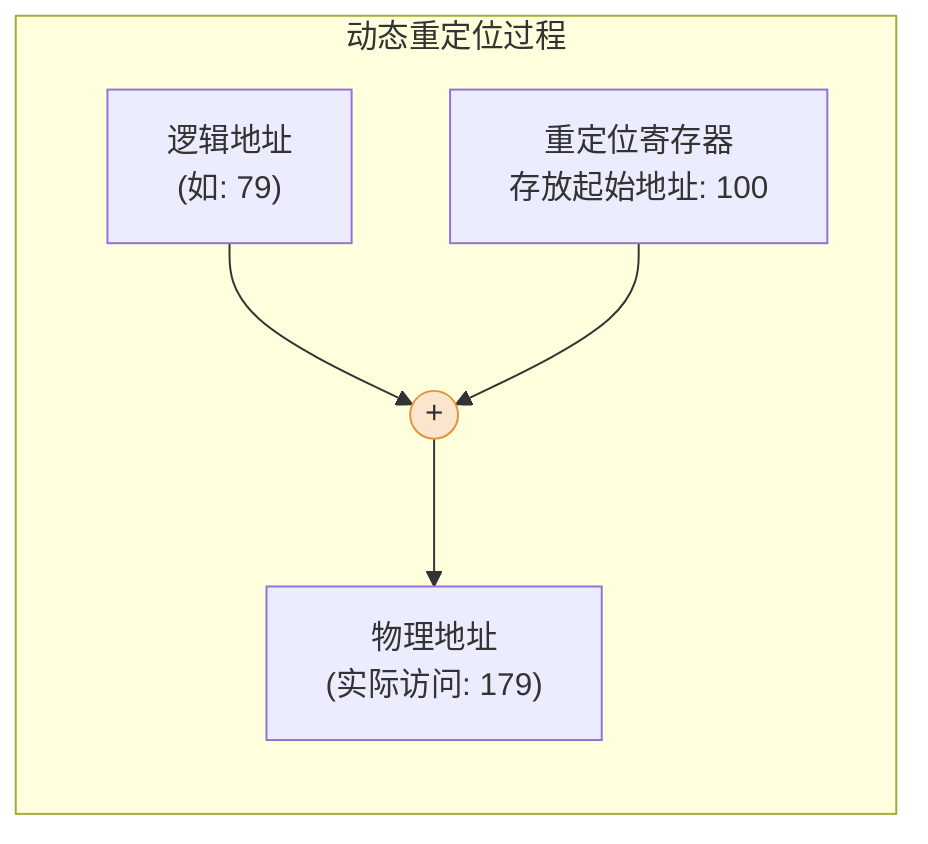
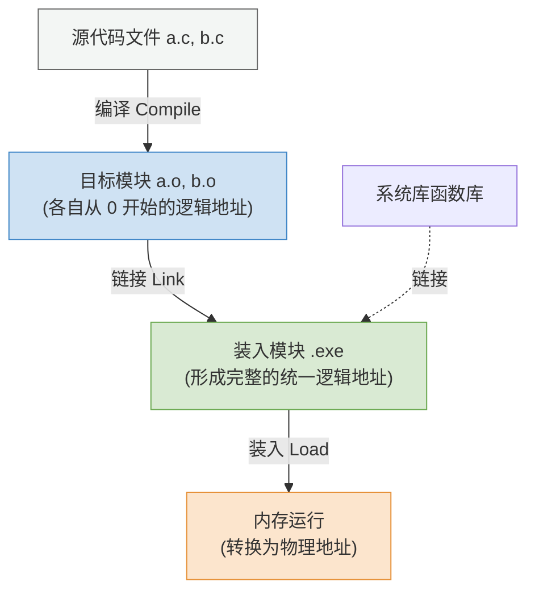

# 操作系统：内存管理基础与程序运行过程

> **导语**
> 本节课我们将正式进入操作系统的第三章——**内存管理**。
> 对于跨考的同学来说，理解底层的硬件常识（如指令工作原理、逻辑地址与物理地址的区别）是学好这一章的基石。我们将从最基础的内存概念讲起，逐步剖析程序是如何从源代码一步步变成在 CPU 上运行的机器指令的。

---

## 一、 内存的基本概念与作用

### 1. 什么是内存？

内存（Memory）是用于存放数据的硬件组件。

- **作用**：为了缓和高速 CPU 与慢速外存（如磁盘）之间的速度矛盾。程序在执行前，必须先将指令和相关数据从外存调入内存，CPU 才能对其进行快速处理。

### 2. 存储单元与地址编址

为了区分内存中存放的庞大且繁杂的数据，操作系统必须给内存进行**编号**（就像给酒店的每个房间编号一样）。

- **存储单元**：内存被划分成的一个个小房间。
- **内存地址**：每个存储单元的编号（通常从 0 开始，用二进制表示）。
- **编址方式 (考点前提条件)**：
  - **按字节编址**：一个地址对应一个存储单元，该单元存放 **1 个字节 (Byte = 8 bits)** 的数据。_(考研中最常见的情况)_
  - **按字编址**：一个地址对应的存储单元存放 **1 个字 (Word)** 的数据。字的具体长度（如 16位、32位、64位）需根据题目条件确定。

> **单位换算速记：**
>
> - $1\text{K} = 2^{10}$
> - $1\text{M} = 2^{20}$
> - $1\text{G} = 2^{30}$
> - 例如：一台电脑有 $4\text{GB}$ 内存且按字节编址，意味着它有 $4 \times 2^{30}$ 个存储单元。要唯一标识这些单元，至少需要 **32 个二进制位**作为地址线（因为 $4\text{G} = 2^2 \times 2^{30} = 2^{32}$）。

---

## 二、 指令工作原理与地址分类

### 1. 机器指令的结构

我们用 C 语言写的代码（如 `x = x + 1`），编译后会变成 CPU 认识的二进制**机器指令**。一条机器指令通常由两部分组成：

- **操作码**：告诉 CPU 要干什么（如：做加法、做数据传送）。
- **地址码/参数**：告诉 CPU 怎么干，去哪里找数据（如：去内存地址 `79` 读取变量 `x` 的值）。

### 2. 逻辑地址 vs 物理地址 (核心辨析)

在编译程序时，编译器并不知道这个程序未来会被装入到物理内存的哪一个具体位置。

- **逻辑地址 (相对地址)**：编译生成的指令中使用的地址。它通常默认程序是从地址 `0` 开始连续存放的（即相对于程序起始位置的偏移量）。
- **物理地址 (绝对地址)**：程序在内存中实际存放的真实地址。
  - _问题产生_：如果程序实际被装入到物理地址 `100` 开始的位置，但指令里写的还是去地址 `79` 找数据，CPU 就会访问错地方（原本应该去 `179` 找）。
  - _解决目标_：必须实现**从逻辑地址到物理地址的转换**！

---

## 三、 程序的装入 (地址转换策略)

如何将逻辑地址转换为正确的物理地址？操作系统提供了三种装入策略：

### 1. 绝对装入

- **原理**：在程序**编译时**，如果已经确切知道程序未来将被放到内存的哪个物理位置，编译器就直接将指令里的相对地址全部修改为**绝对物理地址**。
- **特点**：灵活性极差，一旦换台电脑或换个内存位置就无法运行。仅适用于**单道程序环境**（早期无 OS 阶段）。

### 2. 可重定位装入 (静态重定位)

- **原理**：程序编译时仍使用逻辑地址。在程序**装入内存时**，由装入程序一次性将指令中的所有逻辑地址加上一个“起始偏移量”，转换为物理地址。
- **特点**：
  - 作业必须被分配**连续**的内存空间。
  - 作业必须在运行前**一次性全部装入**。
  - 装入后，程序在运行期间**绝对不能再移动位置**（因为地址已经写死了）。

### 3. 动态运行时装入 (动态重定位) —— 现代 OS 主流方案

- **原理**：程序在内存中保存的依然是**逻辑地址**。系统设置一个专门的硬件寄存器——**重定位寄存器**，存放该程序在内存中的起始物理地址（如 `100`）。只有当 CPU **真正去执行某条指令访存时**，硬件才会瞬间完成 `逻辑地址 + 重定位寄存器 = 物理地址` 的计算。
- **特点 (优点极多)**：
  - 允许程序在内存中**动态移动位置**（只需修改重定位寄存器的值即可）。
  - 允许程序分配到**不连续**的存储区。
  - 不必在运行前将所有代码全部装入，支持**动态申请内存**（为后续的虚拟存储技术打下基础）。

---

## 四、 程序运行的完整生命周期

我们从写下 C 语言代码到程序最终跑起来，到底经历了哪些步骤？

1.  **编辑 (Edit)**：程序员编写源代码文件（如 `.c` 文件）。
2.  **编译 (Compile)**：编译器将源代码翻译成若干个独立的**目标模块**（如 `.o` 或 `.obj` 文件）。每个模块都包含了机器指令，且**各自的逻辑地址都是从 `0` 开始的**。
3.  **链接 (Link)**：链接程序将这些零散的目标模块，以及所需的系统库函数（如 `printf`），组装拼接成一个完整的**装入模块**（即 `.exe` 可执行文件）。
    - _本质_：链接这一步，其实就是**确定整个程序完整的逻辑地址空间**的过程。
4.  **装入 (Load)**：装入程序将 `.exe` 文件装入内存准备运行。
    - _本质_：装入这一步，就是**确定最终物理地址**的过程。

### 补充考点：三种链接方式

在第 3 步“链接”时，也有不同的时机选择：

1.  **静态链接**：在程序运行前，提前把所有模块一次性全部链接成一个庞大的装入模块。（最传统）
2.  **装入时动态链接**：目标模块平时散放着，只有在**装入内存时**，才边装入边链接。
3.  **运行时动态链接**：平时不链接也不装入。只有在程序**真正运行到**某行代码，发现需要某个模块时，才临时把它调入内存并链接。
    - _优点_：极大地节省了内存空间，提高了内存利用率（用不到的代码永远不会进内存）。
