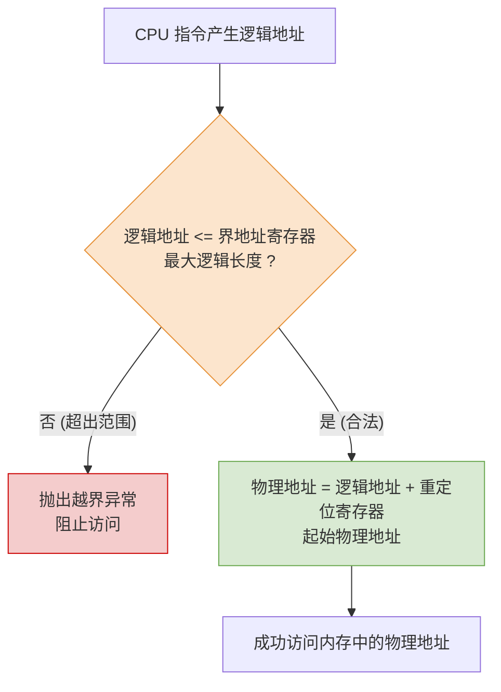

# 操作系统：内存管理的基本概念

> **导语**
> 操作系统作为系统资源的管理者，必然要对内存这种核心软硬件资源进行管理。本节课我们将梳理内存管理的整体框架，解答“操作系统在管理内存时到底需要做哪些事情”。核心主要包括四个大方面：**内存空间的分配与回收**、**内存空间的扩充**、**地址转换**以及**内存保护**。

---

## 一、 内存空间的分配与回收

当各种进程想要投入运行前，必须将相关的数据放入内存。操作系统需要负责：

- **状态记录**：记录内存中哪些区域已被分配，哪些区域还在空闲。
- **分配空间**：当有新进程要运行，且内存中有多个空闲位置时，决定将其存放在什么位置。
- **回收空间**：当进程运行结束后，及时回收它之前所占用的内存空间。

---

## 二、 内存空间的扩充（实现虚拟性）

- **生活实例**：一个大小超过 60GB 的大型游戏（如 GTA），为什么能在只有 4GB 物理内存的电脑上顺利运行？
- **核心功能**：在实际内存空间不足以容纳所有进程时，操作系统需要提供某种技术（如虚拟存储技术），**从逻辑上对内存空间进行扩充**。把物理上较小的内存拓展为逻辑上很大的内存，这也是操作系统“虚拟性”特性的体现。

---

## 三、 地址转换

为了让程序员编程更方便，程序员在写程序时只需关注**逻辑地址（相对地址）**，而不必关心底层的物理硬件细节。将逻辑地址转换为最终的**物理地址**（即地址重定位）的过程，交由操作系统负责。

地址转换（装入方式）通常有以下三种发展阶段：

1.  **绝对装入**：在编译时就产生绝对物理地址。只适用于无操作系统的单道程序阶段（由编译器完成，非操作系统）。
2.  **可重定位装入（静态重定位）**：在程序装入内存时，由操作系统的装入程序负责将逻辑地址转换为物理地址。多用于早期的多道批处理系统。
3.  **动态运行时装入（动态重定位）**：在程序真正运行时才把逻辑地址转换为物理地址。需要硬件（重定位寄存器）支持，这是**现代操作系统普遍采用的方式**。

---

## 四、 内存保护

**内存保护的目的**：保证各个进程只能在各自的存储空间内运行，互不干扰。进程绝不能随意外溢访问操作系统的空间，也不能非法篡改其他进程的数据，以保障系统整体的安全。

### 常见的两种保护机制

#### 方法 1：设置一对“上下限寄存器”

- **上限寄存器**：存放进程内存空间的最高物理地址。
- **下限寄存器**：存放进程内存空间的最低物理地址。
- **判定方式**：CPU 执行指令时，将要访问的内存地址与这两个寄存器对比，只有落在上下限之间才被允许访问。

#### 方法 2：利用“重定位寄存器”与“界地址寄存器”

- **重定位寄存器（基址寄存器）**：存放进程的**起始物理地址**。
- **界地址寄存器（限长寄存器）**：存放进程的**最大逻辑长度**。
- **判定与转换流程**：

---

## 五、 本节核心总结

内存管理的整体框架可以概括为以下四大功能：

| 核心功能                | 解决的主要问题               | 相关技术/实现方式                      |
| :---------------------- | :--------------------------- | :------------------------------------- |
| **1. 内存的分配与回收** | 数据放哪儿？走后怎么收？     | 连续分配、非连续分配管理等（后续细讲） |
| **2. 内存的扩充**       | 内存不够大怎么办？           | 虚拟存储技术                           |
| **3. 地址转换**         | 逻辑地址如何映射到物理地址？ | 绝对装入、静态重定位、**动态重定位**   |
| **4. 内存保护**         | 如何防止进程间互相干扰越界？ | 上下限寄存器、**基址 + 限长寄存器**    |

> **考点提示**：本节内容作为内存管理的“大纲”，重在建立全局观。其中最常考的选择题概念是**内存保护的两种寄存器别名**（重定位寄存器 = 基址寄存器；界地址寄存器 = 限长寄存器），切记不要混淆。
