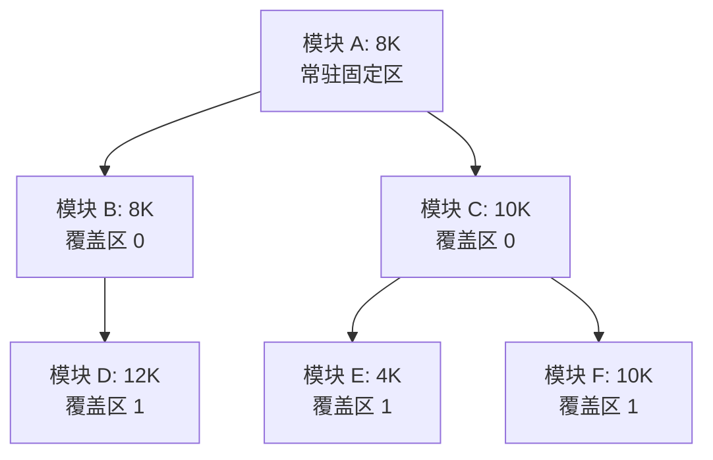

# 操作系统：内存空间的扩充（覆盖与交换技术）

> **导语**
> 在内存管理中，除了地址转换和存储保护，另一个重要的功能是**内存空间的扩充**。早期的计算机内存极小，而现代多道程序并发也常遇到物理内存吃紧的情况。本节课重点探讨传统操作系统解决这一问题的两种技术：**覆盖技术（Overlay）**与**交换技术（Swapping）**。

---

## 一、 覆盖技术 (Overlay)

### 1. 产生背景与核心思想

- **背景**：早期计算机内存极小（如早期 IBM PC 仅 1MB 内存），而程序大小往往超过物理内存总和，导致大程序无法运行。
- **核心思想**：将程序按照自身逻辑结构分为多个段（模块）。**常用的段常驻内存，不常用的段在需要时才调入内存**。

### 2. 内存区域划分

采用覆盖技术时，内存空间被划分为：

- **固定区 (Fixed Area)**：用于存放最常用、最核心的程序段（如 `main` 函数）。这些段调入后**不再调出**，直到程序运行结束。
- **覆盖区 (Overlay Area)**：用于存放不常用的程序段。当需要用到时调入，用不到时被其他段覆盖调出。可以有若干个覆盖区。

### 3. 实例分析

假设有一个程序，其调用结构和模块大小如下：

- 模块 A (8K) 依次调用 B (8K) 和 C (10K)。
- 模块 B 调用 D (12K)。
- 模块 C 依次调用 E (4K) 和 F (10K)。

**分析：**
因为 B 和 C 是由 A 依次调用的，所以 B 和 C **不可能同时被访问**。同理，D、E、F 也不会同时被访问。

**空间计算：**

- **固定区**：存放模块 A $\rightarrow$ 需要 **8K**。
- **覆盖区 0**：由 B 和 C 共享，取最大值 $\rightarrow$ 需要 **10K**。
- **覆盖区 1**：由 D、E、F 共享，取最大值 $\rightarrow$ 需要 **12K**。
- **优化后总需求**：$8K + 10K + 12K = 30K$。（如果不采用覆盖技术，总共需要 52K）。

### 4. 覆盖技术的优缺点

- **优点**：打破了物理内存的限制，使得大程序能在小内存机器上运行。
- **缺点（致命伤）**：**对用户不透明**。程序的调用结构（覆盖树）必须由**程序员显式声明**，极大增加了编程负担。该技术现已淘汰，仅存在于早期操作系统中。

---

## 二、 交换技术 (Swapping / 对换技术)

### 1. 核心思想

当内存空间紧张时，系统将内存中某些暂时不能运行的进程**换出**外存（挂起），把外存中已具备运行条件的进程**换入**内存。
_在进程在内存与磁盘之间动态调度，从而在逻辑上拓充了内存空间。_

### 2. 进程状态与中级调度

交换技术是**中级调度（内存调度）**的核心支撑机制。

- **PCB 常驻内存**：进程的数据和程序虽被换出，但其 **PCB（进程控制块）绝不会被换出**。PCB 会保留在内存的**挂起队列**中，以便操作系统保持对该进程的管理。
- **七状态模型引入**：进程被换出外存后，进入**挂起态 (Suspend)**。
  - 就绪态 $\rightarrow$ 被换出 $\rightarrow$ **就绪挂起态**。
  - 阻塞态 $\rightarrow$ 被换出 $\rightarrow$ **阻塞挂起态**。

### 3. 交换技术的三大核心问题

#### Q1：换出的进程放到外存的哪里？

现代操作系统的磁盘空间通常划分为两部分：

| 区域名称          | 存放内容         | 分配方式 | 追求目标                                  |
| :---------------- | :--------------- | :------- | :---------------------------------------- |
| **文件区**        | 普通文件         | 离散分配 | 追求存储空间的**利用率**                  |
| **对换区 (Swap)** | 被换出的进程数据 | 连续分配 | 追求极高的**换入换出速度** (I/O 速度更快) |

**结论**：被换出的进程数据存放在磁盘的**对换区**。

#### Q2：什么时候应该进行交换？

- **内存吃紧时触发**：当系统负荷高、运行进程多，且频繁发生**缺页**时，说明内存严重不足，启动换出。
- **负荷降低时暂停**：当系统缺页率明显下降，负荷减轻时，暂停换出。

#### Q3：应该换出哪些进程？

系统在选择被牺牲（换出）的进程时，通常考虑以下原则：

1.  **优先换出阻塞进程**：阻塞进程短期内无法运行，占着内存也是浪费。
2.  **换出低优先级进程**：保障高优先级进程的运行。
3.  **考虑内存驻留时间**：为了防止低优先级进程产生“饥饿”（刚进内存又被换出），系统会考量进程在内存的驻留时间，驻留太短的暂时不换出。

---

## 三、 覆盖与交换的区别对比

| 对比维度       | 覆盖技术 (Overlay)                           | 交换技术 (Swapping)                          |
| :------------- | :------------------------------------------- | :------------------------------------------- |
| **作用范围**   | 发生在**同一个程序/进程内部**                | 发生在**不同程序/进程之间**                  |
| **核心机制**   | 不同时访问的模块共享同一块内存（覆盖区）     | 将整个进程地址空间在内存和外存之间倒腾       |
| **用户透明度** | 对用户**不透明**（需程序员显式指明逻辑结构） | 对用户**透明**（由操作系统自动完成中级调度） |
| **历史地位**   | 已退出历史舞台（早期 OS 使用）               | 现代 OS 依然在使用（结合虚拟内存）           |

---

_注：本节知识点常在选择题中进行概念辨析考察，特别是覆盖与交换的“作用范围”和磁盘“对换区/文件区”的特性差异，需重点理解记忆。_
