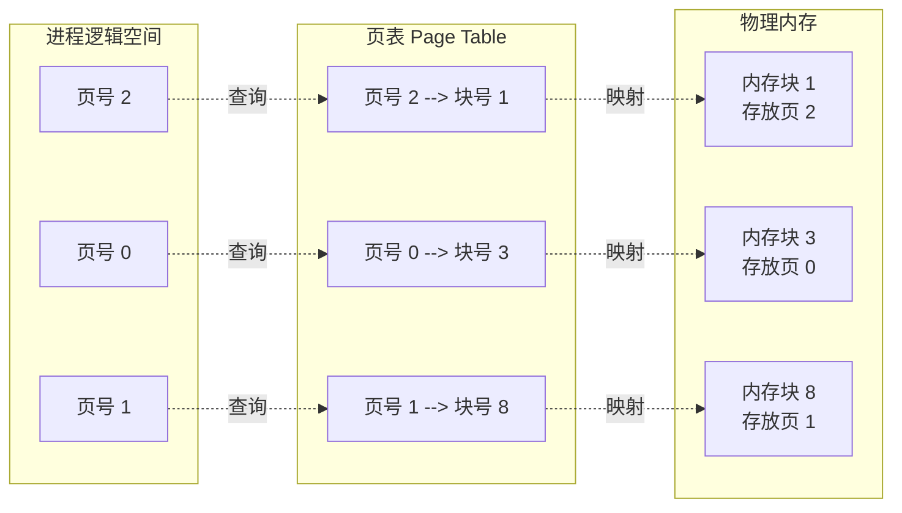

# 操作系统：基本分页存储管理

> **导语**
> 各位同学大家好，本节课我们将学习内存管理中极其重要的高频考点与难点——**基本分页存储管理**。
> 之前我们学习的连续分配方式会产生碎片，且大进程装入困难。为了解决这些问题，引入了非连续分配方式。本节将从分页的核心概念、页表数据结构，以及逻辑地址到物理地址的转换原理三个维度进行详细拆解。

---

## 一、 分页存储的核心概念辨析

分页存储管理的核心思想是：**把内存和进程都划分为大小相等的小块，然后将进程的各个小块离散地存放到内存的各个小块中。**

为了防止做题时被概念绕晕，我们必须严格区分以下四个术语（它们在考卷中会交替出现）：

### 1. 物理内存层面的划分

系统将整个物理内存划分为一个个**大小相等**的区域（如每个区域 $4\text{KB}$）。

- **物理划分称谓**：**页框** (Page Frame)、**页帧**、**内存块**、**物理块**、**物理页面**。（这些词指的是同一个东西！）
- **编号**：系统给这些物理块从 $0$ 开始依次编号，称为**页框号**或**物理块号**。

### 2. 逻辑进程层面的划分

系统也将用户进程的逻辑地址空间划分为与“页框”**完全相等**大小的一个个区域。

- **逻辑划分称谓**：**页** (Page)、**页面**。
- **编号**：系统给进程的这些页从 $0$ 开始依次编号，称为**页号**或**页面号**。

> **核心关系**：进程的**页面**会被操作系统离散地放入物理内存的**页框**中，它们之间有着**一一映射**的对应关系。

---

## 二、 记录映射关系的桥梁：页表 (Page Table)

既然进程的页面被离散地打散存放到了内存的各个页框中，操作系统靠什么来记录“第几页放到了第几个页框里”呢？答案就是**页表**。

### 1. 页表的基本结构

操作系统会为**每一个进程**建立一张页表，通常存放在进程的 PCB (进程控制块) 中。

- **页表项**：页表中的每一行称为一个页表项。
- **包含内容**：在逻辑上，页表项包含**“页号”**和对应的**“块号（页框号）”**两部分信息。

### 2. 高频考点：页表项占用多少字节？

我们通过一道经典的推理题来搞懂：
**条件**：内存大小为 $4\text{GB}$，页面大小为 $4\text{KB}$。求一个页表项至少占几个字节？

**推导过程**：

1.  计算总块数：$4\text{GB} / 4\text{KB} = 2^{32} / 2^{12} = 2^{20}$ 个内存块。
2.  块号范围：从 $0$ 到 $2^{20}-1$。
3.  表示块号所需的比特位：至少需要 **20 个比特** 才能表示 $2^{20}$ 个状态。
4.  字节换算：计算机分配存储空间以字节为单位，$20$ 个比特至少需要 **3 个字节** ($3 \times 8 = 24\text{ bits}$) 来存储。
    **结论**：在这个系统中，每个页表项中的**块号字段**至少需要占用 3 个字节。

### 3. 高频考点：页号是否需要占用存储空间？

**答案：不需要！页号是隐含的。**

- **原理**：因为各个页表项在内存中是**连续存放**的。只要我们知道页表在内存中的**起始地址** $X$，以及每个页表项的大小 $L$（如上题算出的 3 字节），我们想找第 $i$ 号页的块号，直接用公式计算物理位置即可：
  $$ \text{第 } i \text{ 号页表项的地址} = X + L \times i $$
- 因此，页表项在物理上**只存储块号**，这样极大节省了页表的内存开销。

---

## 三、 逻辑地址到物理地址的转换

### 1. 转换的基本思路

虽然进程整体是离散分布的，但**每个页面内部的数据是连续存放的**。因此地址转换遵循以下三步：

1.  **确定页号**：算出要访问的逻辑地址属于进程的哪个页（页号 $P$）。
2.  **查找物理块起始地址**：拿着页号去查页表，找到对应的物理块号，算出该物理块在内存中的**起始地址**。
3.  **加上页内偏移量**：算出逻辑地址相对于页起始位置的偏移量（页内偏移量 $W$）。
    $$ \text{最终物理地址} = \text{物理块起始地址} + \text{页内偏移量 } W $$

> **原始土算法（针对页面大小不是 2 的整数次幂时）**：
>
> - 页号 $P$ = `逻辑地址 / 页面长度 (取整)`
> - 页内偏移量 $W$ = `逻辑地址 % 页面长度 (取余)`

### 2. 神奇的优化：当页面大小是 $2$ 的整数次幂时

现实中，页面大小永远被设计为 $2$ 的整数次幂（如 $4\text{KB} = 2^{12}$ 字节）。这带来了两个巨大的硬件优化：

#### A. 地址拆分瞬间完成

假设页面大小为 $2^{12}$ 字节。硬件直接将逻辑地址分为两段：

- **末尾 12 位**：直接就是**页内偏移量**。
- **其余高位**：直接就是**页号**。
  _(硬件只需简单地截断二进制位，省去了耗时的除法和取余运算电路)_

#### B. 物理地址计算变成简单的“拼接”

如果页面大小不是 $2$ 的次幂，算物理地址要用乘法：`物理块号 × 页面大小 + 偏移量`。
但如果是 $2$ 的次幂（比如末 12 位是偏移量），只要查到物理块号，直接把**物理块号**和**页内偏移量**进行二进制**拼接**，得到的结果就是最终的物理地址！

### 3. 逻辑地址结构的考点总结

如果题目告诉你页面大小是 $2^k$ 字节，这就暗示了：

- 逻辑地址结构的**末尾 $k$ 位**用来表示**页内偏移量**。
- 如果有 $m$ 位用来表示页号，则说明该进程最多允许有 $2^m$ 个页面。

|      页号 P ($m$ 位)       |      页内偏移量 W ($k$ 位)      |
| :------------------------: | :-----------------------------: |
| 决定进程最大页面数 ($2^m$) | 决定每个页面的大小 ($2^k$ 字节) |

---

## 四、 本节核心总结

1.  **严格区分名词**：页/页面（逻辑划分），页框/物理块（物理划分）。二者大小绝对相等。
2.  **页表两大特性**：第一，页号是隐含的，不占存储空间；第二，页表项里存的是**块号**，不是物理首地址。
3.  **地址转换的捷径**：只要页面大小是 $2^k$，逻辑地址就天然被分成了“高位的页号”和“低 $k$ 位的页内偏移量”。拿到块号后，直接与偏移量**拼接**即得物理地址。
