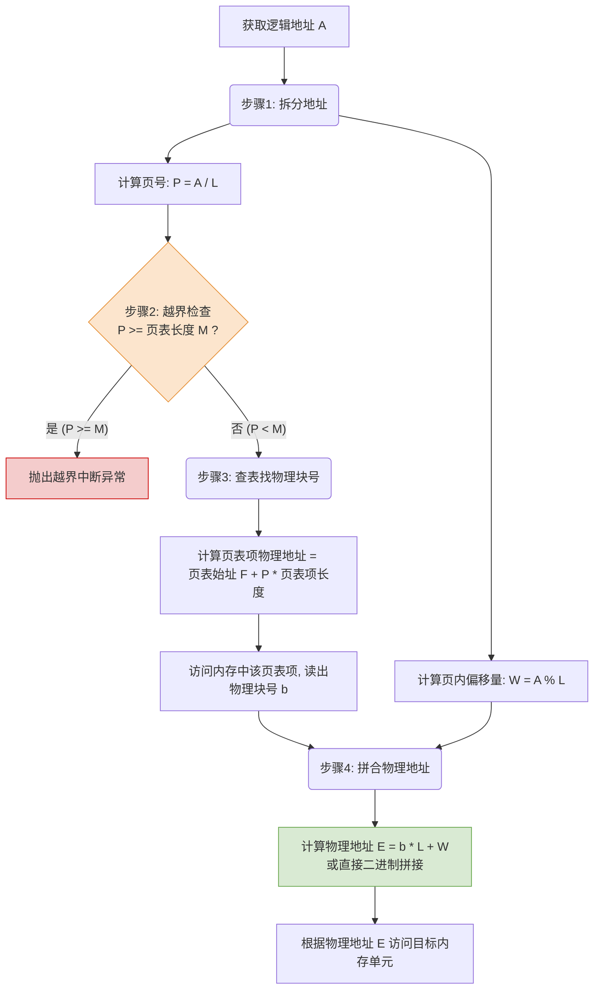

# 操作系统：基本地址变换机构

> **导语**
> 本节课我们将学习基本分页存储管理中的核心硬件机制——**基本地址变换机构**。它的主要作用是将逻辑地址转换为物理地址。掌握其工作原理、具体流程以及相关的手算题型，是本章大题与客观题的高频考点。

---

## 一、 核心硬件：页表寄存器 (PTR)

为了实现地址转换，系统中设置了一个专门的硬件寄存器——**页表寄存器 (Page Table Register, PTR)**。

- **存放内容**：
  1.  **页表起始地址 ($F$)**：该进程的页表在物理内存中存放的首地址。
  2.  **页表长度 ($M$)**：该进程的页表总共有多少个页表项（即该进程总共有多少页）。
- **上下文切换机制**：
  当进程未上处理机运行时，页表的起始地址和长度存放在**进程控制块 (PCB)** 中。只有当进程被调度上处理机执行时，操作系统内核才会将这两个参数加载到页表寄存器 (PTR) 中。

---

## 二、 地址变换的完整流程 (四大核心步骤)

在分页系统中，逻辑地址的结构是固定不变的（分为**页号 $P$** 和 **页内偏移量 $W$**）。假设逻辑地址为 $A$，页面大小为 $L$，地址变换的完整过程如下：

### 🚨 易错点提示

1.  **越界检查包含等号**：由于页号是从 $0$ 开始的，若页表长度为 $M$，则合法的最大页号为 $M-1$。因此当 **$P \ge M$** 时，就会发生越界中断。
2.  **概念区分**：
    - **页表长度**：页表中页表项的个数（进程有多少页）。
    - **页表项长度**：每个页表项占用的存储空间大小（占几个字节）。
    - **页面大小**：每个页面/内存块占用的存储空间大小。

---

## 三、 经典真题演练 (手算模拟)

> **题目描述**：
> 某系统按字节寻址，逻辑地址结构中页内偏移量占 $10$ 位。已知页号 $2$ 对应的内存块号 $b = 8$。
> 现求逻辑地址 $A = 2500$ 对应的物理地址 $E$。

**解答步骤**：

1.  **推导页面大小**：
    “页内偏移量占 10 位” 意味着页面大小 $L = 2^{10} \text{ 字节} = 1024 \text{ 字节} = 1\text{KB}$。
2.  **计算页号 $P$ 与页内偏移量 $W$**：
    - 页号 $P = A / L = 2500 / 1024 = 2$ （整数部分）
    - 页内偏移量 $W = A \% L = 2500 \% 1024 = 452$ （余数部分）
3.  **越界检查与查表**：
    题目已知页号 $2$ 对应的内存块号 $b = 8$，说明页号 $2$ 合法未越界，且找到了目标内存块。
4.  **计算物理地址 $E$**：
    - **十进制算法**：$E = b \times L + W = 8 \times 1024 + 452 = 8192 + 452 = 8644$
    - **二进制拼接法 (计算机硬件的实际做法)**：
      块号 $8$ 的二进制为 `1000`，偏移量 $452$ 的二进制为 `01 1100 0100`。
      直接拼接得到：`1000 0111 0001 00`，转换为十进制即为 $8644$。

---

## 四、 深入探讨：页表项大小与内存边界对齐

在上一节我们计算过，如果内存大小为 $4\text{GB}$，页面大小为 $4\text{KB}$，共有 $2^{20}$ 个内存块。表示 $2^{20}$ 个内存块号至少需要 $20$ 个比特，即 **$3$ 个字节**。

**问题出现**：
如果页表项大小设为精确的 $3$ 字节，而一个内存块大小为 $4096$ 字节：
$4096 / 3 = 1365$ 余 $1$ 字节。
这意味着一个内存块最多装下 $1365$ 个页表项，还会剩下一个 $1$ 字节的“页内碎片”。当我们需要查询第 $1365$ 号页表项时，它将被迫跨越两个不同的内存块存放！这会给地址计算和读取带来极大的硬件麻烦。

**工程优化方案**：
在实际应用中，为了方便页表的查询和硬件寻址，通常会**将页表项的长度对齐拓展**（例如从 $3$ 字节拓展到 **$4$ 字节**）。

- $4096 / 4 = 1024$。
- 这样每个内存块刚好装下整数个（$1024$ 个）页表项，不会产生跨页存储的问题，硬件地址计算极为方便。

---

## 五、 本节核心考点总结

1.  **位数的相互推导**：
    - **页面大小 $\leftrightarrow$ 页内偏移量位数**（例如页面大小 $4\text{KB}=2^{12}\text{B}$ $\leftrightarrow$ 偏移量占 $12$ 位）。
    - 做题时，只要已知其中一个条件，必须立刻能推导出另一个。
2.  **页式管理地址是一维的**：
    在页式存储管理中，由于页面大小是固定的，逻辑地址结构也是固定的（系统自行划分页号和偏移量）。因此，只要告诉 CPU 一个整体的逻辑地址值，CPU 就能自己完成拆分和定位。**地址对程序员而言是一维的**。
3.  **两次访存 (极其重要的结论)**：
    在基本地址变换机构中，完成一次逻辑地址到物理地址的访问，**总共需要两次访问内存**：
    - **第一次访存**：访问内存中的**页表**，查找对应的物理块号。
    - **第二次访存**：根据计算出的物理地址，访问**目标内存单元**（取数据/指令）。

> **后续预告**：
> 两次访存严重拖慢了系统速度。有没有办法减少访存次数？在下一节中，我们将引入一种新的硬件机构——**具有快表（TLB）的地址变换机构**来解决这一问题。
