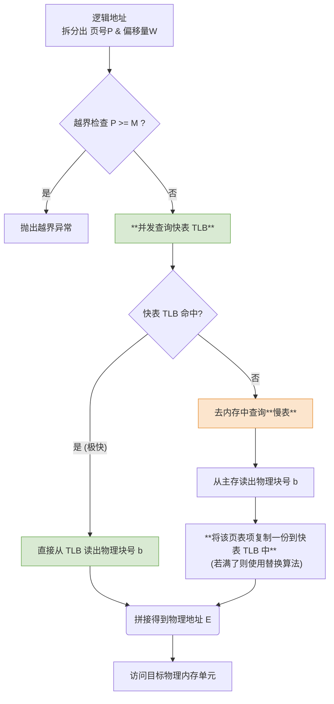

# 操作系统：具有快表的地址变换机构

> **导语**
> 本节课我们将在上一节基本地址变换机构的基础上，引入一个极其重要的硬件——**快表 (TLB)**。
> 基本地址变换机构每次都需要在内存中查询页表，导致“两次访存”，严重拖慢了执行效率。为了解决这个问题，硬件引入了 TLB 缓存最近使用的页表项。掌握 TLB 的工作原理以及带有 TLB 后的耗时计算，是大题与客观题的高频考点。

---

## 一、 什么是快表 (TLB)？

- **定义**：快表，又称联想寄存器（TLB - Translation Lookaside Buffer），是一种**访问速度比内存快得多**的高速缓存（Cache 的一种专门用于存页表项的变体）。
- **存放内容**：用来存放**当前进程最近访问过**的若干个**页表项的副本**。
- **对比“慢表”**：我们将原本存放在物理主存（内存）中的完整页表称为**慢表**。快表的访问速度通常是微秒甚至纳秒级别，远高于访问内存慢表的速度。

> **⚠️ 概念辨析提示：**
>
> - TLB 也是一种高速缓存，但它通常指的是**专门存放页表项**的高速缓存。
> - 而我们平时狭义上说的 Cache（高速缓冲存储器），指的是存放**普通数据和机器指令**的高速缓存。两者在功能指向上有所区别。

---

## 二、 引入快表后的地址变换流程

在加入了快表之后，CPU 在得到逻辑地址并拆分出“页号”后，查找页表项的流程发生了改变：

**关键机制总结**：

1.  **命中则一访存**：如果页号在快表中**命中**，系统可以直接拿到物理块号，拼接偏移量后，直接去访问目标内存单元。整个过程**只需 1 次访存**（访问目标数据）。
2.  **未命中则更新 TLB**：如果快表未命中，系统必须去查内存中的慢表，找到物理块号后，**必须将这个页表项的副本写入快表 TLB**，以便下次能快速命中。
3.  **同时查找 (高级特性)**：在一些现代系统中，快表和慢表的查询是**同时开始**的。如果快表命中，立刻终止慢表的查询。

---

## 三、 系统平均耗时计算 (核心大题考点)

理解引入 TLB 后的耗时计算是考试的重中之重。请注意审题，看清题目采用的是“**串行查询**”还是“**同时查询**”。

**【前置条件】**

- 访问 1 次快表耗时：$1\text{us}$
- 访问 1 次内存（查慢表 / 访问最终数据）耗时：$100\text{us}$
- 快表命中率：$90\%$

### 场景 1：先查快表，未命中再查慢表（串行）

- **TLB 命中时耗时**：查快表($1\text{us}$) + 访问目标数据($100\text{us}$) = **$101\text{us}$**
- **TLB 未命中耗时**：查快表($1\text{us}$) + 查慢表($100\text{us}$) + 访问目标数据($100\text{us}$) = **$201\text{us}$**
- **平均耗时**：
  $$ 101 imes 90\% + 201 imes 10\% = 111 ext{ us} $$

### 场景 2：快表与慢表“同时查询”（并发）

- **TLB 命中时耗时**：由于并发，快表 $1\text{us}$ 出结果，慢表查询立即终止。查快表/终止慢表($1\text{us}$) + 访问目标数据($100\text{us}$) = **$101\text{us}$**
- **TLB 未命中耗时**：同时起跑，第 $1\text{us}$ 时快表宣告失败，但此时慢表**已经查了 $1\text{us}$**，只需再查 $99\text{us}$ 即可出结果（总耗时还是 $100\text{us}$）。查慢表出结果($100\text{us}$) + 访问目标数据($100\text{us}$) = **$200\text{us}$**
- **平均耗时**：
  $$ 101 imes 90\% + 200 imes 10\% = 110.9 ext{ us} $$

> **对比**：如果**没有快表**，每次都要查慢表，耗时为：查慢表($100\text{us}$) + 访问目标数据($100\text{us}$) = **$200\text{us}$**。
> 引入 TLB 后，平均耗时从 $200\text{us}$ 降到了 $111\text{us}$ 左右，效能提升巨大。

---

## 四、 为什么 TLB 命中率能高达 90%？(局部性原理)

快表的容量通常很小（通常只能存几十到几百个页表项），为什么命中率还能这么高？这是因为著名的**局部性原理**。

### 1. 时间局部性 (Temporal Locality)

- **含义**：如果程序执行了某条指令或访问了某个数据，那么在不久的将来，该指令或数据**很有可能被再次执行或访问**。
- **原因**：程序中存在大量的**循环结构**（如 `for/while` 循环）。
- **TLB 体现**：循环体内的代码或循环变量（如 `int i`）往往集中在某 1~2 个页面中。只要把这几个页面的页表项调入 TLB，接下来千万次的循环都将直接在 TLB 命中。

### 2. 空间局部性 (Spatial Locality)

- **含义**：一旦程序访问了某个存储单元，在不久的将来，其**附近的存储单元**也很有可能被访问。
- **原因**：程序指令通常是顺序存放的；数据结构（如数组）在内存中也是连续存放的。
- **TLB 体现**：当程序遍历一个巨大的数组时，虽然数据很多，但它们**同属于那几个连续的页面**。访问数组元素 `A[0]` 未命中并调入 TLB 后，访问同页的 `A[1]` 到 `A[1000]` 将全部在 TLB 命中。

---

## 五、 本节总结与核心警示

1.  **快表的本质**：存放最近使用的**页表项副本**的高速缓存，目的是加速逻辑地址到物理块号的映射过程。
2.  **“两次访存”的化解**：基本分页必须查慢表（两次访存）；引入 TLB 后，若命中，**仅需 1 次访存**（取最终数据）。
3.  **计算避坑指南**：做耗时计算题时，务必咬文嚼字，看清题目是否声明了**“快表与慢表同时查找”**。若同时查找，未命中时的查表耗时只需算慢表的时间。
