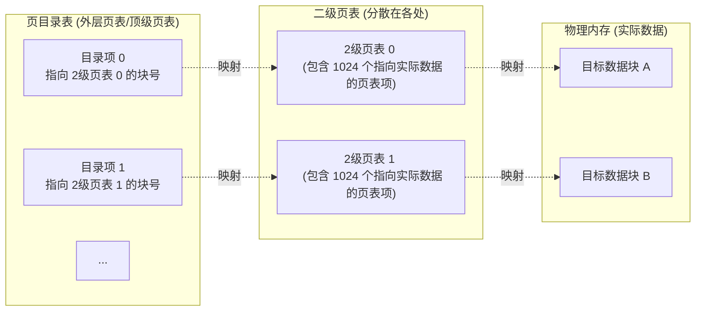

# 操作系统：两级页表机制

> **导语**
> 本节课我们将探讨内存管理中一个精妙的进阶设计——**两级页表机制**。
> 单级页表虽然实现了基本的分页管理，但在面临海量内存和庞大地址空间时，暴露出“必须连续存放庞大页表”的致命缺陷。我们将从单级页表的问题出发，推演两级页表的诞生逻辑，掌握其地址结构拆分与地址变换过程，并破解相关的高频计算考点。

---

## 一、 单级页表面临的两大痛点

假设系统是 32 位逻辑地址空间，按字节编址，页面大小为 $4\text{KB} (2^{12} \text{B})$，每个页表项大小为 $4\text{B}$。

### 痛点 1：页表体积庞大且必须连续存放（违背离散分配初衷）

- **页表大小计算**：
  - 32 位地址，后 12 位是页内偏移量，前 20 位是页号。这意味着一个进程最多可以有 $2^{20}$ 个页面。
  - 每个页面对应一个页表项，共需 $2^{20}$ 个页表项。
  - 总页表大小 = $2^{20} \times 4\text{B} = 4\text{MB}$。
- **问题所在**：为了能根据页号通过公式直接计算出页表项的物理地址（`始址 + 页号 × 页表项大小`），这 **$4\text{MB}$ 的页表必须在物理内存中连续存放**！这就要求操作系统必须为单个进程的页表分配连续的 1024 个物理页框，这极其困难，完全丧失了分页存储“离散分配”的优势。

### 痛点 2：大量不常用的页表项常驻内存造成浪费

根据**局部性原理**，进程在一段时间内往往只频繁访问某几个特定的页面。将整个长达 $4\text{MB}$ 的页表全部塞进内存常驻，是一种极大的资源浪费。

---

## 二、 痛点 1 的解决：两级页表机制的引入

**解决思路（套娃思想）**：既然进程空间太大，我们把它分了页；现在页表也太大了，那我们就**把页表也“分页”**！

### 1. 对页表进行再分组

- 因为页面大小是 $4\text{KB}$，每个页表项是 $4\text{B}$，所以**一个物理页框刚好能装下 $1024 (2^{10})$ 个页表项**。
- 我们将包含 $2^{20}$ 个页表项的庞大单级页表，每 1024 个切分成一组。这样庞大的单级页表就被拆分成了 1024 个**“小页表（二级页表）”**。
- 这 1024 个小页表，每一个刚好占满一个物理页框。它们可以**离散地**存放在物理内存的任意位置，彻底解决了必须连续存放的难题。

### 2. 引入“页目录表”（顶级页表 / 外层页表）

既然小页表被打散存放了，CPU 怎么知道第 $X$ 组小页表放在物理内存的哪个块里呢？

- **方法**：再建立一张“高管通讯录”，也就是**页目录表**。
- **作用**：页目录表的每一个表项，记录的是**某一个二级页表在物理内存中存放的块号**。

---

## 三、 两级页表的逻辑地址结构与地址变换

引入两级页表后，原本 20 位的“页号”在逻辑上被拆分成了两级：

### 1. 逻辑地址结构的拆分

依然是 32 位地址，拆分如下：
| 一级页号 (10 位) | 二级页号 (10 位) | 页内偏移量 (12 位) |
| :---: | :---: | :---: |
| 用于查“页目录表” | 用于查“二级页表” | 定位最终字节位置 |

### 2. 地址变换的完整流程 (手算推演思路)

假设 CPU 要访问某逻辑地址，转换步骤如下：

1.  **切分地址**：根据地址结构，从逻辑地址中切分出：一级页号、二级页号、页内偏移量。
2.  **查顶级页表**：根据 PCB 中保存的**页目录表起始地址**，结合“一级页号”，找到对应的页目录项。读出**目标二级页表存放在哪个物理块中**。
3.  **查二级页表**：来到该物理块（二级页表），结合“二级页号”，找到对应的页表项。读出**最终目标数据存放在哪个物理块中**。
4.  **拼合物理地址**：用最终的物理块号与“页内偏移量”进行拼接（或计算：`块号 × 页面大小 + 偏移量`），得出最终物理地址，访问目标内存单元。

---

## 四、 核心考点：多级页表的细节与规律 (避坑指南)

在做大题或综合选择题时，必须牢记以下两个核心铁律：

### 🚨 铁律 1：各级页表的大小绝对不能超过一个页面！

这是反推多级页表逻辑地址结构的关键！

- **推导思路**：如果题目给定页面大小为 $4\text{KB}$，页表项大小为 $4\text{B}$，则一个页面最多只能装 $1024 (2^{10})$ 个页表项。
- **做题应用**：这就意味着，无论是顶级页表还是中间某级页表，其对应的**页号字段绝对不能超过 10 位**。如果算出来剩下的页号位数为 18 位，就不能只用两级页表（因为 $2^{18}$ 远大于 $2^{10}$，一个页面装不下该级页表）。此时必须拆成三级页表（如 8 位 + 10 位 + 10 位 偏移量）。

### 🚨 铁律 2：N 级页表的访存次数规律

如果不考虑快表（TLB）机构：

- **单级页表**：访问逻辑地址需要 **2 次**访存（1 次查页表 + 1 次取数据）。
- **两级页表**：访问逻辑地址需要 **3 次**访存（1 次查目录表 + 1 次查二级页表 + 1 次取数据）。
- **通用公式**：**采用 $N$ 级页表，访问一个逻辑地址总共需要进行 $N + 1$ 次访存**。
  _(代价：离散存放节约了连续大空间，但付出了增加访存时间开销的代价)_

---

## 五、 后续预告：痛点 2 的解决

对于痛点 2（不常用的页表项白白占用内存），我们在页表项中增加一个**“状态位 / 存在位”**，用于标识该页面是否已经调入内存。如果 CPU 访问到尚未调入内存的页面，会触发**缺页中断 (内中断)**，由操作系统负责从外存（磁盘）将页面调入内存。这构成了**虚拟存储技术**的核心基石，我们将在后续章节详细讲解。
