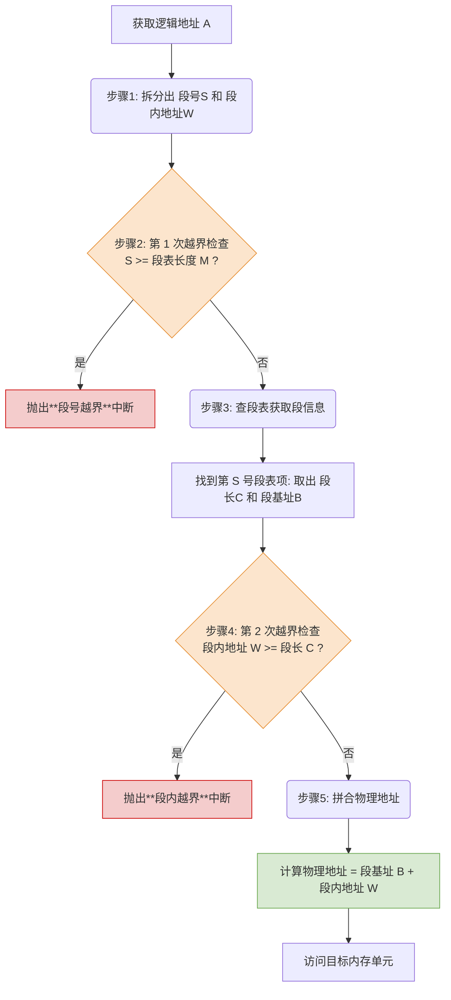

# 操作系统：基本分段存储管理

> **导语**
> 各位同学大家好，本节课我们将学习另一种非连续分配的存储管理方式——**基本分段存储管理**。
> 与“分页”将进程机械地切分成固定大小不同，“分段”则是按照程序的**逻辑关系**来进行划分。本节课我们将剖析分段的物理与逻辑结构、段表的设计原理，梳理从逻辑地址到物理地址的变换流程，并深度对比“分段”与“分页”在各维度的本质区别。

---

## 一、 分段的基本概念

### 1. 什么是分段？

- **按逻辑划分**：进程的地址空间按照**程序自身的逻辑关系**划分为若干个段。例如：主函数（`main`）一个段、子函数一个段、全局变量一个段等。
- **分配与编址**：
  - 内存分配**以段为单位**，每个段在内存中占据连续的空间，但各段之间可以**离散不相邻**。
  - 每个段有一个用户自己定义的**段名**。
  - 在每个段内部，地址都是**从 0 开始编址的**。
- **优点**：由于是按逻辑功能模块划分的，用户编程更加方便，程序的可读性极高。

### 2. 逻辑地址结构

在分段存储管理中，逻辑地址由两部分组成：
$$ \text{逻辑地址} = \text{段号 (S)} + \text{段内地址 (W)} $$
_在用户编程时使用的“段名”和“变量偏移量”，在经过编译程序后，会被直接翻译成“段号”和“段内地址（段内偏移量）”。_

> **📌 核心考点：地址位数决定什么？**
> 假设系统按字节编址，逻辑地址结构中：
>
> - **段号占 16 位**：决定了每个进程最多可分 $2^{16} = 65536$ 个段。
> - **段内地址占 16 位**：决定了每个段的最大长度不能超过 $2^{16} \text{ Bytes} = 64 \text{ KB}$。

---

## 二、 记录映射关系的桥梁：段表 (Segment Table)

为了让操作系统能在物理内存中找到这些离散存放的段，系统必须为每个进程建立一张**段映射表（段表）**。

### 1. 段表项的结构

段表中的每一行称为一个段表项，它记录了某个逻辑段在内存中的存放信息。与“页表项”不同，由于每个段的长度都不一样，段表项中**必须**显式记录段的长度。

| 段号 (隐含不占空间) | 段长 (Limit) | 段基址 (Base - 起始物理地址) |
| :-----------------: | :----------: | :--------------------------: |
|          0          |      7K      |             80K              |
|          1          |      3K      |             120K             |

- **段表项长度固定**：例如，段长用 16 位（2 字节）表示，段基址用 32 位（4 字节）表示，则每个段表项**固定占 6 个字节**。
- **隐含的段号**：因为段表项大小固定，所以段表在内存中是连续存放的，**段号是隐含的，不占存储空间**。查表公式：`某段表项的物理地址 = 段表始址 + 段号 × 段表项大小`。

---

## 三、 地址变换的完整流程 (核心考点)

在分段系统中，将逻辑地址转换为物理地址的过程与分页非常相似，**最大的区别在于：必须进行两次越界检查！**

假设 CPU 要访问逻辑地址 $A$，系统从 PCB 中将该进程的**段表始址 ($F$)** 和 **段表长度 ($M$)** 恢复到**段表寄存器**中：

---

## 四、 分段与分页的核心对比 (高频选择题考区)

分段和分页这两种非连续分配方式，在考试中极易被放进同一个选择题里进行辨析考察。

| 对比维度                | 分页 (Paging)                                                                  | 分段 (Segmentation)                                                                                                                            |
| :---------------------- | :----------------------------------------------------------------------------- | :--------------------------------------------------------------------------------------------------------------------------------------------- |
| **划分依据**            | **物理划分**。纯粹是为了提高内存利用率，属于系统行为。                         | **逻辑划分**。为了方便编程和满足用户需求，属于用户行为。                                                                                       |
| **大小固定性**          | **大小固定**（由系统硬件和 OS 决定）。                                         | **大小不固定**（由用户编写的程序逻辑决定）。                                                                                                   |
| **对用户的透明度**      | 对用户**不可见（透明）**。用户不知道程序被分了页。                             | 对用户**可见**。编程时需显式提供段名。                                                                                                         |
| **地址空间维数**        | **一维**。程序员只需给出一个单一的相对地址，系统硬件会自动切分出页号和偏移量。 | **二维**。程序员必须显式给出两个坐标：【段名】和【段内偏移量】。                                                                               |
| **越界检查次数**        | 1 次（只需检查页号是否越界，因页长固定且逻辑地址偏移量天然受限）。             | **2 次**（除检查段号外，**必须**检查段内地址是否超过了该段的具体段长）。                                                                       |
| **信息共享与保护**      | **极难实现**。一个页面中可能混杂了部分可共享代码和部分不可共享的私有数据。     | **极易实现**。由于是按逻辑划分的，只需将可共享代码（纯代码区）独立成段，让不同进程的段表项指向同一段基址即可；保护标记也可按逻辑精确打在段上。 |
| **访存次数 (无快表时)** | 2 次（1 次查页表 + 1 次访存）                                                  | 2 次（1 次查段表 + 1 次访存）                                                                                                                  |

> **拓展说明**：
> 和分页系统一样，分段系统也可以引入**快表 (TLB)**。将近期频繁访问的段表项存入快表，命中时也能将访存次数从 2 次降为 1 次，大幅提升地址变换速度。

---

## 五、 本节重点总结

1.  **段表结构必须背**：由于段长不固定，段表项中除了“段基址”外，必须拥有**“段长”**字段。
2.  **两次越界检查必须防**：手算地址变换大题时，千万别忘了第 2 步的**“段内地址 VS 段长”**越界检查！
3.  **二维 vs 一维必须懂**：分段是二维的（用户显式指定段号和偏移量），分页是一维的（系统默默帮你切分），这是常考判断题的核心题眼。
4.  **共享与保护的天然优势**：一旦题目问到“哪种方式更容易实现共享和保护”，首选分段。
