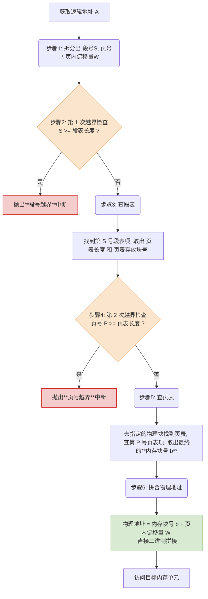

# 操作系统：段页式管理方式

> **导语**
> 各位同学大家好，本节课我们将学习一种将分段与分页完美结合的内存管理方式——**段页式管理方式**。
> 单纯的分页管理空间利用率高但缺乏逻辑保护，单纯的分段管理逻辑清晰但会产生外部碎片。为了融合两者的优点，现代操作系统通常采用“先分段，再分页”的段页式管理。本节我们将深入剖析其地址结构、段表与页表的双重映射机制，以及完整的地址变换流程。

---

## 一、 为什么要引入段页式管理？（分段与分页的优缺点对比）

在学习段页式之前，我们先复习并对比一下前两节学的分页和分段管理的痛点：

| 管理方式     | 优点                                                         | 缺点                                                                       |
| :----------- | :----------------------------------------------------------- | :------------------------------------------------------------------------- |
| **分页管理** | 内存空间利用率高，**不会产生外部碎片**，只会有少量内部碎片。 | 按物理结构划分，**不方便按逻辑模块实现信息的共享和保护**。                 |
| **分段管理** | 按逻辑结构划分，**极易实现信息的共享和保护**。               | 如果段很长，需分配庞大的**连续物理空间**；且会产生难以利用的**外部碎片**。 |

**段页式管理的核心思想**：

- **先分段**：把用户进程按照逻辑模块进行“分段”（继承分段的优点，方便共享和保护）。
- **再分页**：将每一个段再进一步划分为大小相等的“页面”；同时物理内存也划分为大小相同的“页框/物理块”。最后将各个页面**离散地**存放到物理内存的页框中（继承分页的优点，消除外部碎片，无需大片连续物理空间）。

---

## 二、 段页式的逻辑地址结构 (考点核心)

在段页式系统中，逻辑地址由三个部分组成：

$$ \text{逻辑地址} = \text{段号} + \text{页号} + \text{页内偏移量} $$

- **物理本质**：这其实是将纯分段系统中的“段内地址”进一步拆分成了“页号”和“页内偏移量”。
- **用户透明度（二维地址空间）**：
  - **分段对用户可见**：程序员在编程时，依然只需要显式地给出**[段号]**和**[段内地址]**。
  - **分页对用户透明**：系统硬件会自动将程序员给出的“段内地址”强行拆分为“页号”和“页内偏移量”。
  - **结论**：因此，段页式管理的地址空间依然是**二维的**（用户只需提供两个维度的坐标）。

> **【实战计算规律】**
> 假设某系统按字节寻址，逻辑地址结构如下：
> | 段号 (16位) | 页号 (4位) | 页内偏移量 (12位) |
> | :---: | :---: | :---: |
>
> - **段号占 16 位** $\rightarrow$ 每个进程最多可分 $2^{16} = 65536$ 个段。
> - **页号占 4 位** $\rightarrow$ 每个段最大可包含 $2^4 = 16$ 个页面。
> - **页内偏移量占 12 位** $\rightarrow$ 每个页面（即每个物理块）的大小为 $2^{12} \text{B} = 4\text{KB}$。

---

## 三、 数据结构：段表与页表的双重映射

由于既有分段又有分页，系统需要为**每个进程建立一张段表**，并为**每个段建立一张页表**。（即：**一个进程对应一个段表，一个进程可能对应多个页表**）。

### 1. 段表结构 (与纯分段系统不同！)

在段页式中，段不再直接连续存放在物理内存中，而是被分页了。因此段表项记录的不再是段的物理基址，而是**该段对应页表的存放位置**。
| 段号 (隐含) | 页表长度 | 页表存放块号 (物理块号) |
| :---: | :---: | :---: |

- **页表长度**：表示这个段被分成了多少页。
- **页表存放块号**：表示这个段专属的那张“页表”存放在物理内存的哪一个块里。

### 2. 页表结构 (与纯分页系统相同)

记录每个逻辑页面最终存放在物理内存的哪个块中。
| 页号 (隐含) | 内存块号 (物理块号) |
| :---: | :---: |

---

## 四、 地址变换的完整流程 (核心大考点)

结合段表寄存器 (PTR，存放进程段表起始地址和段表长度)，逻辑地址 $A$ 到物理地址 $E$ 的转换需经过如下步骤：

### 🚨 访存次数分析 (无快表 TLB 情况下)

在段页式系统中，完成一次逻辑地址的访问，**总共需要 3 次访存**：

1.  **第一次访存**：访问内存中的**段表**。
2.  **第二次访存**：访问内存中的**页表**。
3.  **第三次访存**：访问最终的**目标内存单元**（取数据/指令）。

_(代价：相比单级分页和纯分段系统的 2 次访存，段页式多了一次查表开销)_

---

## 五、 快表 (TLB) 优化机制

为了解决段页式管理“三次访存”导致速度变慢的问题，同样可以引入**快表 (TLB)**。

- **关键字查询**：由于一个地址由段号和页号共同决定，TLB 查询时会将**【段号 + 页号】**作为联合关键字进行搜索。
- **命中效果**：如果快表命中，可以直接读出最终的物理块号。
- **访存次数锐减**：只要快表命中，**仅需 1 次访存**（直接访问最终目标内存单元），跳过了漫长的查段表和查页表过程，极大提升了系统性能。

---

## 六、 本节核心防坑总结

1.  **段表结构差异**：纯分段的段表存的是【段长 + 段基址】；段页式的段表存的是【**页表长度 + 页表物理块号**】。
2.  **两次越界检查必须防**：查段表前查【段号越界】；查页表前查【**页号越界**】（因为各段被分出的页数不同，必须检查）。
3.  **访存次数必须牢记**：无 TLB 时需 **3 次**访存；TLB 命中时只需 **1 次**访存。
4.  **地址维数定性**：虽然拆成了三段，但对程序员而言，依然只需给出“段名”和“段内偏移”，因此段页式地址结构**依然是二维的**。
