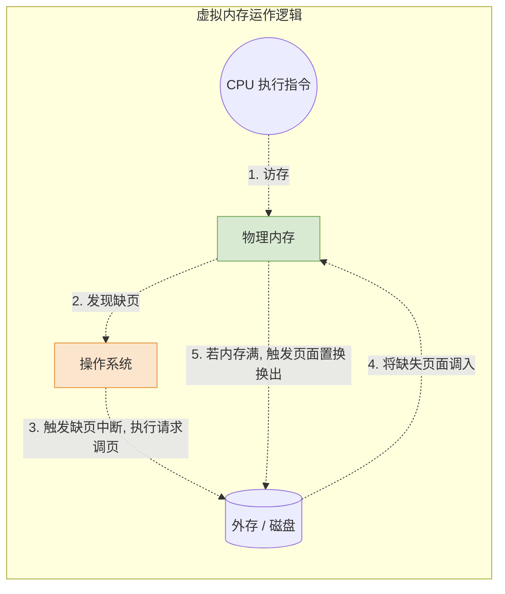

# 操作系统：虚拟内存的基本概念

> **导语**
> 本节课我们将进入内存管理中一项极具里程碑意义的核心技术——**虚拟内存 (Virtual Memory)**。
> 在之前的学习中，无论是连续分配还是基本的分页/分段管理，都存在大作业无法运行或并发度低的问题。虚拟内存技术基于局部性原理，通过操作系统的精妙调度，成功实现了“物理内存虽小，逻辑内存无限大”的神奇效果。

---

## 一、 传统存储管理方式的特征与痛点

在学习虚拟内存之前，我们先来看看传统存储管理方式（基本分页、基本分段、固定分区等）存在的两个致命缺陷，它们严重制约了系统性能。

### 1. 一次性 (All-or-Nothing)

- **含义**：作业**必须一次性全部装入内存后**，才能开始运行。
- **痛点**：
  - **大作业无法运行**：当作业大小超过内存总容量时（如在 4GB 内存的电脑上想玩 60GB 的 GTA），根本无法启动。
  - **并发度极低**：当多个作业同时要求运行时，由于每个作业都必须全部装入，导致内存很快被占满，能同时在内存中运行的程序数量锐减。

### 2. 驻留性 (Always-Resident)

- **含义**：一旦作业被装入内存，就会**一直驻留在内存中**，直到作业运行结束。
- **痛点**：
  - **严重浪费资源**：在很长一段时间内，进程可能只需要访问一小部分数据（例如游戏只在一个特定场景，不需要加载全局地图）。但因为驻留性，那些暂时完全用不到的数据依然死死霸占着宝贵的内存空间。

---

## 二、 突破口：局部性原理 (Principle of Locality)

为什么我们敢于不把整个程序一次性装入内存？底气来源于计算机科学中最著名的定律之一——**局部性原理**。

### 1. 时间局部性 (Temporal Locality)

- **含义**：如果程序执行了某条指令或访问了某个数据，那么**在不久的将来，它很有可能被再次执行或访问**。
- **原因**：程序中存在大量的**循环结构**（如 `for` 循环），循环体内的指令和相关变量（如计数器 `i`）会被极高频地重复访问。

### 2. 空间局部性 (Spatial Locality)

- **含义**：如果某个存储单元被访问，那么**在不久的将来，其附近的存储单元也很有可能被访问**。
- **原因**：程序中的代码指令通常是**顺序存放、顺序执行**的；数据结构（如数组）在内存中也是**连续存放**的，通常会被顺序遍历。

> **💡 核心启示：高速缓存思想**
> 基于局部性原理，我们不需要把所有的程序代码全塞进内存。我们只需要把**近期频繁使用的数据**放入高速的内存中，而把暂时用不到的数据留在慢速的外存（磁盘）中。一旦需要用到，再去外存调取即可。这就是虚拟内存的底层逻辑。

---

## 三、 虚拟内存的定义与三大特征

基于局部性原理，操作系统可以在程序装入时，只将极少部分即将使用的页面调入内存即刻启动程序运行。在运行中，如果发现需要的数据不在内存，由操作系统负责将其从外存调入；如果内存满了，再将暂不使用的数据换出到外存。
这种**物理上并未增加，但逻辑上极大拓充了内存容量**的技术，就是虚拟内存。

虚拟内存具有以下三大颠覆性特征：

|  特征名称  | 含义说明                                                               | 解决的传统痛点                                   |
| :--------: | :--------------------------------------------------------------------- | :----------------------------------------------- |
| **多次性** | 作业在运行时，**允许被分成多次调入内存**，无需一次性全部装入。         | 解决“一次性”带来的大作业装不进、并发度低的问题。 |
| **对换性** | 作业运行时，允许将其暂时用不到的页面**换出**到外存，需要时再**换入**。 | 解决“驻留性”带来的内存空间浪费问题。             |
| **虚拟性** | 从逻辑上扩充了内存的容量，用户感觉到的内存容量远大于实际物理内存。     | 实现了“小物理内存运行大程序”的奇迹。             |

---

## 四、 虚拟内存的实现机制

### 1. 离散分配是前提

如果采用连续分配方式，每次调入新数据都需要找到紧挨着的连续空闲空间，这极其困难且易产生碎片。因此，**虚拟内存技术必须建立在“离散分配”的内存管理方式之上**。

基于传统的三种离散分配方式，虚拟内存派生出了三种实现方式：

- **请求分页**存储管理方式（最为常用，考研核心）
- **请求分段**存储管理方式
- **请求段页式**存储管理方式

### 2. 操作系统需要增加的两大核心功能

为了在基本的分页/分段管理上实现虚拟内存，操作系统必须额外提供以下两个核心能力：

1.  **请求调页/调段功能**：
    当 CPU 运行程序发现所需信息不在内存中时，操作系统必须能够响应请求，主动去外存中将这部分缺失的信息**调入**内存。
2.  **页面/段置换功能**：
    当内存空间已满，但又需要调入新页面时，操作系统必须能够根据某种算法（如 LRU），挑选出暂时用不到的页面，将其**换出**到外存，为新页面腾出空间。

---

## 五、 本节总结

本节课是虚拟内存的基石，主要在**选择题**中考察概念辨析：

1.  **痛点对立**：牢记传统方式的“一次性”与“驻留性”，正好被虚拟内存的“多次性”与“对换性”所攻破。
2.  **理论支撑**：虚拟内存能够高效运作的灵魂是**局部性原理**（时间与空间）。
3.  **两大核心功能**：实现虚拟内存，OS 必须增加**“请求调入”**与**“页面置换”**两大机制。接下来的课程，我们将深入“请求分页管理”，揭开这两大机制的神秘面纱。
