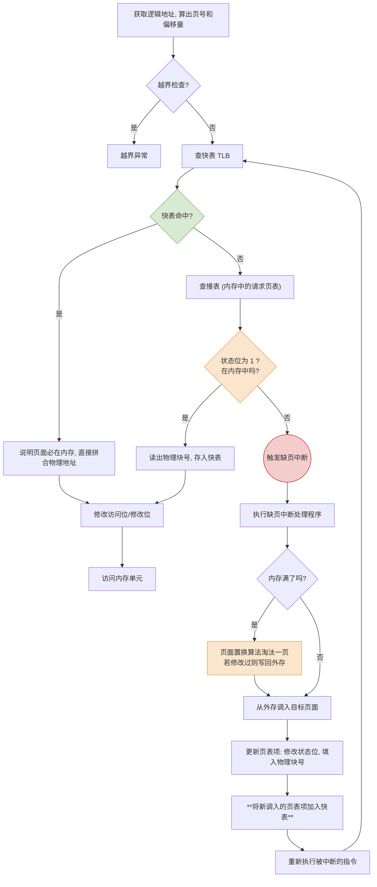

# 操作系统：请求分页管理方式

> **导语**
> 各位同学大家好，本节课我们将深入学习虚拟内存管理的核心实现技术——**请求分页管理方式**。
> 它是建立在“基本分页存储管理”基础之上的，为了实现虚拟内存，操作系统额外增加了两大核心功能：**请求调页**与**页面置换**。本节课我们将围绕这两大功能，对比基本分页，剖析请求页表的新增字段、缺页中断机构的运作原理以及完整的地址变换流程。

---

## 一、 请求页表机制：新增的四大字段

为了支持“调页”和“置换”，原本的页表必须扩充，以记录更多状态信息。与基本分页相比，请求分页的页表项（请求页表）新增了以下四个核心字段：

| 页号 | 物理块号 | **状态位 (存在位)** | **访问字段** | **修改位 (脏位)** | **外存地址**  |
| :--: | :------: | :-----------------: | :----------: | :---------------: | :-----------: |
|  0   |    15    |    `1` (在内存)     |   `12` 次    |   `0` (未修改)    | 磁盘柱面/扇区 |
|  1   |    --    |   `0` (不在内存)    |      --      |        --         | 磁盘柱面/扇区 |

### 新增字段详解：

1.  **状态位 (存在位)**：指示该页面当前是否已经调入内存（`1` 表示在内存，`0` 表示缺失）。这是触发缺页中断的直接依据。
2.  **访问字段**：记录该页面被访问的频率（如访问次数）或最近一次访问的时间。用于**页面置换算法**选择淘汰哪个页面的参考依据（例如 LRU 算法）。
3.  **修改位 (脏位)**：标记该页面调入内存后是否被修改过。
    - `0`：未修改。淘汰时直接丢弃，无需写回。
    - `1`：已修改。淘汰时**必须写回外存**以覆盖旧数据。_(极大节省了 I/O 时间)_
4.  **外存地址**：记录该页面在磁盘（外存）上的存放位置。当发生缺页时，操作系统根据此地址去外存寻找目标页面。

---

## 二、 缺页中断机构 (核心考点)

当 CPU 要访问的逻辑地址对应的页面**不在内存中（状态位为 0）**时，缺页中断机构会触发一个**缺页中断信号**。

### 1. 缺页中断的处理流程

1.  **触发中断**：硬件发现状态位为 0，产生缺页中断。
2.  **阻塞进程**：操作系统启动中断处理程序。因为调页需要极慢的 I/O 操作（读磁盘），系统会将发生缺页的进程**阻塞**，让出 CPU。
3.  **寻找空闲块或置换**：
    - **情况 A（有空闲块）**：直接为该页分配一个空闲的内存块。
    - **情况 B（无空闲块）**：调用**页面置换算法**选出一个要被淘汰的旧页面。若该旧页面被修改过（修改位为 1），则先将其写回外存。
4.  **调入页面**：将外存中的目标页面读入选定的物理块中。
5.  **修改页表**：将该页的“状态位”改为 1，填入新分配的“物理块号”，并同时**将该页表项加入快表 (TLB)** 中。
6.  **唤醒进程**：调页 I/O 完成后，将该进程唤醒，重新放回就绪队列。

### 2. 缺页中断的特性辨析 (选择题高频)

- **属于内中断（故障/Fault）**：缺页中断是由当前执行的指令（找不到目标页面）直接引发的，因此属于内中断。且它属于可以被操作系统修复的“故障”类异常。
- **一条指令可能触发多次**：一条指令执行时可能涉及多个不同的内存单元（如 `COPY A to B`，A 和 B 分别在不同的页），如果这两个页都不在内存中，执行这一条指令就会发生两次缺页中断。

---

## 三、 完整的地址变换流程 (对比基本分页)

在请求分页系统中，地址变换的过程比基本分页更为复杂。我们需要重点关注多出来的三大步骤：**查状态位判断调页**、**内存满时的置换**以及**表项的修改更新**。

### 💡 核心细节补充提示：

1.  **快表命中的隐含前提**：如果一个页表项在快表中（TLB 命中），说明这个页面**一定已经在内存中**。因为如果页面被换出了，系统会同步将它从快表中删掉。
2.  **修改位的更新时机**：只有当执行的是**写指令**时，才需要将对应页表项的“修改位”置为 1；如果是只读指令，则无需修改。
3.  **新调入页面的快表操作**：当一个缺失的页面被辛苦调入内存后，系统不仅会修改慢表，**一定会同时将它加入快表**，以便接下来重新执行该指令时能瞬间在快表中命中。

---

## 四、 本节复习总结

本节课的内容主要在于理解逻辑流程，切忌死记硬背。重点掌握以下三个模块：

1.  **请求页表的四大新增字段**：特别理解“状态位”（触发中断）和“修改位”（减少写回 I/O）的作用。
2.  **缺页中断的本质**：属于内中断，可能被一条指令反复触发。处理它需要慢速的 I/O 磁盘操作，因此必须谨慎置换。
3.  **地址变换新增的三大动作**：
    - **何时调页**：查慢表发现状态位为 0 时。
    - **何时置换**：调页时发现物理内存已经没有空闲块时。
    - **何时修改**：发生置换调页后需修改页表/快表；读写访问后需更新访问位/修改位。

> **下节预告**：
> 当内存满了必须淘汰一个页面时，到底该淘汰谁？这直接决定了系统会不会因为频繁产生缺页中断而卡死。下一节我们将重点攻克**页面置换算法**这一必考大题内容。
