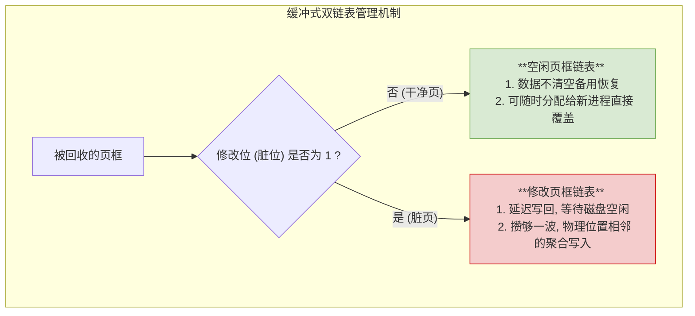

# 操作系统：页框回收 (2025 考纲新增)

> **导语**
> 本节课我们将学习 2025 年考研大纲中全新加入的考点：**页框回收 (Reclaim)**。
> 在之前的学习中，我们已经熟悉了“页面置换”。页框回收与页面置换在概念上有相似之处，但在触发时机、资源分配策略以及底层优化思想上有着本质的区别。本节课我们将通过对比，深入剖析页框回收的机制及其经典的**缓冲式回收（页框缓冲）**优化策略。

---

## 一、 概念辨析：页面置换 vs. 页框回收

为了准确把握新考点，我们必须先理清这两个英文和含义均不相同的概念：

### 1. 页面置换 (Replacement)

- **字面含义**：替换、更换。
- **触发时机**：**被动触发**。通常发生在进程发生缺页，且操作系统**已经没有空闲物理页框可用**时，被迫进行的临时抢救。
- **核心特征**：**即收即用**。操作系统通过置换算法（如 LRU、CLOCK），从当前进程或全局进程中强行收回一个页框，把旧页面换出，然后**立刻**将这个页框分配给当前缺页的进程使用。

### 2. 页框回收 (Reclaim)

- **字面含义**：拿回、回收利用、未雨绸缪。
- **触发时机**：**主动触发 / 预防性触发**。
  - **定时触发**：操作系统设置定时器（如每隔 10 秒），周期性地检查并回收那些很久没用的页框。
  - **阈值触发**：操作系统实时监测当前系统中的空闲页框总数，当该数量**低于设定的安全下限阈值**时，主动启动回收。
- **核心特征**：**囤积备用**。操作系统回收页框后，**并不立即分配给特定进程**，而是将这些页框存放在“空闲页框池”中统一保管。当未来有进程发生缺页需要新页框时，操作系统可以从容地从池子中分配，做到“手里有框，心中不慌”。

---

## 二、 页框回收的执行策略

当操作系统决定要执行页框回收时，面临两个核心问题：回收谁的？回收后怎么管理？

### 1. 优先回收哪些页框？ (Who)

如果系统中有大量页框可以回收，操作系统通常遵循以下优先级策略：

1.  **用户进程优先于内核进程**：内核进程关乎操作系统的核心稳定与安全，重要性极高。因此，操作系统会优先“薅”用户进程的羊毛，回收用户进程占用的、很久未使用的页框。
2.  **借鉴置换算法**：在确定了候选的用户进程页框后，操作系统会借用经典的页面置换算法（如 FIFO、LRU、CLOCK 等），选出最该被回收的一个或多个页框。

### 2. 缓冲式回收策略 (How - 核心优化点)

页框被回收后，如果只是简单地清空，那是极其低效的。现代操作系统通常采用**缓冲式回收 (页框缓冲算法)**，通过以下三大机制来极致优化 I/O 性能：

#### A. 核心策略 1：保留被回收页框内的数据 (快速恢复)

- **机制**：当物理页框被操作系统收回到空闲链表时，**并不清空里面原本保存的旧页面数据**。
- **妙用**：如果不久之后，原来的进程再次需要访问这个页面，操作系统在分配空闲页框时，会惊喜地发现“旧数据还在”！于是直接将这个携带着原数据的页框原封不动地还给进程。
- **优势**：实现了页面的**瞬间恢复**，完全避免了极其耗时的磁盘 I/O 读取操作。

#### B. 核心策略 2：延迟写回脏页框 (优化 I/O 时机)

- **机制**：如果被回收的页框是“脏页”（修改位为 1，说明数据被改过，必须写回磁盘），操作系统**并不立刻将其写回外存**，而是暂存在一个队列中。
- **妙用**：操作系统会智能监测磁盘的忙碌状态。在磁盘满负荷下载文件时暂缓写回，等磁盘处于**空闲状态**时，再慢慢地将这些脏页数据写回。
- **优势**：避免了与正常的磁盘读写任务抢占带宽，提升了磁盘 I/O 的整体响应效率。

#### C. 核心策略 3：双链表分类管理，聚合写入 (减少寻道开销)

- **机制**：操作系统同时维护两个队列：
  1.  **空闲页框链表**：存放“干净页”（未修改过，可直接被覆盖使用的页框）。
  2.  **修改页框链表 (脏页链表)**：存放必须写回磁盘的页框。
- **聚合写入优化**：对于修改页框链表中的脏页，操作系统会将它们攒到一定数量。然后，根据它们在磁盘上对应的扇区物理位置进行排序。当发现有多个页面的磁盘物理位置相邻时，**一口气聚合写入磁盘**。
- **优势**：就像做收纳一样，一次性把相邻的东西放好。极大减少了磁盘磁头臂来回移动（寻道）的机械开销，成倍提升写入效率。

---

## 三、 本节核心总结速记

1.  **概念对立**：
    - **页面置换** = 被动补救，即收即用，引发者是缺页中断。
    - **页框回收** = 主动预防，囤积备用，引发者是定时器或空闲阈值。
2.  **回收优先级**：普通用户进程的页框 $\rightarrow$ 内核进程的页框。
3.  **缓冲式回收精髓 (三板斧)**：
    - **不清空数据** $\rightarrow$ 搏一次“免 I/O”快速恢复的机会。
    - **延迟写回** $\rightarrow$ 避开磁盘高峰期。
    - **双链表+聚合写入** $\rightarrow$ 减少磁盘机械寻道时间。
