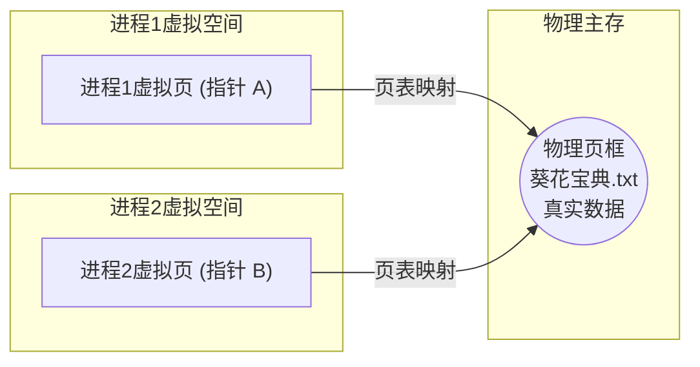

# 操作系统：内存映射文件 (Memory-Mapped Files)

> **导语**
> 各位同学大家好，本节课我们将学习操作系统中一个非常实用的高级特性——**内存映射文件 (Memory-Mapped Files)**。
> 我们将从它的定义和作用出发，通过与“传统文件访问方式”的对比，深入浅出地剖析其底层实现原理，以及它是如何极大地简化程序员的编程模型并实现进程间文件共享的。

---

## 一、 什么是内存映射文件？

简单来说，**内存映射文件**是操作系统向上层程序员提供的一个**系统调用功能**（如 Linux 中的 `mmap`）。
通过这个功能，操作系统能够将磁盘上的文件数据直接映射到进程的虚拟地址空间中。这带来了两大核心优势：

1.  **极大地简化了文件数据的访问方式**。
2.  **方便地实现了多个进程共享同一个文件的数据**。

---

## 二、 传统文件访问 vs 内存映射文件

为了更好理解内存映射的优势，我们以访问磁盘上的一个文件（如《葵花宝典.txt》，被拆分为多个 $1	ext{KB}$ 的磁盘块）为例，进行对比。

### 1. 传统的文件访问方式 (繁琐的系统调用)

传统的读写文件流程非常机械，需要频繁陷入内核态，程序员必须手动管理读写指针和内存缓冲区：

1.  **打开文件**：使用 `open` 系统调用打开文件。
2.  **定位指针**：使用 `seek` 系统调用，让操作系统的读写指针指向想要读取的位置。
3.  **读入数据**：使用 `read` 系统调用，指明要读取的字节数。操作系统会将指定的数据（如文件的第二块）从磁盘读入主存（内存）中的缓冲区。
4.  **访问/修改数据**：进程对主存中的这块数据进行读取或修改。
5.  **写回外存**：如果数据被修改，程序员必须显式地调用 `write` 系统调用，将主存里的新数据写回磁盘。

### 2. 内存映射文件方式 (优雅的指针操作)

使用内存映射文件，一切变得像访问数组一样简单：

1.  **打开文件**：使用 `open` 系统调用打开文件。
2.  **建立映射**：使用 `mmap` 系统调用。操作系统会将文件映射到进程的**虚拟地址空间**中，并给程序员返回一个**指向该区域起始地址的指针**。
3.  **直接读写**：程序员拿到起始指针后，只需加上偏移量，就可以像**访问普通内存数组**一样直接访问文件数据的任何部分，完全抛弃了 `read` 和 `write` 函数！
4.  **关闭文件**：使用 `close` 系统调用关闭文件。操作系统会自动将修改过的数据写回磁盘。

---

## 三、 内存映射文件的底层原理：缺页与自动加载

调用 `mmap` 时，文件数据真的立刻全部被加载进内存了吗？
**并没有！** 操作系统非常聪明，它采用了“懒加载”的策略。

1.  **建立映射 (缺页状态)**：调用 `mmap` 后，操作系统只是在进程的虚拟地址空间和文件之间建立了一种逻辑映射关系，此时**并未将实际的文件数据块读入物理主存**。
2.  **触发缺页异常**：当进程通过指针实际访问文件的某一块数据（如第二块）时，发现该区域在物理内存中不存在，硬件会触发**缺页异常 (Page Fault)**。
3.  **自动读入**：操作系统捕获缺页异常后，会在后台**自动**将缺失的文件数据块从磁盘读入物理主存。这一切对程序员是完全透明的。
4.  **自动写回 (脏页回写)**：当程序对加载进内存的数据进行修改后，操作系统会在进程执行 `close` 关闭文件时，**自动将那些被修改过的数据块（脏页）写回磁盘**；未修改的数据块则直接被丢弃。

---

## 四、 内存映射文件的两大核心作用

### 作用一：极大地简化编程模型

由于底层有操作系统的缺页异常机制兜底，程序员不再需要手动管理缓冲区，不再需要一次次调用 `read/write`。**只需拿到一个起始指针，加上内存偏移量即可为所欲为**。数据的读入和写出全由操作系统全权自动包办。

### 作用二：实现进程间的文件数据共享

内存映射文件是实现**进程间通信 (IPC)** 和**共享内存**的绝佳方式。

**共享原理：**

1.  **进程 1** 使用系统调用，将《葵花宝典.txt》映射到自己的虚拟地址空间。
2.  **进程 2** 也使用系统调用，将同一个文件映射到自己的虚拟地址空间。
3.  由于它们映射的是同一个文件，操作系统的**页表机制**会将这两个独立进程的虚拟页面，映射到**同一块物理内存页框**上。

**效果**：当进程 1 通过其指针修改了数据，由于它们访问的是同一块物理内存，进程 2 能够**立刻**看到数据的改变！这就是基于内存映射的高效数据共享机制。

---

## 五、 总结与拓展

1.  **核心机制**：通过 `mmap` 返回指针，利用**缺页异常**实现按需自动读取，利用**脏页机制**实现关闭时自动写回。
2.  **性能优化**：由于文件的读入和写出完全由操作系统底层的 I/O 调度系统接管，操作系统可以运用更高级的策略（如**预读入 (Read-ahead)**、**缓写出 (Delayed-write)**）来大幅优化磁盘 I/O 的整体效率，这往往比程序员在应用层手动调用的效率高得多。
