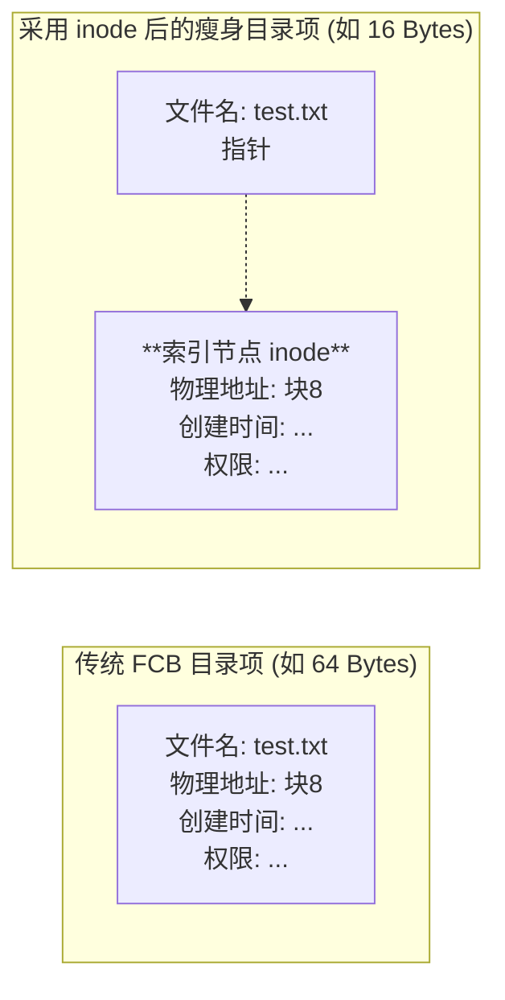

# 操作系统：文件目录管理与索引节点

> **导语**
> 各位同学大家好，本节课我们将深入学习操作系统中与我们日常使用最息息相关的概念——**文件目录**。
> 我们每天都在 Windows 或 Mac 系统中新建文件夹、按路径查找文件，但你是否思考过操作系统在底层是如何实现这些目录层级的？本节课我们将从目录的本质（文件控制块 FCB）讲起，梳理目录结构从单级到无环图的演进过程，并重点剖析用于极致提升文件检索速度的核心机制——**索引节点 (inode)**。

---

## 一、 文件控制块 (FCB) 与 目录的本质

我们平时看到的“文件夹”或“目录”，在操作系统的视角下，其实**本身也是一种有结构的文件（称为目录文件）**。

### 1. 目录文件的结构

目录文件由一条条的**目录项**（记录）组成。**一个目录项，本质上就是一个文件控制块 (FCB)**。每个 FCB 对应着该目录下的一个普通文件（或子目录）。

### 2. 文件控制块 (FCB) 的核心内容

FCB 包含了文件的一系列基本信息、存取控制信息和使用信息。其中，实现目录管理最重要的两个核心字段是：

- **文件名**：用户按名存取的关键字。
- **物理地址**：文件数据在底层磁盘上的实际存放位置。

> **底层逻辑揭秘：双击打开文件夹时发生了什么？**
> 当你双击打开 `D:\照片` 这个文件夹时，操作系统会在底层查询 `D盘根目录` 这个目录文件，找到名为 `照片` 的 FCB 目录项，读出 `照片` 目录文件的磁盘存放位置。然后触发 I/O 操作将该目录文件的数据读入内存，你才能看到里面包含的各种照片文件。

---

## 二、 目录结构的四代演进

操作系统的目录结构经历了从简单到复杂、从死板到灵活的四个发展阶段：

### 1. 单级目录结构 (最早期的雏形)

- **结构**：整个系统只有一张宏大的目录表，所有文件都在这一个目录中。
- **致命缺陷**：**绝对不允许文件重名**！因为没有层级隔离，重名会导致按名存取时系统无法定位。在多用户系统中，极易发生重名冲突，因此不适用于多用户操作系统。

### 2. 两级目录结构

- **结构**：分为**主文件目录 (MFD)** 和 **用户文件目录 (UFD)**。主目录记录各个用户名及其对应 UFD 的位置；每个 UFD 记录该用户自己的文件。
- **优点**：
  - **允许不同用户间文件重名**（如 User1 和 User2 都可以有 `demo.txt`）。
  - 天然实现了用户间的文件访问隔离和保护。
- **缺点**：用户依然无法在自己的 UFD 下建立子文件夹，文件无法分类管理。

### 3. 多级目录结构 (树形目录结构) —— 现代主流

- **结构**：允许目录嵌套，形成一棵倒置的树。这是现代操作系统（如 Windows, Linux）普遍采用的结构。
- **核心概念辨析**：
  - **绝对路径**：从根目录出发的路径。查找极其耗时，**路径有几级，就需要进行几次磁盘 I/O 操作**。
  - **相对路径**：从当前正在浏览的目录（当前工作目录）出发的路径。
- **性能优化启示**：由于相对路径的起点目录文件已经被调入内存，免去了从根目录逐层往下读取的 I/O 开销。因此，**引入“当前目录”并使用“相对路径”，可以大幅减少磁盘 I/O 次数，提升文件访问速度。**
- **痛点**：树形结构层次清晰、便于保护，但**极不方便实现文件共享**。

### 4. 无环图目录结构 (为共享而生)

- **结构**：在树形目录的基础上，允许存在跨层级指向同一个节点的**有向边**，使得目录结构变成一个有向无环图 (DAG)。
- **共享机制**：允许不同用户的不同目录项（甚至可以用不同的文件名）指向同一个文件数据块。
- **删除机制的改变（共享计数器）**：
  引入共享后，如果用户 A 点击删除，系统不能直接抹除物理文件。系统为每个共享节点设置一个**共享计数器**（如初始为 2）。用户 A 删除时，仅删除其对应的 FCB 目录项，并将计数器减 1。**只有当共享计数器归 0 时，真正的物理文件数据才会被彻底删除。**

---

## 三、 极致的搜索优化：索引节点 (inode)

在树形目录中按路径层层查找时，需要反复将目录文件从磁盘调入内存进行比对。但比对时，我们**实际上只需要用到 FCB 中的“文件名”字段**，而 FCB 中附带的那些庞大的创建时间、所有者、物理地址等信息在比对阶段全是毫无用处的冗余数据。

### 1. 核心优化思想 (给 FCB 疯狂瘦身)

将除了文件名之外的所有信息（物理地址、各种属性等）全部“踢出”目录表，存放到一个独立的数据结构中，这个结构就叫**索引节点 (inode)**。

优化后，**目录表中的表项只剩下两个字段：【文件名】 + 【指向对应索引节点的指针】。**

### 2. 为什么这样能极大提升搜索速度？ (考点推演)

假设一个磁盘块大小为 $1\text{KB} (1024\text{B})$：

- **传统 FCB (大体积)**：假设每个 FCB 占 $64\text{B}$。一个磁盘块只能装 $1024 / 64 = 16$ 个目录项。若目录中有 $640$ 个文件，目录文件需占用 **$40$ 个磁盘块**。搜索整个目录最坏情况需要启动 $40$ 次磁盘 I/O。
- **瘦身后 (小体积)**：假设只保留文件名和指针，每个目录项仅占 $16\text{B}$。一个磁盘块可以装 $1024 / 16 = 64$ 个目录项。同样 $640$ 个文件，只需占用 **$10$ 个磁盘块**！搜索最坏情况只需启动 $10$ 次磁盘 I/O。
- **结论**：目录项变小了，每个磁盘块能装下的目录项就多了。查找文件时需要**启动磁盘 I/O 的次数大幅锐减**，从而实现了搜索速度的质的飞跃。

### 3. 磁盘索引节点 vs 内存索引节点

- **磁盘索引节点**：存放在磁盘上的 inode，记录文件的静态属性。
- **内存索引节点**：当文件被找到并准备使用时，其 inode 会被调入内存。为了方便运行时的管理，内存中的 inode 会**额外增加**一些动态信息（如：文件是否被修改过、当前有几个进程正在访问该文件等）。

---

## 四、 本节复习指南

本节属于选择题高频产出区，复习时请牢记以下对应关系：

1.  **单级目录** $\rightarrow$ 绝对不能重名。
2.  **树形目录** $\rightarrow$ 引入“当前目录 / 相对路径”可减少磁盘 I/O。
3.  **无环图目录** $\rightarrow$ 共享文件删除的判断依据是“共享计数器归零”。
4.  **索引节点 (inode)** $\rightarrow$ 其核心设计目的是给目录表“瘦身”，使得每个磁盘块能容纳更多目录项，从而**减少查找文件时的磁盘 I/O 次数**。
