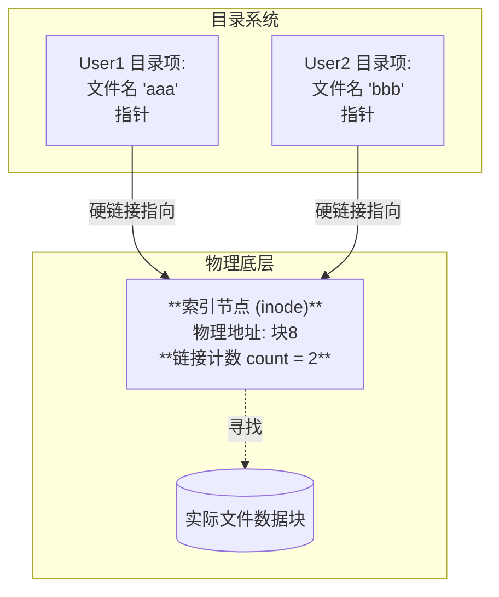

# 操作系统：文件共享的实现方式

> **导语**
> 各位同学大家好，本节课我们将学习操作系统是如何实现**文件共享**的。
> 文件共享允许系统中不同的用户（或进程）共同使用同一个文件，这样不仅节约了存储空间，还能实现数据的实时同步。本节课我们将重点辨析“共享与复制”的区别，并详细讲解两种经典的共享机制：**基于索引节点的硬链接**和**基于符号链的软链接**。

---

## 一、 概念辨析：共享 vs 复制

在正式学习之前，我们必须严格区分“共享文件”与“复制文件”在底层实现上的不同：

- **共享 (Share)**：系统中**只有一份真实的文件数据**。多个用户都通过某种方式指向这一份数据。
  - _特点_：任何一个用户对文件数据的修改，**其他所有共享该文件的用户都能立刻看到数据的变化**。
- **复制 (Copy)**：系统中有**多份相同的文件数据副本**。每个用户拥有自己独立的那一份数据。
  - _特点_：一个用户修改自己那份文件的数据，对其他用户的文件副本**没有任何影响**。

---

## 二、 基于索引节点的共享方式 (硬链接 - Hard Link)

在学习文件目录时我们知道，为了给目录项“瘦身”，操作系统将文件的物理地址及各种属性抽离出来，存放在一个叫**索引节点 (inode)** 的数据结构中。目录项中只保留文件名和指向该 inode 的指针。硬链接正是巧妙地利用了这一点。

### 1. 实现机制

**硬链接的本质，就是让不同用户的目录项，直接指向同一个文件的索引节点 (inode)。**

- 当 User 1 创建了文件 A，该文件拥有一个独立的 inode。
- 当 User 2 想要共享这个文件时，系统会在 User 2 的目录下创建一个新的目录项，并让它的**底层指针直接指向文件 A 的 inode**。
- **注意**：User 2 可以为这个共享文件取一个**完全不同的文件名**（如在 User 1 叫 `aaa`，在 User 2 可以叫 `bbb`）。

### 2. 链接计数器 (Count) 机制

如果直接让多个目录项指向同一个 inode，当某个用户想删除文件时就会出现问题：如果直接把实际物理文件删了，其他用户目录项里的指针就会变成**“悬空指针”**。为了解决这个问题，inode 中必须设置一个**链接计数器 (`count`)**。

- **计数器含义**：表示当前系统中有多少个目录项（硬链接）正指向这个 inode。
- **增加链接**：每多一个用户共享该文件，`count++`。
- **删除文件时的逻辑 (核心考点)**：
  - 当 User 1 选择删除文件 `aaa` 时，操作系统**仅仅删除了 User 1 目录下的这个 FCB 目录项**，并将 inode 中的 `count--`。
  - 此时操作系统会检查 `count` 的值。如果 `count > 0`，说明还有其他用户在用，**绝对不能删除底层真实的物理文件数据和 inode**。
  - **只有当 `count == 0` 时，真正的文件数据及其 inode 才会被操作系统从磁盘上彻底抹除。**

---

## 三、 基于符号链的共享方式 (软链接 - Soft Link / Symbolic Link)

软链接的共享方式，我们在日常生活中极为熟悉，它就是 Windows 系统中的**快捷方式**。

### 1. 实现机制

**软链接的本质，是建立一个新的特殊类型文件（Link 型文件），在这个文件的数据里，只保存了共享文件的绝对路径（或相对路径）。**

- 当 User 3 想共享 User 1 的文件 `C:\User1\aaa` 时，User 3 可以创建一个特殊文件 `ccc`。
- 这个文件 `ccc` 的类型是 `Link`，它里面并不包含文件数据，也不直接指向 inode，里面只写了一串字符串：`"C:\User1\aaa"`。
- **访问过程**：当 User 3 尝试打开文件 `ccc` 时，操作系统发现它是一个 Link 型文件，于是会**读取里面的路径字符串，然后根据这个路径，一层一层地去检索目录**，最终找到真正的目标文件。

### 2. 删除文件对软链接的影响

- 如果 User 1 彻底删除了原文件 `aaa`（真实数据被抹除，目录项消失）。
- 此时 User 3 的软链接文件 `ccc` **依然存在**。
- 但是，当 User 3 双击 `ccc` 试图打开时，操作系统顺着里面记录的路径去寻找，发现路径尽头已经没有那个文件了，就会报错提示**“快捷方式所指向的项目已被删除”**。

### 3. 软链接的性能缺点 (考点)

由于每次访问软链接，操作系统都必须**根据其内部记录的路径字符串，重新逐层检索目录**，这期间必然会触发多次额外的磁盘 I/O 操作。因此，**通过软链接访问共享文件的速度，要远慢于通过硬链接直接访问**。

---

## 四、 本节核心对比速记

在考试的选择题中，必须能快速反应出硬链接与软链接在底层机制上的根本区别：

| 特性维度           | 基于索引节点 (硬链接)                                   | 基于符号链 (软链接/快捷方式)                                  |
| :----------------- | :------------------------------------------------------ | :------------------------------------------------------------ |
| **底层指向**       | 直接指向真实的 **inode 节点**                           | 指向一个存有**原文件路径的 Link 型新文件**                    |
| **访问速度**       | **快** (直接拿物理地址去读数据)                         | **慢** (需重新解析长路径，增加磁盘 I/O)                       |
| **空间开销**       | 极小 (只增加一个 FCB 目录项)                            | 较大 (需占用一个真实的物理块来存路径字符串，并分配新的 inode) |
| **原文件删除影响** | 仅当前目录项被删，真实数据不受影响，除非 `count` 减为 0 | 原文件被删后，软链接依然存在，但**失效变为空壳**              |
| **计数器机制**     | **必须有** (在 inode 中维护 `count`)                    | **不需要** (软链接不增加文件本身的硬链接数)                   |

> **学习建议**：理解本节内容时，脑海中可以一直联想 Windows 的“快捷方式”。快捷方式删了对原文件毫无影响；原文件删了，快捷方式就变成了无法打开的“死链”。这就是典型的软链接特性。
