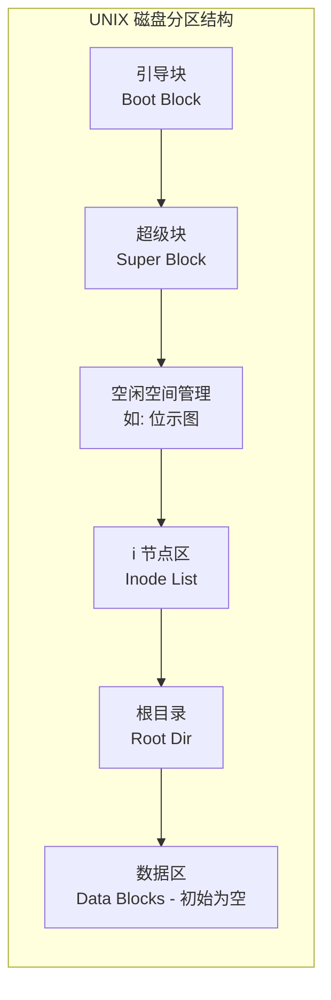

# 操作系统：文件系统的全局结构

> **导语**
> 各位同学大家好，本节课我们将学习考研大纲中的一个核心考点：**文件系统的全局结构**。
> 本节课我们将以时间为线索，从一个磁盘刚刚出厂开始，一步步推演文件系统在**外存（磁盘）**上是如何建立起来的，并详细剖析当系统运行时，文件系统在**内存**中又维护了哪些关键的数据结构。理解这些全局结构，是彻底掌握文件操作（如打开、读写）底层逻辑的关键。

---

## 一、 文件系统在外存中的结构（从白纸到建制）

当一块全新的磁盘出厂时，它就像一张白纸。要让它能够存储文件，必须经历两道“格式化”工序。

### 1. 物理格式化 (低级格式化)

这是磁盘刚出厂后进行的第一步操作，主要面向**底层硬件层面**。

- **划分扇区**：将空白的磁盘物理介质划分出一个个的**扇区 (Sector)**，作为读写的基本单位。
- **坏块管理 (对 OS 透明)**：在划分扇区时，会对磁盘进行扫描。如果发现某个扇区物理损坏（坏扇区），磁盘驱动器会将其标记，并**使用预留的备用扇区来替换这个坏扇区**。
  > **核心特性**：这种坏块的替换操作是由底层磁盘驱动器悄悄完成的。对于上层的操作系统而言，它依然认为自己访问的是正常的逻辑扇区 $N$，**操作系统根本意识不到坏扇区的存在（即坏块对 OS 透明）**。

### 2. 逻辑格式化 (高级格式化)

在物理扇区划分完毕后，就可以进行逻辑格式化，为**操作系统层面**建立文件系统的管理数据结构。

- **磁盘分区 (Partitioning)**：将一整个物理磁盘划分为多个独立的逻辑分区（又称**卷**，Volume）。比如大家熟悉的 C盘、D盘、E盘。每个分区的大小和地址范围由**分区表 (Partition Table)** 记录。
- **建立文件系统**：在每个分区内，可以建立独立的文件系统（如 UNIX 文件系统、NTFS 等）。以 UNIX 系统为例，逻辑格式化后，分区内会被写入以下核心数据结构：

#### 核心区域详解：

1.  **超级块 (Super Block)**：用于快速定位该分区内**大量空闲磁盘块**的起始位置，主要在为新建文件或扩展文件快速分配大片空间时使用。
2.  **空闲空间管理 (如位示图)**：例如用 $0$ 代表空闲，$1$ 代表已分配。用于精确快速地判断**某一个特定磁盘块**当前是否被占用。（_与超级块功能有一定重叠，但侧重点不同_）
3.  **i 节点区 (Inode List)**：
    - 存放该分区内所有文件的**索引节点 (Inode)**。
    - 这是一个连续存放的超大数组，每个 Inode 大小固定。
    - **寻址优势**：操作系统只要知道该区域的起始地址、Inode 的固定大小，就能通过简单的数组下标（如 $i$ 号节点）极其迅速地计算出任意 Inode 的物理存放位置。
4.  **根目录 (Root Directory)**：文件系统的万物之源。逻辑格式化必须建立根目录，以后所有的子目录和文件都要从这里开始生长。
5.  **数据区**：逻辑格式化完成后，该区域初始全是**空白**的。只有当用户真正新建文件、写入数据时，才会慢慢填充。

---

## 二、 文件系统在内存中的结构

当操作系统运行起来后，为了提高文件访问速度并管理正在被访问的文件，操作系统会在**内存 (内核区)** 中动态维护三个极其重要的数据结构：

### 1. 目录缓存 (Directory Cache)

- **作用**：暂存近期访问过的目录数据（即该目录下的 FCB 集合）。
- **原理**：读取目录需要极其耗时的磁盘 I/O。如果用户最近访问了目录 $M$，系统会将其缓存在内存中。不久后若再次访问目录 $M$，就可以直接在内存中秒查，极大地加快了路径解析和目录检索的速度。

### 2. 系统的打开文件表 (System-wide Open-file Table)

- **数量**：整个操作系统**只有一张**。
- **作用**：包含了系统内**所有当前被打开的文件**的 FCB（目录项）副本，以及该文件被多少个进程共享打开的**打开计数器**。

### 3. 进程的打开文件表 (Per-process Open-file Table)

- **数量**：每个进程的 PCB 中都拥有**自己独立的一张**。
- **作用**：记录当前进程打开了哪些文件。
- **内容**：这张表中**绝不保存文件的 FCB**！它只保存两样东西：
  1.  该进程对这个文件的**打开方式/访问权限**（如只读、读写）。
  2.  一个**系统表索引指针**，指向“系统的打开文件表”中该文件对应的条目。

---

## 三、 贯穿始终：Open 与 Read 操作的底层联动

我们用一个完整的 `open` 和 `read` 例子，将外存和内存的数据结构全部串联起来。

假设进程要执行：`fd = open("/m/a.txt", 只读)`，接着执行 `read(fd, ...)`。

### 阶段一：Open 系统调用（建立映射通道）

1.  **路径解析与目录缓存**：OS 逐层解析路径，找到目录 $m$。如果 $m$ 不在内存缓存中，则触发 I/O 将 $m$ 的目录数据读入主存的**目录缓存**中。
2.  **查找 FCB**：在内存缓存的目录 $m$ 中进行比对，找到了文件 `a.txt` 的 FCB 目录项。
3.  **系统表登记**：将文件 `a` 的 FCB **复制一份放入“系统的打开文件表”**，并将其打开计数器设置为 $1$（若已有其他进程打开，则计数器加 $1$）。
4.  **进程表登记与返回 fd**：在发起调用的**进程打开文件表**中新建一个条目，记录打开方式为“只读”，并将其指针指向系统表中的对应条目。最后，向程序员返回该进程表条目的编号，即**文件描述符 (fd)**。

### 阶段二：Read 系统调用（顺藤摸瓜读取数据）

当进程接着调用 `read(fd, bytes, buffer)` 时：

1.  **查进程表**：OS 拿到程序员传来的 `fd`，直接去该进程的**进程打开文件表**中找第 `fd` 个条目。
2.  **顺藤摸瓜找 FCB**：顺着条目里的指针，直接跳到**系统打开文件表**中对应的条目，顺利拿到了文件 `a.txt` 的 **FCB (或内存 Inode)**。
3.  **定位外存并读取**：通过 FCB 中记录的物理地址信息，OS 准确地知道文件 `a.txt` 在外存中的物理块号，触发磁盘 I/O，将数据读入指定的内存 buffer 中。

> **💡 核心感悟**：
> `open` 操作的过程非常繁琐（需查磁盘目录），但它为后续操作修了一条高速公路。一旦有了返回的 `fd`，随后的 `read/write` 只需在内存的几张表里瞬间跳转，直接获取 FCB 并发起 I/O，完全**跳过了漫长的目录检索过程**。
