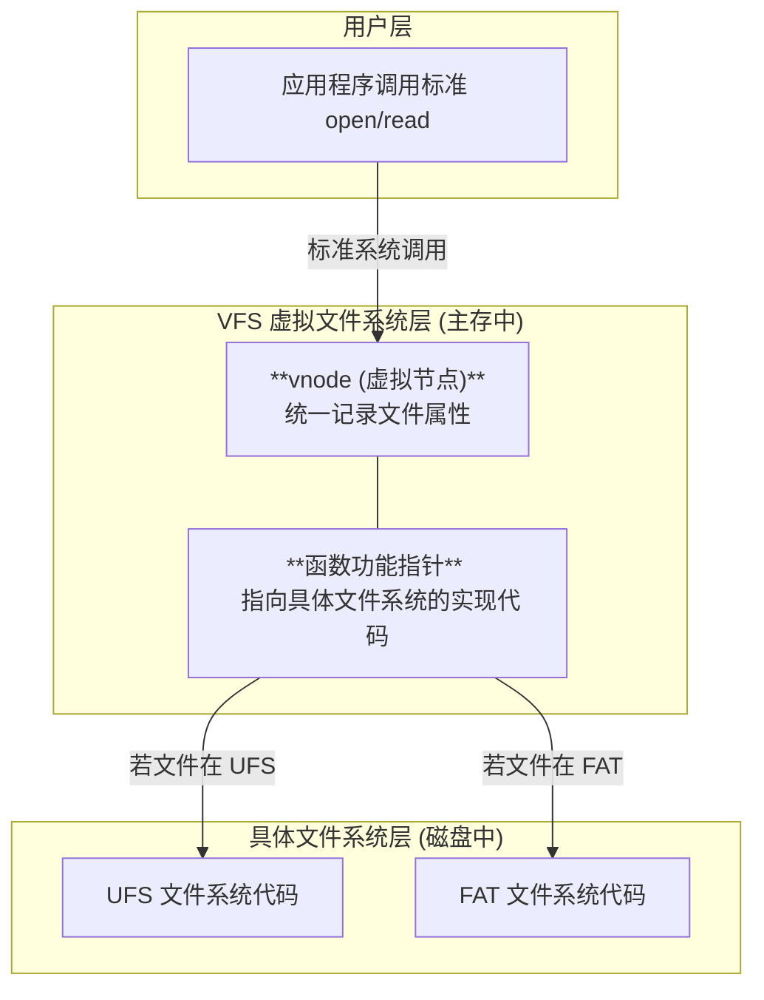

# 操作系统：虚拟文件系统与文件系统的挂载

> **导语**
> 各位同学大家好，本节课我们将学习操作系统第四章的两个重要新考点：**虚拟文件系统 (VFS)** 和 **文件系统的挂载**。
> 现实中，一台电脑可能同时插着 NTFS 格式的硬盘、FAT32 格式的 U 盘，它们底层的文件读取规则千差万别。如果让程序员去适配每一种文件系统，那简直是噩梦。为此，操作系统引入了“虚拟文件系统”作为中间层，并通过“挂载”机制将外部设备动态接入系统。本节课我们将深入剖析这两个核心概念。

---

## 一、 虚拟文件系统 (VFS - Virtual File System)

### 1. 为什么需要虚拟文件系统？

假设没有 VFS，当我们在程序中需要打开一个文件时：

- 如果要操作的是 `UFS` 文件系统，调用的函数可能是 `open(x, y)`。
- 如果要操作的是 `NTFS` 文件系统，调用的函数可能叫 `fopen(x)`。
- 如果要操作的是 `FAT` 文件系统，函数名和参数格式可能又变了。

这意味着，程序员在编写代码时，必须提前知道文件存放在哪种格式的磁盘上，并编写完全不同的底层调用代码。这不仅麻烦，而且毫无可移植性。

### 2. VFS 的三大核心特性

为了屏蔽底层文件系统的差异，操作系统内核引入了 **VFS (虚拟文件系统)** 层。它具备以下三个核心特性：

#### 特性一：向上层提供统一的标准接口

- **机制**：VFS 向用户进程提供一套**统一的、标准的系统调用接口**（例如 Linux 中遵循 POSIX 标准的 `open`, `read`, `write`）。
- **作用**：用户在编程时只需调用这个标准接口，无需关心文件到底存放在 U 盘 (FAT) 还是系统盘 (UFS) 中。VFS 充当了“翻译官”，完美**屏蔽了底层具体文件系统的实现差异**。

#### 特性二：向下层要求实现规定的函数接口

- **机制**：VFS 作为“包工头”，向下层的具体文件系统（如 UFS, FAT, NTFS）提出了硬性要求：**必须实现我 VFS 规定好的这套标准函数（函数名、参数必须一致）**。
- **作用**：如果一个全新的文件系统想要挂载到该操作系统上，它的开发者就必须按照 VFS 的规范去编写底层的 `open`, `read` 等实现代码。只有满足 VFS 的标准，才能被操作系统接纳并支持。

#### 特性三：引入统一的数据结构 `vnode` (虚拟节点)

不同的底层文件系统，其描述文件的目录项格式截然不同（例如 UFS 的目录项只有文件名和 inode 号；而 FAT 的目录项包含了文件的所有属性）。VFS 如何用一套代码去管理这些千奇百怪的数据结构呢？

- **机制**：**每当打开一个文件，VFS 就会在主存（内存）中为该文件新建一个 `vnode` (v 节点)**。
- **作用**：无论底层是什么文件系统，只要文件被打开，其核心信息都会被**提取并复制**到这个标准的 `vnode` 数据结构中。此后，VFS 只需操作 `vnode`，就能统一管理所有打开的文件。

> **🚨 核心易错点：`vnode` 与 `inode` 的区别**
>
> 1.  **存在位置**：`vnode` **只存在于主存（内存）中**，文件关闭后就会消失；而 `inode`（索引节点）既存在于主存，也**永久存储在外存（磁盘）中**。
> 2.  **包含关系**：打开文件时，系统会将外存中的 `inode` 读入内存，并将其信息复制到新建的 `vnode` 中。
> 3.  **特殊指针**：`vnode` 中除了包含文件属性，还包含一个至关重要的**函数功能指针**，它指向了该文件所属的底层文件系统（如 FAT）的具体函数代码列表，从而实现函数调用的向下路由。

---

## 二、 文件系统的挂载 (Mounting)

当我们将一个 U 盘插到电脑上时，U 盘里的文件系统是如何接入到操作系统中的呢？这个过程就叫**挂载 (Mount)**，也叫**安装 (Installation)**。

### 挂载操作的三大核心步骤

当操作系统识别到新接入的文件系统时，会在底层执行以下三个核心步骤：

#### 步骤一：在 VFS 的挂载表中注册

- VFS 在内存中维护着一张**挂载表 (Mount Table)**，记录了当前系统接入的所有文件系统的基本信息（如容量、格式、状态等）。
- 挂载时，VFS 首先会在挂载表中为新接入的 U 盘文件系统**新建一个表项**，完成“注册报到”，让系统感知到它的存在。

#### 步骤二：提供函数地址列表

- 新接入的文件系统必须向 VFS 提交一份自己的**函数地址列表**。
- 这份列表告诉 VFS：“我的底层的 `open` 函数代码在内存地址 A，`read` 函数代码在地址 B”。只有拿到这份地址清单，VFS 的 `vnode` 才能通过指针准确地调用到底层代码。

#### 步骤三：将新文件系统挂载到指定的“挂载点”

- **什么是挂载点？** 挂载点其实就是操作系统原有目录树中的一个**已存在的父目录（或节点）**。
- **操作实质**：将新文件系统的根目录，直接“缝合”挂接到操作系统指定的挂载点目录下。
- **系统差异对比**：
  - **Windows 系统的挂载点**：以**盘符**为单位，和系统盘平级。例如插上 U 盘后，系统分配一个全新的盘符 `G:\` 作为挂载点。
  - **macOS / Linux 系统的挂载点**：统一的**倒置树状目录结构**。例如，插上 U 盘后，它会被挂接到根目录下的 `/Volumes/` 目录下（如 `/Volumes/MyUSB/`）。`/Volumes/` 就是它的挂载点。

---

## 三、 本节总结归纳

1.  **VFS 的核心价值**：对上提供统一标准接口（屏蔽差异）；对下要求实现规范约束；中间通过统一的 `vnode` 数据结构进行抽象管理。
2.  **`vnode` 的必考属性**：必须牢记 `vnode` **仅存在于内存**，且包含了指向具体文件系统操作函数的**功能指针**。
3.  **挂载三部曲**：注册挂载表 $\rightarrow$ 提供底层函数指针表 $\rightarrow$ 缝合到指定挂载点目录。
