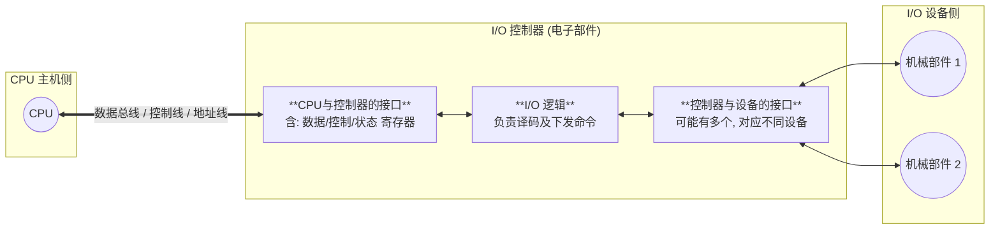

# 操作系统：I/O 控制器

> **导语**
> 各位同学大家好，本节课我们将深入学习设备管理的基础概念——**I/O 控制器（设备控制器）**。
> I/O 设备由机械部件和电子部件组成，而操作系统重点管理的就是其电子部件（即 I/O 控制器）。CPU 无法直接控制机械部件，必须通过 I/O 控制器作为“中介”来实现对设备的控制。掌握 I/O 控制器的功能、组成和编址方式，是理解后续“I/O 控制方式”的基础。

---

## 一、 机械部件与电子部件

I/O 设备通常由两部分组成：

1.  **机械部件**：看得见摸得着的部分（如鼠标的滚轮/按键、显示器的 LED 屏）。主要用于执行具体的 I/O 操作。
2.  **电子部件 (I/O 控制器 / 设备控制器)**：通常是一块印刷电路板（PCB）。CPU 无法直接操作机械部件，必须通过它来**间接控制** I/O 设备的机械部件。

---

## 二、 I/O 控制器的四大主要功能

作为 CPU 与机械部件之间的“中介”，I/O 控制器主要需要完成以下四大功能：

1.  **接收和识别 CPU 发出的命令**：
    - CPU 会发送读/写命令及相关参数（如读写的字节数）。
    - 控制器中设有**控制寄存器**，用于存放 CPU 发来的命令和参数，供后续执行。
2.  **向 CPU 报告设备的状态**：
    - CPU 作为资源管理者，需要了解设备当前是忙碌、空闲还是故障。
    - 控制器中设有**状态寄存器**（如 `1` 表示空闲，`0` 表示忙碌），CPU 可读取该寄存器获取设备状态。
3.  **数据交换**：
    - 作为中间人，控制器内设有**数据寄存器**，用于暂存 CPU 发来的输出数据，或暂存设备发来的输入数据。
    - 实现 CPU 与控制器之间、控制器与设备之间的数据传送。
4.  **地址识别**：
    - 类似于内存编址，I/O 控制器中有多个寄存器（数据、控制、状态寄存器）。为了让 CPU 准确操作对应的寄存器，必须给它们编址。
    - 控制器必须能够识别 CPU 提供的地址，以判断 CPU 想要操作的是哪一个特定的寄存器。

---

## 三、 I/O 控制器的组成结构

I/O 控制器内部结构主要分为三大区块：

1.  **CPU 与控制器的接口**：
    - 主要用于实现 CPU 与控制器之间的通信。
    - 包含数据寄存器、控制寄存器、状态寄存器等。CPU 通过地址线指明操作哪个寄存器，通过控制线发指令，通过数据总线读写数据。
2.  **I/O 逻辑**：
    - 控制器的“大脑”。负责接收并识别 CPU 的命令（地址译码），并将其翻译成具体的设备控制信号，下发给底层机械部件。
3.  **控制器与设备的接口**：
    - 用于实现控制器与物理设备之间的通信。
    - **注意**：一个 I/O 控制器可能会控制多个外部设备，因此它可能具有多个设备接口。

---

## 四、 寄存器的两种编址方式 (核心考点)

由于一个 I/O 控制器内有多个寄存器，且系统中有多个 I/O 控制器，如何对这些寄存器进行编址（分配地址）有两种经典方案：

### 1. 内存映像 I/O (Memory-Mapped I/O)

- **原理**：将 I/O 控制器中的寄存器当作物理内存空间的一部分，即**寄存器地址与内存地址统一编排**。
  - _例如_：内存地址是 `0 ~ N-1`，则控制器的寄存器紧接着从 `N`, `N+1` 开始编址。
- **优点**：**极大地简化了指令系统**。CPU 就像操作普通内存单元一样操作 I/O 寄存器，不需要设置专门的 I/O 指令。

### 2. 寄存器独立编址 (Port-Mapped I/O)

- **原理**：I/O 寄存器的地址空间与内存的地址空间**完全独立**。
  - _例如_：内存地址是 `0 ~ N-1`，I/O 寄存器的地址又是从 `0, 1, 2...` 开始编址的两个独立体系。
- **缺点**：因为地址空间重合，CPU 在下发指令时，必须使用**专门的 I/O 指令**（如 x86 的 `IN`, `OUT` 指令）来明确指出当前操作的是 I/O 寄存器而不是内存，并要指明操作的是哪个控制器的哪个寄存器。

---

## 五、 本节总结归纳

1.  **整体认知**：I/O 设备 = 机械部件 + 电子部件 (I/O 控制器)。OS 只与电子部件（中介）打交道。
2.  **核心功能与寄存档案**：理解**数据**、**控制**、**状态**寄存器的作用，这是支持 I/O 控制器实现命令接收、状态报告和数据交换三大功能的数据基础。
3.  **编址方式对比**（选择题高频）：
    - **内存映像 I/O**：统一编址，无需专门 I/O 指令，编程方便。
    - **独立编址**：独立体系，必须使用专门的硬件 I/O 指令进行特殊访问。
