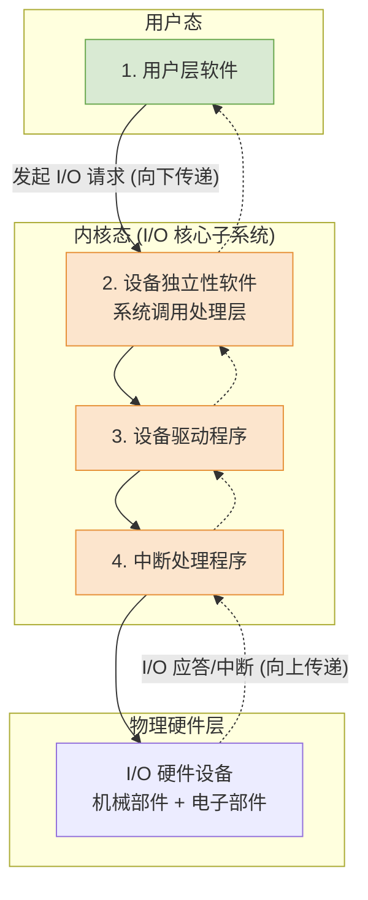

# 操作系统：I/O 软件的层次结构

> **导语**
> 各位同学大家好，本节课我们将深入学习计算机底层极为重要的一个架构体系——**I/O 软件的层次结构**。
> 就像计算机网络分为 TCP/IP 多层模型一样，操作系统的 I/O 系统也是一层一层搭建起来的。每一层使用下层提供的服务，并向上层提供更高级、更易用的接口。本节课我们将从上到下，逐一剖析这四层软件结构各自的核心功能与边界，并梳理 I/O 请求与应答的完整执行流。

---

## 一、 I/O 软件的四层总体架构

操作系统的 I/O 软件从上到下，可以清晰地划分为四个层次。其中，最上层在用户态执行，下面三层在内核态执行（统称为 **I/O 核心子系统**）。

- **向下请求**：当用户程序发起 I/O 请求时，指令流是**自上而下**逐层传递的。
- **向上应答**：当硬件设备完成 I/O 动作后（抛出中断），数据和状态流则是**自下而上**逐层返回的。

---

## 二、 各层核心功能深度剖析

### 1. 用户层软件 (User-Level Software)

作为最贴近用户的一层，它的使命是把底层复杂的 I/O 抽象为傻瓜式的操作。

- **核心功能**：向用户提供一系列易用的**库函数**（如 C 语言的 `printf`, `scanf`，或 Windows API）。
- **动作原理**：当你在代码里写下 `printf("Hello")` 时，用户层软件在底层会将其翻译并封装成等价的 `write` 系统调用，并去敲打操作系统内核的大门（陷入内核态）。

### 2. 设备独立性软件 (Device-Independent Software)

这是内核中最“操心”的管家，又称设备无关性软件。**所有与具体物理硬件细节无关的宏观管理工作，几乎全归它管。**

- **核心功能清单**：
  1.  **向上层提供统一的系统调用接口**（如标准的 `read/write` 接口）。
  2.  **设备的分配与回收**（当多个进程抢打印机时，由它来分配调度）。
  3.  **设备的保护**（根据文件权限，决定某用户是否有权读写该设备）。
  4.  **数据缓冲区管理**（化解高速 CPU 与低速外设的速度矛盾）。
  5.  **逻辑设备名到物理设备名的映射**（查 LUT 表，详见下文拓展）。

> **💡 拓展：逻辑设备表 (LUT - Logical Unit Table)**
> 用户在代码中指定的是**逻辑设备名**（如 `/dev/printer1`），而操作系统底层必须知道它对应哪个**物理设备**。
> 设备独立性软件通过查 **LUT**，不仅能完成名称映射，还能在表项中找到该物理设备对应的**设备驱动程序的入口地址**。
>
> - _单用户系统_：全系统维护一张 LUT。
> - _多用户系统_：为每个用户维护一张独立的 LUT（类似于文件系统的两级目录，允许不同用户使用相同的逻辑设备名）。

### 3. 设备驱动程序 (Device Drivers)

天下设备千奇百怪（不同厂家的打印机，其内部寄存器定义完全不同）。操作系统不可能内置所有硬件的控制代码，这就需要**厂家自己写说明书**——也就是驱动程序。

- **核心地位**：从这一层开始，**直接与硬件打交道**！它深深受制于硬件的具体型号。
- **核心功能**：
  - 接收来自上层（设备独立性软件）的通用指令。
  - 将通用指令翻译成特定硬件能听懂的**具体控制信号**。
  - 直接操作 I/O 控制器内部的各个**数据、控制、状态寄存器**。
- _形态_：由于每个设备的工作特性不同，通常每类设备都对应一个专门的驱动程序（常以独立进程的形式运行在内核中）。

### 4. 中断处理程序 (Interrupt Handlers)

这是最底层、最贴近硬件响应的软件。

- **核心功能**：当 I/O 硬件干完活（如读完一个字符），会向 CPU 发送电信号触发中断。中断处理程序立刻接管 CPU：
  1.  保存当前进程的 CPU 现场环境。
  2.  从 I/O 控制器的状态寄存器中读取设备状态，判断 I/O 是正常结束还是发生了硬件故障。
  3.  如果正常，就将数据从控制器的寄存器搬运到内存缓冲区。
  4.  将数据向上抛给驱动程序和独立性软件处理，最后唤醒被阻塞的用户进程。

---

## 三、 本节总结与应试指南

在操作系统的考试中，本节主要以**选择题**的形式出现。请务必牢记以下几点通关秘籍：

1.  **次序题必秒**：牢记 I/O 请求的下发顺序（**用户层 $\rightarrow$ 独立性 $\rightarrow$ 驱动 $\rightarrow$ 中断 $\rightarrow$ 硬件**）和 I/O 响应的上传顺序（反向）。
2.  **打交道边界**：谁会直接操纵硬件寄存器？**只有【设备驱动程序】和【中断处理程序】**！设备独立性软件及以上的层次，绝对不会碰硬件细节。
3.  **甩锅大法定归属**：做题时判断某个功能属于哪一层，问自己一个问题——_“这个功能换一台别的厂牌的打印机，还需要改代码吗？”_
    - **不需要改**（如：权限保护、分配回收、系统调用接口）：属于**设备独立性软件**。
    - **必须得改**（如：设置寄存器、读设备状态）：属于**设备驱动程序**或**中断处理程序**。
