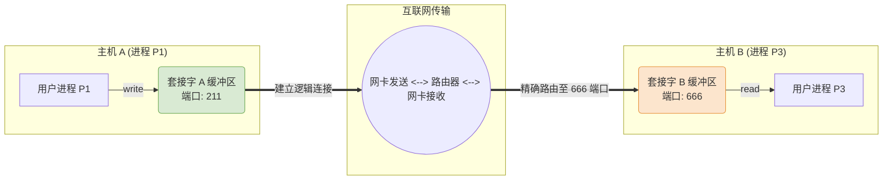

# 操作系统：I/O 接口与阻塞模型

> **导语**
> 各位同学大家好，本节课我们将学习设备管理章节中的两个核心考点：**输入/输出 (I/O) 应用程序接口** 和 **设备驱动程序接口**。
> I/O 设备种类繁多，操作系统如何向上层提供统一易用的编程接口，同时又向下包容各厂家的奇葩硬件？此外，应用程序在发起 I/O 请求时，是必须死等还是可以转头干别的事？理解这些接口设计哲学和阻塞机制，是掌握现代操作系统 I/O 体系的关键。

---

## 一、 输入/输出 (I/O) 应用程序接口

在“设备独立性软件”这一层，操作系统需要向上层的应用程序提供系统调用接口。由于设备的物理特性差异巨大，无法用一套统一的函数（比如都用 `read`带个地址参数）来搞定所有设备。因此，操作系统根据设备的特性，提供了三大类标准接口。

### 1. 字符设备接口

- **适用对象**：键盘、鼠标、打印机等无结构、不可寻址的设备。
- **特性**：数据的传输以**字符**为单位。没有地址概念，因此接口中不需要提供读写的物理地址或偏移量。
- **标准接口**：
  - `get(x)`：从字符设备中读取一个字符并存入变量 `x`。
  - `put(x)`：将变量 `x` 中的一个字符输出到字符设备。

### 2. 块设备接口

- **适用对象**：磁盘、U 盘等有结构、可寻址的设备。
- **特性**：数据的传输以**块（或连续的多个字节）**为单位。由于设备可寻址，操作时**必须指明操作的具体位置**。
- **标准接口**：
  - `seek(offset)`：移动设备的读写指针到指定的物理/逻辑位置。
  - `read/write`：在指针当前位置，读/写指定长度的连续数据块。

### 3. 网络设备接口 (网络套接字接口 - Socket)

网络设备（网卡）非常特殊，它需要处理来自互联网的复杂数据包，并且要将这些数据包精确地分发给同一台主机上的不同进程（比如微信的数据给微信，支付宝的数据给支付宝）。为此，操作系统引入了 **Socket (套接字)** 机制。

#### Socket 通信核心流程：

1.  **创建套接字**：调用 `socket()`。这相当于在操作系统内核中申请了一块专门用于网络通信的缓冲区。系统返回一个套接字描述符（指针）。
2.  **绑定端口**：调用 `bind()`。将这个套接字与本机的某一个端口号（如 666）绑定。
    - _作用_：当网卡收到海量数据包时，可以通过数据包头部的“目标端口号”，将其精准投递到对应进程的套接字缓冲区中。
3.  **建立连接**：调用 `connect()`。将本机的套接字与远程主机的 `[IP地址 : 端口号]` 建立逻辑连接（如 TCP 连接）。
4.  **读写数据**：调用常规的 `read()` 和 `write()`。
    - **写数据**：应用程序将数据 `write` 给套接字描述符 $\rightarrow$ OS 将数据复制到内核套接字缓冲区 $\rightarrow$ 网卡驱动将数据发送到网络。
    - **读数据**：网卡收到数据引发中断 $\rightarrow$ OS 将数据放入指定端口的套接字缓冲区 $\rightarrow$ 应用程序通过 `read` 从缓冲区取走数据。

---

## 二、 阻塞 I/O 与 非阻塞 I/O

当用户进程发起上述的 I/O 系统调用时，根据系统调用返回的时机，分为两种模式：

### 1. 阻塞 I/O (Blocking I/O)

- **机制**：应用程序发出 I/O 系统调用后，会被操作系统剥夺 CPU 执行权，状态转为**阻塞态 (Blocked)**。直到 I/O 操作（如敲击键盘、读取磁盘数据）**彻底物理完成**，该进程才会被唤醒并恢复执行。
- **例子**：C 语言中的 `scanf()`。只要你不敲键盘输入回车，程序就死死卡在那里，无法执行下一行代码。

### 2. 非阻塞 I/O (Non-blocking I/O)

- **机制**：应用程序发出 I/O 系统调用后，系统调用会**迅速返回**，进程无需转入阻塞态，可以立刻继续执行后续代码。真正的物理 I/O 操作由操作系统在后台异步完成。
- **例子 (以写磁盘为例)**：进程调用 `write` 写入 10MB 数据到磁盘。虽然磁盘当前正在满负荷运转，但操作系统**会瞬间把这 10MB 数据复制到操作系统的“内核缓冲区”中**。数据一旦进了内核缓冲区，系统调用就立即返回给用户进程。至于内核什么时候把这 10MB 真正写进物理磁盘，用户进程根本不关心，也不需要等待。

---

## 三、 设备驱动程序接口 (向下包容)

在“设备独立性软件”之下，是直接操控硬件的“设备驱动程序”。

- **痛点**：世界上有成千上万种硬件设备（如罗技的鼠标、惠普的打印机）。如果罗技的读取函数叫 `read(a,b)`，惠普的叫 `read_hp(x,y,z)`，操作系统内核根本无法统一调用。难道每增加一种硬件，就要修改操作系统的内核代码吗？
- **解决方案 (统一标准)**：
  操作系统定义了一套**严格的设备驱动程序接口标准**。操作系统对所有硬件厂商说：“你想让你的硬件在我的系统上运行，你编写的驱动程序就必须严格按照我规定的函数名和参数格式来写（比如全都叫 `read`，全都带 3 个参数）！”
- **现实意义**：这也是为什么你在官网下载驱动时，必须严格区分 Windows 版驱动和 macOS 版驱动。因为**不同的操作系统，对驱动程序接口的规范标准是完全不同的**。厂商必须为各个系统单独按照其标准定制驱动。

---

## 四、 本节核心知识总结

| 考点             | 核心机制与作用                                                             | 典型代表 / 例子                      |
| :--------------- | :------------------------------------------------------------------------- | :----------------------------------- |
| **字符设备接口** | 提供面向字符的读写，**无地址参数**                                         | `get()`, `put()`                     |
| **块设备接口**   | 提供面向块的读写，**必须提供地址/指针偏移参数**                            | `seek()`, `read()`, `write()`        |
| **网络设备接口** | 通过 **Socket + [IP:端口]** 实现网络数据包的精准路由与点对点通信           | `socket()`, `bind()`, `connect()`    |
| **阻塞 I/O**     | 发起 I/O 后进程进入**阻塞态**，死等 I/O 物理完成                           | `scanf()` 等待用户键盘输入           |
| **非阻塞 I/O**   | 数据移交内核缓冲区后**瞬间返回**，进程继续执行，由内核后台处理硬件 I/O     | 高并发网络写操作，异步写入磁盘       |
| **驱动程序接口** | **操作系统要求厂家必须遵循的标准**，屏蔽底层厂商差异，避免修改系统内核代码 | Windows 驱动、macOS 驱动必须分开开发 |
