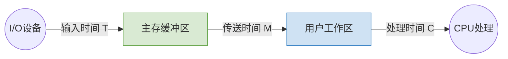
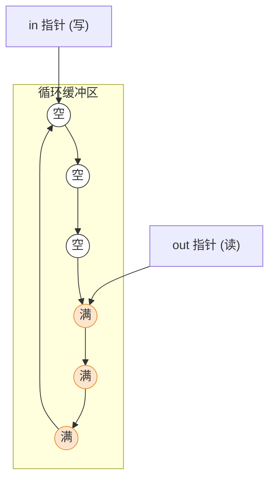
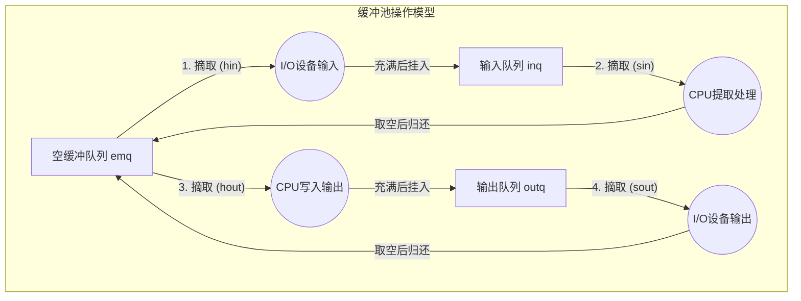

# 操作系统：缓冲区管理 (Buffer Management)

> **导语**
> 各位同学大家好，本节课我们将深入学习操作系统设备管理中的一个极其重要的机制——**缓冲区管理**。
> 我们将首先探讨什么是缓冲区以及它的核心作用，随后重点剖析考研中最高频的计算考点：**单缓冲**与**双缓冲**的时间计算。最后，我们将了解应对更复杂场景的**循环缓冲区**与**缓冲池**技术。

---

## 一、 缓冲区的基本概念与作用

### 1. 什么是缓冲区？

缓冲区是一个用于暂存数据的**存储区域**。

- **硬件实现**：由专门的硬件寄存器组成（如联想寄存器/快表）。成本高、容量小、速度极快，常用于对速度要求极其苛刻的场景。
- **软件实现（内存）**：在内存中开辟一块空间作为缓冲区。这是设备独立性软件层进行缓冲区管理的主要对象，也是本节课探讨的重点。

### 2. 缓冲区的四大核心作用 (⭐简答/选择题考点)

1.  **缓和 CPU 与 I/O 设备之间速度不匹配的矛盾**：CPU 速度极快，可瞬间填满/取空缓冲区；I/O 设备速度慢，可以慢慢从缓冲区取走/放入数据。
2.  **减少对 CPU 的中断频率，放宽对 CPU 中断响应时间的限制**：如果没有缓冲区，字符设备每输入/输出一个字符就会触发一次中断；有了缓冲区，只需在缓冲区满或空时才触发一次中断，大幅解放 CPU。
3.  **解决数据粒度不匹配的问题**：例如，输出进程每次生成一整“块”数据，而 I/O 设备每次只能处理一“个”字符。缓冲区可以完美桥接这种数据单位大小的差异。
4.  **提高 CPU 与 I/O 设备之间的并行性**。

---

## 二、 单缓冲 (Single Buffer)

**核心规则**：

- 当缓冲区**非空**时，**不能**往里冲入数据，只能传出数据。
- 当缓冲区**为空**时，**可以**往里冲入数据，但**必须充满后**才能传出数据。

### 1. 工作流程与时间参数

假设系统为用户进程分配了一个与“块”大小相等的缓冲区。处理一块数据包含以下三个时间段：

- **$T$**：设备将一块数据输入到缓冲区的时间。
- **$M$**：将缓冲区中的数据传送到用户进程工作区的时间。
- **$C$**：CPU 处理这块数据的时间。

### 2. 核心考点：处理一块数据的平均时间

**解题技巧**：假定一个初始状态（通常为：**工作区满，缓冲区空**），分析下一次再次回到该状态所需的时间。

- **情况 1：$T > C$ (输入慢，处理快)**
  - CPU 处理完工作区数据 ($C$) 时，设备还没把缓冲区填满 ($T$)。必须等设备填满缓冲区后，才能进行传送 ($M$)。
  - **耗时**：$T + M$
- **情况 2：$T < C$ (输入快，处理慢)**
  - 设备填满缓冲区 ($T$) 时，CPU 还没处理完上一块数据 ($C$)。必须等 CPU 处理完后，才能进行传送 ($M$)。
  - **耗时**：$C + M$

> **🔥 结论速记**：单缓冲处理一块数据的平均时间为 **$\max(C, T) + M$**

---

## 三、 双缓冲 (Double Buffer)

系统为进程分配**两个**大小为一个数据块的缓冲区。

### 1. 核心考点：处理一块数据的平均时间

**初始状态设定**：工作区空，缓冲区1满，缓冲区2空。

- **情况 1：$T > C + M$ (设备输入极慢)**
  - CPU 传送并处理完数据 ($M + C$) 时，设备连一个缓冲区都还没填满。整个系统的瓶颈在设备输入。
  - **耗时**：$T$
- **情况 2：$T < C + M$ (设备输入快，CPU 处理慢)**
  - 设备填满缓冲区2 ($T$) 时，CPU 还在传送或处理上一个缓冲区的数据。系统的瓶颈在 CPU。
  - **耗时**：$C + M$

> **🔥 结论速记**：双缓冲处理一块数据的平均时间为 **$\max(T, C + M)$**

### 2. 双缓冲在机器通信中的应用

- **单缓冲通信**：在任一时刻只能实现数据的**单向传输**（半双工）。因为缓冲区一旦在发送数据，就不能接收数据。
- **双缓冲通信**：可以实现同一时刻的**双向传输**（全双工）。为两台机器各配置两个缓冲区（一个专用于发送，一个专用于接收）即可。

---

## 四、 循环缓冲区 (Circular Buffer)

当两个缓冲区依然无法满足速度差异时，可以分配多个缓冲区并链成一个环形队列。

- **结构**：由多个大小相等的缓冲区连接成一个循环队列。
- **指针管理**：
  - **`in` 指针**：指向下一个可以**冲入**数据（供设备写入）的**空缓冲区**。
  - **`out` 指针**：指向下一个可以**取出**数据（供 CPU 读取）的**满缓冲区**。

---

## 五、 缓冲池 (Buffer Pool)

为了提高缓冲区的利用率，将系统中所有的缓冲区统一管理起来，形成缓冲池。

### 1. 组成结构 (3 个队列)

根据缓冲区的使用状态，缓冲池中的缓冲区被组织成三个队列：

1.  **空缓冲队列 (`emq`)**：挂满空缓冲区的队列。
2.  **输入队列 (`inq`)**：挂满**已装入输入数据**的缓冲区队列。
3.  **输出队列 (`outq`)**：挂满**已装入输出数据**的缓冲区队列。

### 2. 四种工作缓冲区及操作流程

根据实际运算中扮演的功能，又抽象出四种“工作缓冲区”（本质上是从上述队列中摘下节点进行操作的过程）：

- **收容输入 (hin)**：从 `emq` 摘下一个空缓冲区 $\rightarrow$ 设备将数据输入其中 $\rightarrow$ 充满后挂入 `inq` 队尾。
- **提取输入 (sin)**：从 `inq` 摘下一个满缓冲区 $\rightarrow$ CPU 将数据取走工作区 $\rightarrow$ 取空后挂入 `emq` 队尾。
- **收容输出 (hout)**：从 `emq` 摘下一个空缓冲区 $\rightarrow$ CPU 将输出数据写入其中 $\rightarrow$ 充满后挂入 `outq` 队尾。
- **提取输出 (sout)**：从 `outq` 摘下一个满缓冲区 $\rightarrow$ 设备将数据取走输出 $\rightarrow$ 取空后挂入 `emq` 队尾。

---

## 六、 本节总结与复习建议

1.  **选择题核心考点**：务必熟记并理解**单缓冲 ($\max(C, T) + M$)** 和 **双缓冲 ($\max(T, C+M)$)** 的平均耗时公式，考试时大概率会直接代入具体数字（如 $T=10, M=2, C=5$）进行计算。
2.  **概念辨析**：理解缓冲区与快表（硬件寄存器）的区别；理解双缓冲相比单缓冲在全双工通信中的不可替代性。
3.  **循环缓冲与缓冲池**：无需死记硬背枯燥的名词，重在**理解其流转原理**（如缓冲池中节点是如何在 `emq`, `inq`, `outq` 之间循环流动，被 CPU 和外设交替消费的）。
