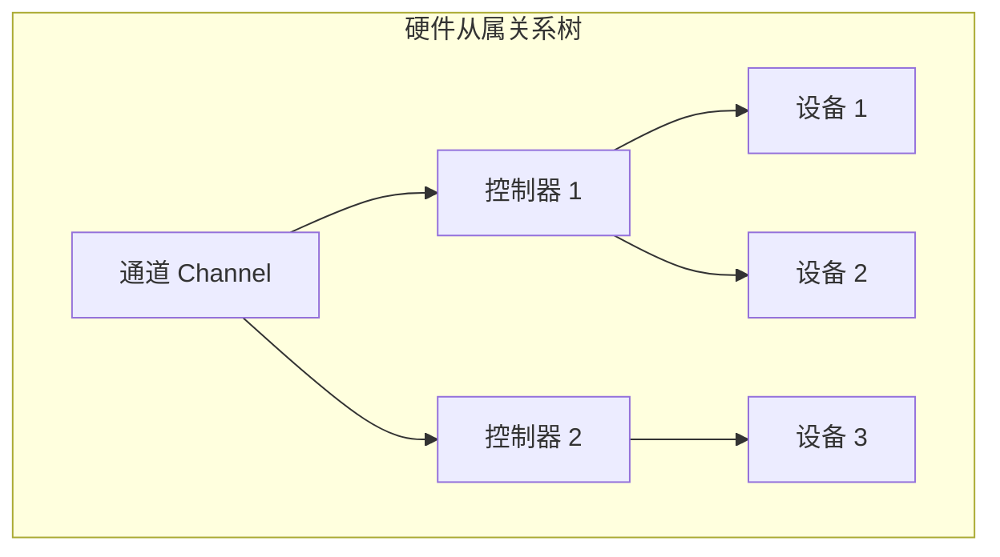
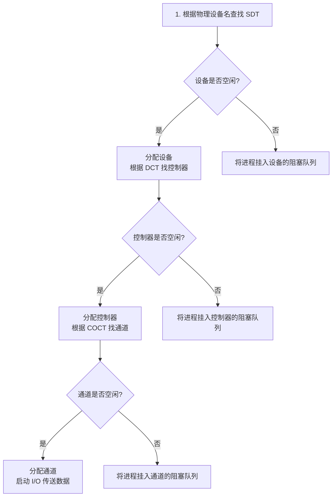

# 操作系统：设备的分配与回收

> **导语**
> 各位同学大家好，本节课我们将深入学习设备管理中的重要环节——**设备的分配与回收**。
> 操作系统在将底层硬件设备分配给进程时，需要考虑设备的物理属性、分配算法以及系统的安全性。本节课我们将从分配时应考虑的因素入手，详细剖析操作系统用于管理设备资源的四大核心数据结构，并推演设备分配的具体步骤及基于逻辑设备名的改进方案。

---

## 一、 设备分配时应考虑的因素

在进行设备分配时，操作系统主要从以下三个维度进行考量：

### 1. 设备的固有属性

根据设备在同一时间段内支持的使用方式，设备可分为三类：

- **独占设备**：一个时间段内只能分配给一个进程使用（如：打印机）。
- **共享设备**：可同时分配给多个进程使用，宏观上同时共享，微观上交替使用（如：磁盘）。
- **虚拟设备**：通过 SPOOLing 技术将独占设备改造成共享设备，使其可同时分配给多个进程使用。

### 2. 设备分配算法

类似于进程调度，设备分配也需要公平和效率。常见的分配算法包括：

- 先来先服务 (FCFS)
- 优先级高者优先
- 短任务优先等

### 3. 设备分配的安全性

设备分配的安全性决定了系统是否会发生死锁。主要分为两种分配方式：

| 分配方式           | 工作机制                                                                                               | 优点                                          | 缺点                                                         |
| :----------------- | :----------------------------------------------------------------------------------------------------- | :-------------------------------------------- | :----------------------------------------------------------- |
| **安全分配方式**   | 为进程分配设备后，**立刻将该进程阻塞**，直到设备完成 I/O 并释放后才唤醒进程。                          | 破坏了“请求和保持”条件，**绝不会发生死锁**。  | CPU 和 I/O 设备只能**串行工作**，资源利用率和执行效率极低。  |
| **不安全分配方式** | 进程发出 I/O 请求并获得设备后，**不被阻塞**，继续向下执行。只有当某个新的 I/O 请求得不到满足时才阻塞。 | 进程的计算与 I/O 任务**并行执行**，效率极高。 | 有可能会发生死锁。通常需要结合**银行家算法**来进行死锁避免。 |

---

## 二、 静态分配与动态分配

| 分配类型     | 机制说明                                                                   | 死锁风险                             |
| :----------- | :------------------------------------------------------------------------- | :----------------------------------- |
| **静态分配** | 进程在**运行前**，一次性申请并获得它所需的全部资源。直到运行结束后才归还。 | 无死锁风险（破坏了“请求和保持”条件） |
| **动态分配** | 进程在**运行过程中**，根据需要动态地申请设备资源。                         | 效率高，但存在死锁风险               |

---

## 三、 设备分配管理中的数据结构

为了管理设备，操作系统内部维护了一套自上而下的树形数据结构。
一个通道可以控制多个控制器，一个控制器可以控制多个设备。

为了映射上述硬件关系，操作系统配置了四张核心控制表：

### 1. 设备控制表 (DCT - Device Control Table)

**每个设备一张**，记录该设备的具体使用情况。核心字段包括：

- **设备类型**（如打印机、扫描仪）与 **设备标识符**（物理设备名唯一 ID）。
- **设备状态**（忙碌 / 空闲 / 故障）。
- **指向控制器表的指针**：用于反向找到该设备从属的控制器。
- **重复执行次数/时间**：设备发生错误时的重试容错机制。
- **设备队列的队首指针**：指向正在排队等待使用该设备的进程阻塞队列。

### 2. 控制器控制表 (COCT - Controller Control Table)

**每个设备控制器一张**。核心字段包括：

- **控制器标识符**与**状态**（忙/闲）。
- **指向通道表的指针**：用于反向找到该控制器从属的通道。
- **等待队列指针**：指向排队等待该控制器的进程队列。

### 3. 通道控制表 (CHCT - Channel Control Table)

**每个通道一张**。核心字段包括：

- **通道标识符**与**状态**。
- **与通道连接的控制器表指针**：指向该通道下属的所有 COCT 集合。
- **等待队列指针**：指向排队等待该通道的进程队列。

### 4. 系统设备表 (SDT - System Device Table)

**整个系统只有一张**，记录系统中**全部设备**的情况。

- 表中的每一个表目对应一个具体的物理设备。
- 包含：设备类型、设备标识符、**对应的 DCT 指针**、**设备驱动程序的入口地址**。

---

## 四、 设备分配的具体步骤

设备分配必须严格按照层级“通关”，只有**设备、控制器、通道**三者都分配成功，一次设备分配才算彻底完成。

### 1. 基于“物理设备名”的初始分配步骤

**传统物理设备名分配的缺点**：

1.  **用户编程极不方便**：代码中直接写死了物理设备名（如 `打印机A`），一旦该硬件损坏更换，用户代码将直接报废。
2.  **资源利用率极低**：如果请求的 `打印机A` 正在忙碌，即使旁边有完全相同的空闲 `打印机B`，进程也只能傻等，无法灵活调配。

### 2. 改进：基于“逻辑设备名”的分配机制

为了解决上述缺点，操作系统引入了**逻辑设备表 (LUT - Logical Unit Table)**。

- **逻辑设备名**：用户编程时只指定设备的**类型**（如“我要一台打印机”），而不指定具体哪一台。
- **分配流程改进**：
  1.  用户提供逻辑设备名发起请求。
  2.  操作系统在 **SDT** 中查找该“类型”的所有设备，挑出一台处于“空闲”状态的物理设备分配给进程。
  3.  分配成功后，操作系统在 **LUT** 中新增一个表项，记录 `[逻辑设备名 -> 物理设备名]` 的映射关系，并记录驱动程序入口地址。
  4.  后续分配控制器和通道的步骤与之前相同。
- **LUT 的管理方式**：
  - **单用户系统**：全系统设置一张 LUT，逻辑设备名不允许重复。
  - **多用户系统**：**每个用户各设置一张 LUT**（类似两级文件目录），不同用户可以使用相同的逻辑设备名，且能映射到不同的物理设备上。

---

## 五、 本节总结与复习指南

- **安全 vs 不安全分配**：深刻理解安全性与死锁的关系，不安全分配虽然效率高，但需配合“银行家算法”使用。
- **四大数据结构联动**：闭上眼睛要在脑海中画出 `SDT -> DCT -> COCT -> CHCT` 的顺藤摸瓜检索链条。
- **LUT 表的作用**：这是考研的高频选择题点。理解使用“逻辑设备名”如何极大提升代码的可移植性和系统硬件资源的利用率，并注意单用户与多用户 LUT 结构的差异。
