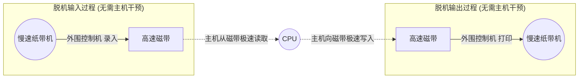

# 操作系统：假脱机技术 (SPOOLing)

> **导语**
> 各位同学大家好，本节课我们将学习设备管理中一个非常经典且极具应用价值的技术——**假脱机技术 (SPOOLing)**。
> 在早期计算机中，CPU 需要直接面对速度极其缓慢的纸带机进行数据读写，导致 CPU 大量时间被浪费。为了解决这种严重的速度矛盾，人们先是发明了“脱机技术”（靠外加硬件解决），随后又在现代操作系统中演化出了纯软件实现的“假脱机技术”。本节课我们将深入剖析它的原理，并以“共享打印机”为例，看它是如何将独占设备“变身”为共享设备的。

---

## 一、 脱机技术：SPOOLing 的前身与历史背景

在没有操作系统的纯手工阶段，程序和数据是通过**纸带机**输入到计算机的。

- **矛盾**：CPU 的处理速度极快，而纸带机的机械输入/输出速度极慢。CPU 在读取输入和写出结果时，必须“迁就”纸带机的龟速，导致极其昂贵的 CPU 资源被严重浪费（**CPU 与 I/O 速度极度不匹配**）。
- **破局：引入脱机技术**
  为了缓解这一矛盾，人们在主机和低速纸带机之间，加入了两样硬件：**外围控制机** 和 **快速的磁带**。

- **什么是“脱机”？**
  “脱机”即**脱离主机的控制**。在进行慢速的纸带录入和纸带打印时，这部分工作完全由独立的“外围控制机”负责。CPU（主机）只和高速的“磁带”进行数据交换。
- **好处**：
  1.  缓解了 CPU 与低速 I/O 设备的速度矛盾。
  2.  实现了**预输入**（即使 CPU 忙，也可以先把数据录入磁带备用）和**缓输出**（即使纸带机忙，CPU 也可以先把结果扔进磁带，然后转头去干别的）。

---

## 二、 假脱机技术 (SPOOLing) 的工作原理

“假脱机”技术，本质上就是**用软件的方式，来模拟实现刚才提到的“脱机技术”中的硬件部件**。

SPOOLing 系统的三大核心组成部分如下（需与脱机技术一一对应）：

### 1. 输入井和输出井 (模拟：磁带)

操作系统在**磁盘**上开辟出两块巨大的存储区域：

- **输入井**：模拟脱机输入时的磁带。用于收容从输入设备发来的数据。
- **输出井**：模拟脱机输出时的磁带。用于收容用户进程准备要输出的数据。

### 2. 输入进程和输出进程 (模拟：外围控制机)

这是 SPOOLing 系统中专门负责控制数据搬运的**软件进程**（这要求操作系统必须支持多道程序技术）：

- **输入进程**：模拟输入时的外围控制机。它在后台默默地将外部输入设备的数据，搬运存放到磁盘的“输入井”中。
- **输出进程**：模拟输出时的外围控制机。它在后台默默地从磁盘的“输出井”中取出数据，并发送给外部输出设备。

### 3. 输入缓冲区和输出缓冲区 (数据中转站)

在**内存**中开辟的两块空间，作为数据在设备和磁盘井之间流转的临时中转站。

- _数据流向 (输入)_：输入设备 $\rightarrow$ 内存输入缓冲区 $\rightarrow$ 磁盘输入井。
- _数据流向 (输出)_：磁盘输出井 $\rightarrow$ 内存输出缓冲区 $\rightarrow$ 输出设备。

---

## 三、 SPOOLing 技术的巅峰应用：共享打印机

打印机是一个典型的**独占式设备**（一段时间内只能允许一个进程使用，否则打印出来的内容会相互穿插、完全错乱）。但我们在实际办公中，多个同事可以同时点击“打印”，电脑并不会因此死机或报错，而是会自动排队。这是如何做到的呢？

**答案：通过 SPOOLing 技术，将物理上的“独占设备”改造成了逻辑上的“共享设备”。**

### 打印机共享的核心流程：

当多个用户进程同时请求打印机服务时，系统并不会直接把物理打印机分配给他们，而是由**假脱机管理进程**在后台默默地执行以下两个操作：

1.  **分配输出井与保存数据 (假装分配设备)**
    管理进程在磁盘的**输出井**中为该用户申请一块空闲空间，并将该用户要打印的全部数据，先塞进这块磁盘缓冲区里。
    _(从用户的视角看，数据已经成功“输出”给打印机了，因此用户进程觉得它已经独占使用了打印机，可以立刻转头去干别的代码任务了！)_
2.  **生成打印任务清单并排队**
    管理进程为该用户生成一张**空白的打印请求表**（里面记录了刚刚存放数据的输出井物理地址、文件大小等信息），并将这张请求表挂到系统的**脱机文件队列（打印任务排队队列）**的队尾。

### 后台输出进程默默打工：

真正的**输出进程**此时像一个不知疲倦的工人。只要物理打印机处于空闲状态，它就会从脱机文件队列的**队头**摘下一个打印请求表，顺着表里记录的地址去磁盘输出井把数据拿出来，真正发送给打印机进行机械打印。打印完毕后，再处理队列里的下一个任务。

---

## 四、 本节要点归纳与复习建议

- **概念映射 (必背)**：
  - SPOOLing 中的**输入井/输出井**，是在**磁盘**上开辟的，用于模拟脱机技术中的**磁带**。
  - SPOOLing 中的**输入/输出进程**，用于模拟脱机技术中的**外围控制机**。
- **核心功能与意义**：
  - 实现了设备的**预输入**与**缓输出**，极大缓解了 CPU 与 I/O 速度不匹配的矛盾。
  - 实现了将**独占式设备（如打印机）虚拟改造为共享设备**。每个进程都觉得自己在独占设备，因为系统为每个进程在磁盘上分配了一个虚拟的“逻辑设备”。

> **学习感悟**：SPOOLing 技术的本质就是一种高级的**缓冲+排队**机制。它就像去热门餐厅吃饭，虽然里面（打印机）只有一张桌子（独占），但门口的迎宾小姐（管理进程）会先给你发个排队号（打印请求表），让你觉得已经被餐厅接待了，你可以去旁边逛街（进程继续执行），等轮到你了，系统自然会把你点好的菜（输出井数据）送上桌。
