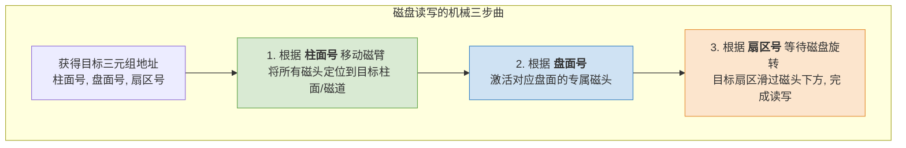

# 操作系统：磁盘的结构

> **导语**
> 各位同学大家好，本节课我们将深入学习设备管理中非常核心的存储设备——**磁盘的结构**。
> 我们将从磁盘最基础的物理构造（磁道、扇区）讲起，探究磁盘如何通过机械运动进行数据的读写；进而引入“盘面”与“柱面”的概念，推导出操作系统中极其重要的**磁盘物理地址结构（三元组）**；最后我们将简单了解磁盘的几种常见分类。掌握这些基础物理结构，是后续学习“磁盘调度算法”的前提。

---

## 一、 磁盘、磁道与扇区

磁盘的表面涂有磁性物质，计算机正是利用这些磁性物质的磁极方向来记录二进制数据。如果我们把硬盘拆开，会看到其内部核心的机械结构。

### 1. 核心物理部件

- **盘片 (Platter)**：磁盘中圆圆的盘片，用于记录数据。
- **磁头 (Head)**：用于读取或写入盘片上的二进制数据。
- **磁头臂 / 磁臂 (Actuator Arm)**：带动磁头在盘片上径向（向里或向外）移动。
- **马达 (Spindle Motor)**：位于磁盘主轴中心，转动时带动整个盘片高速旋转。

### 2. 磁道 (Track)

- **概念**：盘片表面被划分成一个个同心圆，每一个同心圆就是一个**磁道**。
- _注_：实际磁盘中，一个盘面上会有成千上万条磁道。

### 3. 扇区 (Sector)

- **概念**：每一个磁道又被像切披萨一样，划分成一个个的**扇区**。
- **特性**：
  - **一个扇区就是一个“磁盘块”**。每次读写的最小单位就是扇区（例如每个扇区容量规定为 $1\text{KB}$）。
  - **容量均等**：无论在内圈还是外圈，每个扇区存放的**数据量都是完全相同**的。
  - **【考点】数据密度差异**：由于最内侧的扇区物理面积（弧长）最小，但存储的数据量又与其他扇区相同，因此**最内侧扇区的数据密度是最大的**。

---

## 二、 读写数据的基本原理

要在磁盘中读写某个扇区的数据，需要磁臂和马达两者的机械配合：

1.  **寻道（找磁道）**：通过**磁头臂**的伸缩移动，带动磁头，将其精准定位到目标扇区所在的**特定磁道**上。
2.  **旋转（找扇区）**：**马达**带动磁盘高速旋转。当目标扇区随着盘片的转动**刚好滑过磁头下方**时，磁头即可完成数据的读取或写入。

---

## 三、 盘面、柱面与物理地址结构 (核心重点)

实际的硬盘通常是由**多个盘片叠放在一起**组成的，这就引入了空间立体的概念。

### 1. 盘面 (Surface) 与磁头联动机制

- **盘面编号**：一个盘片可以有两个面（正面和背面），每个面称为一个**盘面**（如：0号盘面、1号盘面...）。
- **专属磁头**：**每一个盘面都会配备一个专属的磁头**。
- **【考点】共进退原则**：所有的磁头都是固定在同一个磁头臂组件上的！这意味着，**当磁头臂移动时，所有盘面的磁头只能“同进同退”**，指向各自盘面上相同半径的磁道。

### 2. 柱面 (Cylinder)

- **概念**：在所有盘面中，**相对位置相同（半径相同）的磁道**，在立体空间上组合起来，就像一个圆柱形的侧面，这就构成了**柱面**。

### 3. 磁盘的物理地址结构 (三元组)

基于上述立体结构，操作系统要精准定位磁盘上的任何一个数据块（扇区），就需要提供一个由三个坐标构成的**物理地址（三元组）**：
$$ \text{物理地址} = (\text{柱面号}, \text{盘面号}, \text{扇区号}) $$
_(注：文件管理中提到的“物理块号”，底层最终都会被转换为这种三元组地址)_

---

## 四、 磁盘的分类

根据机械结构的不同，磁盘可进行如下分类：

### 1. 按“磁头是否可移动”分类 (易考选择题)

- **活动头磁盘 (Moving-head Disk)**：
  - **特点**：每个盘面只有一个磁头。必须依靠磁臂的伸缩来移动磁头定位磁道。
  - _这就是我们日常最常见的机械硬盘结构。_
- **固定头磁盘 (Fixed-head Disk)**：
  - **特点**：磁头不可移动！它的做法是“大力出奇迹”——**给每一个磁道都单独配备一个专用的磁头**。
  - **优势**：读取时无需磁臂机械移动，只需电子**激活**目标磁道对应的那个磁头即可，寻道速度极快。

### 2. 按“盘片是否可更换”分类

- **可换盘磁盘**：盘片可以从驱动器中取出和更换。
- **固定盘磁盘**：盘片永久密封固定在磁盘驱动器内部，不可更换。

---

## 五、 本节总结与复习建议

1.  **物理基础强化**：深刻理解“最内圈数据密度最大”、“所有磁头共进退”的机械特性。
2.  **核心三步曲**：必须倒背如流磁盘的物理地址三元组 **(柱面号, 盘面号, 扇区号)**，并清楚它们分别对应哪种机械动作（柱面找磁道需伸缩磁臂、盘面选磁头、扇区靠旋转）。这决定了后续计算磁盘寻道时间、旋转延迟的逻辑顺序。
3.  **分类小坑**：选择题若问“是否每个磁道都有一个磁头”，请立刻反应出这是在考察**固定头磁盘**的特性。
