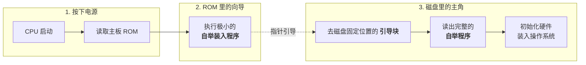

# 操作系统：磁盘管理基础

> **导语**
> 各位同学大家好，本节课我们将学习设备管理中几个简单但常考的基础概念，主要围绕**磁盘管理**展开。
> 一块刚出厂的裸磁盘是如何一步步变成我们熟悉的系统盘的？计算机开机时是如何找到操作系统的？磁盘如果出现物理损坏，系统又是如何处理的？本节课我们将解答这三个问题，分别对应：**磁盘初始化**、**引导块**和**坏块管理**。

---

## 一、 磁盘初始化的三个步骤 (核心考点)

一块刚被制造出来的磁盘，只划分了物理的磁道，还不能直接存储文件。它必须严格经历以下三个步骤，才能投入使用：

### 1. 低级格式化 (物理格式化)

这是在磁盘**出厂前**由底层进行的物理级划分。

- **核心任务**：将空白的磁道划分出一个个的**扇区**。
- **扇区的内部结构**：一个扇区并非全是用来存数据的。它被分为：
  - **头 (Header)**：存放扇区管理所需的元数据，如扇区号、校验码。
  - **数据区域 (Data Area)**：真正用于存放数据的区域（通常固定为 512 字节）。
  - **尾 (Trailer)**：存放错误校验码（ECC）或用于链接分配的指针信息（这样链接指针就不占用数据区了）。

### 2. 磁盘分区 (Partitioning)

在我们**安装操作系统前**，需要对物理磁盘进行逻辑切分。

- **核心任务**：将一整个物理磁盘划分为多个独立的逻辑分区（即我们熟悉的 C盘、D盘、E盘）。每个分区由若干个相邻的柱面组成。

### 3. 逻辑格式化 (高级格式化)

这是操作系统层面的格式化，为每个分区建立管理体系。

- **核心任务**：
  1.  **创建文件系统**：如创建文件系统的根目录。
  2.  **初始化存储空间管理数据结构**：建立我们在上一节学过的空闲链表、位示图、FAT 表或超级块等数据结构。

> **记忆口诀**：低级分扇区 $\rightarrow$ 中级划逻辑盘 $\rightarrow$ 高级建文件系统。

---

## 二、 引导块 (Boot Block) 与计算机启动流程

当你按下电脑的电源键，计算机是如何从一块“毫无生机”的硅板，一步步把庞大的操作系统跑起来的？

### 1. 传统方案的痛点：自举程序全放 ROM

- 开机时，CPU 会去执行一段叫做**自举程序 (Bootstrap Program)** 的初始化代码（负责初始化 CPU、寄存器等硬件，并把操作系统装入内存）。
- 传统方案将完整的自举程序固化在主板的 **ROM（只读存储器）**中。
- **痛点**：ROM 的数据出厂即固化，无法更改。但自举程序比较复杂，难免有 Bug 或需要升级。一旦需要更新，就得把主板上的物理芯片拆下来换掉，极其麻烦！

### 2. 现代方案：两级引导机制 (ROM + 磁盘引导块)

为了解决上述痛点，现代计算机采用了巧妙的接力策略：

1.  **ROM 中只存极小的“自举装入程序”**：这段代码极其简单，绝对不会出错，因此无需更新。它的唯一作用是：去磁盘的一个**固定位置**找后续代码。
2.  **完整的自举程序存放在磁盘的“引导块”中**：磁盘上的这个固定位置被称为**引导块 (Boot Block)** 或启动块。由于它在磁盘上，升级和重写非常方便。

> **概念拓展**：拥有启动分区/引导块的逻辑磁盘，被称为**启动磁盘 (Boot Disk)** 或系统磁盘（通常是我们的 C盘）。

---

## 三、 坏块管理 (Bad Block Management)

磁盘在生产或使用过程中，难免会出现某个扇区物理损坏（坏块）。由于这是硬件损坏，软件无法修复，必须标记并隔离。针对坏块有两种管理策略：

### 1. 软件层面的坏块管理 (适用于简单磁盘)

- **机制**：在**逻辑格式化**阶段，操作系统扫描磁盘。若发现坏块，就在**文件分配表 (FAT)** 中打上特殊标记（如标为不可用）。
- **特点**：坏块对操作系统是**不透明的**（操作系统明确知道谁坏了，并在分配时主动避开它）。

### 2. 硬件层面的坏块管理 (适用于复杂磁盘 / 现代磁盘)

- **机制：扇区备用 (Sector Sparing)**
  - 在磁盘出厂前进行**低级格式化**时，**磁盘控制器（底层硬件）**会维护一个隐藏的**坏块链表**。
  - 同时，磁盘控制器在内部保留了一批处于隐藏状态的**好的备用扇区**。
  - 当操作系统试图向坏块写入数据时，磁盘控制器会在硬件底层暗中**用备用扇区替换坏块**。
- **特点**：坏块对操作系统是**完全透明的**。操作系统以为自己成功写到了目标块 $N$，其实底层硬件偷偷帮它写到了备用块 $X$ 里面，操作系统浑然不知。

---

## 四、 本节要点速记归纳

| 考点方向           | 核心记忆点                                                                                      | 易错辨析                                                                            |
| :----------------- | :---------------------------------------------------------------------------------------------- | :---------------------------------------------------------------------------------- |
| **磁盘格式化**     | **低级格式化** = 划分扇区（含头尾） **逻辑格式化** = 建立文件系统、位示图                    | 经常考察这两者的顺序与职责。**注意：划分 C盘不属于逻辑格式化，那是分区操作。**      |
| **引导块机制**     | **ROM**：存极小的自举装入程序（不可变） **磁盘引导块**：存完整的自举程序（方便升级更新）     | 开机永远是从 ROM 开始执行，再转到磁盘引导块。                                       |
| **坏块管理透明度** | **简单系统 (软件 FAT 表)**：对 OS **不透明** **复杂系统 (硬件扇区备用)**：对 OS **完全透明** | “透明”在计算机里指“看不见/感受不到”。硬件替换由于是底层操作，对上层 OS 就是透明的。 |
