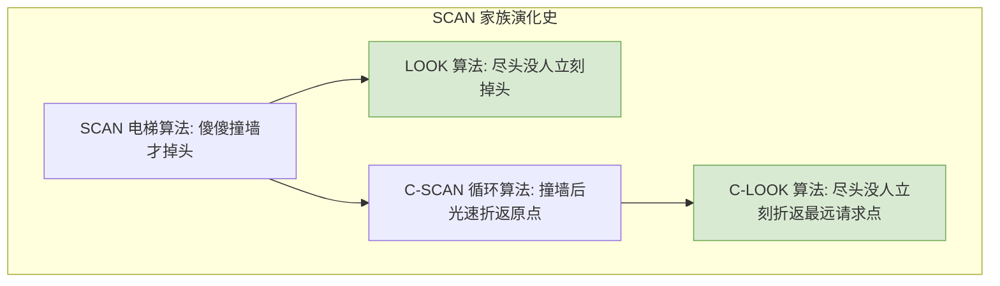

# 操作系统：磁盘调度算法

> **导语**
> 各位同学大家好，本节课我们将学习操作系统设备管理中极其重要、也是大题必考的核心考点——**磁盘调度算法**。
> 一次磁盘读写操作需要花费多少时间？操作系统又能通过什么方法去优化这个时间？本节课我们将首先拆解磁盘读写时间的计算公式，随后通过图文与生动的例子，详细推演 FCFS、SSTF、SCAN、LOOK、C-SCAN、C-LOOK 这六大经典磁盘调度算法的运行轨迹及其优缺点。

---

## 一、 一次磁盘读写操作的时间开销

一次完整的磁盘读写操作，其总耗时由三个部分组成：**寻道时间**、**延迟时间** 和 **传输时间**。

### 1. 寻道时间 (Seek Time) —— 操作系统唯一能优化的时间

这是将磁头臂移动到目标磁道所花费的时间。

- **计算公式**：$T_s = s + m \times n$
  - $s$：启动磁头臂的时间（常数，如 $2\text{ms}$）。
  - $m$：磁头每跨越一个磁道所耗费的时间（常数，如 $0.2\text{ms}$）。
  - $n$：本次需要跨越的总磁道数。
- **优化空间**：由于 $s$ 和 $m$ 是硬件决定的常量，**操作系统唯一能干预的，就是通过“磁盘调度算法”来减少磁头跨越的总磁道数 $n$。**

### 2. 延迟时间 (Rotational Latency)

磁头定位到目标磁道后，需要等待磁盘旋转，直到目标扇区刚好转到磁头下方所经历的时间。

- **计算公式**：假设磁盘转速为 $r$ (转/秒)，则转一圈的时间为 $1/r$ 秒。
- **平均延迟时间**：统计学上，平均需要转半圈才能找到目标扇区。因此：
  $$ T_r = \frac{1}{2} \times \frac{1}{r} = \frac{1}{2r} $$

### 3. 传输时间 (Transfer Time)

从目标扇区读出数据或写入数据所经历的时间。这取决于每次读写的字节数和磁盘的转速。

- **计算公式**：假设每次读写 $b$ 个字节，每个磁道能存 $N$ 个字节。则读写 $b$ 个字节需要转过 $b/N$ 个磁道圈。转一圈耗时 $1/r$ 秒。
  $$ T_t = \frac{b}{N} \times \frac{1}{r} = \frac{b}{rN} $$

> **结论**：总时间 $T_a = T_s + T_r + T_t$。其中，延迟时间和传输时间完全由硬件（如磁盘转速 $r$）决定，**操作系统只能通过调度算法优化寻道时间 $T_s$**。

---

## 二、 六大经典磁盘调度算法推演

假设磁盘磁道号从 `0` 到 `200`。当前磁头停留在 `100` 号磁道。
同时有多个进程请求访问以下磁道：`55, 58, 39, 18, 90, 160, 150, 38, 184`。

### 1. 先来先服务 (FCFS - First Come First Serve)

- **规则**：完全按照请求到达的先后顺序进行响应。
- **移动轨迹**：$100 \rightarrow 55 \rightarrow 58 \rightarrow 39 \rightarrow 18 \rightarrow 90 \dots$
- **优缺点**：
  - _优点_：绝对公平。如果请求比较集中，性能还可以。
  - _缺点_：如果请求极其分散，磁头会像无头苍蝇一样在磁盘上来回狂奔，性能极差，接近随机调度。

### 2. 最短寻找时间优先 (SSTF - Shortest Seek Time First)

- **规则**：每次都优先处理**距离当前磁头最近**的磁道请求。
- **移动轨迹**：
  当前在 `100` $\rightarrow$ 最近的是 `90` $\rightarrow$ 最近的是 `58` $\rightarrow$ 依次向左走到 `18`。
  当左侧走到 `18` 时 $\rightarrow$ 剩下未处理的离 `18` 最近的是 `150` $\rightarrow$ 狂奔到右侧 `150` $\rightarrow$ 依次向右走到 `184`。
- **优缺点**：
  - _优点_：这是一种“贪心算法”，每次寻道时间都很短，平均寻道长度大幅下降，性能较好。
  - _缺点_：**会产生“饥饿”现象！** 如果在磁头所在的小区域内有源源不断的新请求到来，磁头就会被“困”在这个小区域里，导致远处的请求永远等不到服务。

---

为了解决 SSTF 的“饥饿”问题，人们发明了像电梯一样运行的扫描算法。

### 3. 扫描算法 (SCAN / 电梯算法)

- **规则**：磁头只能**朝着一个固定的方向**移动，直到撞到**磁盘的最边缘位置**（如磁道 `0` 或 `200`），才能掉头向相反方向移动。
- **移动轨迹**（假设当前在 `100` 且规定**向右**移动）：
  $100 \rightarrow 150 \rightarrow 160 \rightarrow 184 \rightarrow$ **撞到最右侧边缘 `200` 并掉头** $\rightarrow$ 向左扫描处理 `90` $\rightarrow \dots \rightarrow 18$。
- **优缺点**：
  - _优点_：完美解决了饥饿问题。
  - _缺点_：1. 即使 `184` 之外已经没有请求了，依然傻傻地撞到最边缘的 `200` 才能掉头。2. 对两侧磁道的响应频率极其不均（刚扫过边缘磁道后，边缘磁道要等极其漫长的时间才能迎来下一次扫描）。

### 4. LOOK 调度算法 (SCAN 的聪明版)

- **规则**：一边移动一边往前方看 (Look)。如果在当前移动方向上**已经没有别的请求了，就立刻掉头**，不再傻傻撞墙。
- **移动轨迹**（向右移动）：
  $100 \rightarrow 150 \rightarrow 160 \rightarrow$ **走到 `184` 发现右边没人了，立刻掉头** $\rightarrow$ 向左扫描处理 `90` $\dots$

---

为了解决 SCAN 算法“对两侧磁道响应不均”的缺点，又发明了单向扫描循环的算法。

### 5. 循环扫描算法 (C-SCAN)

- **规则**：磁头依然像电梯一样单向扫描。但在到达**最边缘位置掉头时，不处理任何请求，直接光速折返到另一端的起点**，然后再重新开始单向扫描。
- **移动轨迹**（向右移动）：
  $100 \rightarrow 150 \rightarrow 160 \rightarrow 184 \rightarrow$ **走到边缘 `200`** $\rightarrow$ **直接光速折返到最左侧边缘 `0`** $\rightarrow$ 从 `0` 开始继续向右扫描处理 `18` $\rightarrow 38 \rightarrow \dots \rightarrow 90$。
- **优点**：解决了响应频率不均的问题。任何一个位置的磁道，被扫到的间隔时间几乎是完全均等的。
- **缺点**：依然有“傻傻撞墙折返”的毛病，且折返时浪费了时间。

### 6. C-LOOK 调度算法 (C-SCAN 的聪明版)

- **规则**：单向扫描 + 尽头立刻折返（但不是折返到边缘 `0`，而是**折返到最远端那个有请求的磁道**）。
- **移动轨迹**（向右移动）：
  $100 \rightarrow 150 \rightarrow 160 \rightarrow$ **走到 `184` 发现右边没人了，准备折返** $\rightarrow$ **直接折返到左侧最远的有请求的磁道 `18`** $\rightarrow$ 从 `18` 继续向右扫描。

---

## 三、 本节总结与做题秘籍

1.  **公式推导**：理解延迟时间和传输时间的公式是怎么用转速 $r$ 推出来的。明白只有**寻道时间**是操作系统能调控的。
2.  **SSTF 的饥饿**：记住贪心算法 SSTF 的致命伤是可能导致边缘请求被饿死。
3.  **做题神坑预警**：
    在考研或期末考试中，**如果题目里只写了采用“SCAN”算法或“C-SCAN”算法，没有特别说明，通常默认指代的是其聪明版本（即 LOOK 算法和 C-LOOK 算法）**。也就是默认不需要傻傻撞到物理边缘 `0` 或 `200` 才掉头。做题时请务必留意这个潜规则！
