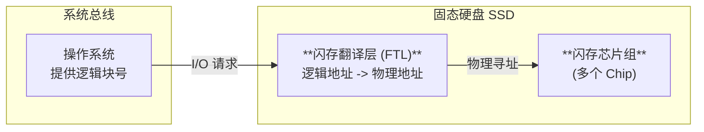

# 操作系统与计组：固态硬盘 (SSD) 核心考点

> **导语**
> 各位同学大家好，本节课我们将学习操作系统与计算机组成原理两门课共同的新增考点：**固态硬盘 (SSD)**。
> 相比于传统的机械硬盘，固态硬盘在物理结构、读写机制和寿命管理上有着本质的区别。本节课我们将深入剖析 SSD 的内部组件、特殊的“按页读写、按块擦除”机制，以及为了延长使用寿命而采用的“磨损均衡技术”。

---

## 一、 固态硬盘的组成结构

固态硬盘 (Solid State Drive, SSD) 摒弃了机械硬盘的磁盘与磁头，基于**闪存 (Flash Memory)** 技术存储数据。闪存本质上是一种**电可擦除的 ROM (EEPROM)**。

SSD 的核心组件主要分为两部分：

1.  **闪存翻译层 (FTL - Flash Translation Layer)**：充当“地址翻译官”。负责将系统发来的逻辑块号映射到固态硬盘内部实际的物理地址。
2.  **存储介质 (Flash Chips)**：由多个黑色的闪存芯片组成，是实际存放数据的地方。

### 闪存芯片的内部层级 (核心对应关系)

在 SSD 内部，存储空间的划分有着严格的层级，并且与传统机械硬盘有极强的对比考点：

- **块 (Block)**：一个闪存芯片包含多个块（通常为 $16\text{KB} \sim 512\text{KB}$）。**SSD 的块相当于机械硬盘的“磁道”**。
- **页 (Page)**：一个块被进一步拆分为多个页（通常为 $512\text{B} \sim 4\text{KB}$）。**SSD 的页相当于机械硬盘的“扇区”**。
- _注意：系统给 SSD 发送的一个逻辑块，实际上对应的是 SSD 内部的一个“页”。_

---

## 二、 固态硬盘的读写特性 (极其重要)

固态硬盘的读写机制与机械硬盘完全不同，这也是选择题最爱考察的地方。

### 1. 读写单位与规则

- **读写单位**：系统对 SSD 的读写是**以“页”为单位**进行的。
- **擦除单位**：SSD 对数据的擦除是**以“块”为单位**进行的。
- **核心法则**：一个块被擦干净之后，其中的**每一个页都可以被写入一次，但可以被读取无数次**。

### 2. 写入覆盖的“痛点”与“数据迁移”

**问题**：如果某一个“页”中已经有了数据，现在想覆盖写入新数据，能直接写吗？
**答案：绝对不行！** SSD 不允许直接覆盖写入。必须先将整个“块”擦除，才能往里面的页写新数据。

**操作系统如何处理这种覆盖写操作？**

1.  **复制有效数据**：将包含目标页的那个“旧块”中，所有其他仍然有效的页，统统**复制**到一个事先擦除干净的“新块”中。
2.  **写入新数据**：在新块的对应位置，写入你想要更新的新数据。
3.  **擦除旧块**：将原来的“旧块”整块彻底擦除，以备未来使用。
4.  **修改映射表**：**闪存翻译层 (FTL)** 将原来的逻辑块号，重新映射到“新块”的物理地址上。

> **结论与考点**：
>
> 1.  SSD 的逻辑地址对应的物理位置是**经常变动**的。
> 2.  由于写操作往往会引发连带的“整块擦除”和“数据大搬家（迁移）”，因此 **SSD 写的速度通常比读的速度慢得多**。

---

## 三、 SSD 与 机械硬盘 (HDD) 的特性对比

| 特性对比     | 固态硬盘 (SSD)         | 机械硬盘 (HDD)              | 考试重点备注                                               |
| :----------- | :--------------------- | :-------------------------- | :--------------------------------------------------------- |
| **寻址方式** | 纯电路寻址             | 机械移动（磁臂寻道 + 旋转） | SSD 支持真正的极速**随机访问**，无论访问哪里时间都一样短。 |
| **读写速度** | 极快 (但**写比读慢**)  | 较慢                        |                                                            |
| **物理特性** | 安静无噪音、抗震耐摔   | 有旋转噪音、极怕震动摔打    | SSD 无机械部件。                                           |
| **能耗**     | 更低 (省电)            | 较高                        |                                                            |
| **价格**     | 更贵                   | 便宜 (适合海量存储)         |                                                            |
| **寿命**     | **有写入次数寿命限制** | 理论上无写入次数限制        | SSD 一个块被擦除几千/上万次后即报废。                      |

---

## 四、 磨损均衡技术 (Wear Leveling)

由于 SSD 的每个“块”擦除次数是有限的（就像羊毛不能只在一只羊身上薅），为了防止某些块被频繁重写而过早损坏，SSD 固件引入了**磨损均衡技术**，目的是**把擦除操作平均分配到各个块上，从而整体延长 SSD 的使用寿命**。

磨损均衡分为两种策略：

### 1. 动态磨损均衡 (Dynamic Wear Leveling)

- **触发时机**：在**写入数据时**动态触发。
- **机制**：当系统需要写入新数据时，SSD 不会死盯着原来的位置，而是**优先选择那些累计擦除次数较少的“新块”**来写入，然后由 FTL 更新地址映射。

### 2. 静态磨损均衡 (Static Wear Leveling)

- **触发时机**：在**后台悄悄运行**。
- **机制**：SSD 会监控数据的读写特征。对于那些**“读多写少”**的数据（如电影、系统底层文件），由于它们极少被修改，也就不会触发擦除操作。SSD 会在后台把这些“冷数据”强制**搬运迁移到那些擦除次数已经很多的老旧块中**。
- **目的**：让那些寿命还很长的“新块”腾出空间，去承担那些频繁擦写的“热数据”任务，做到真正的物尽其用。
