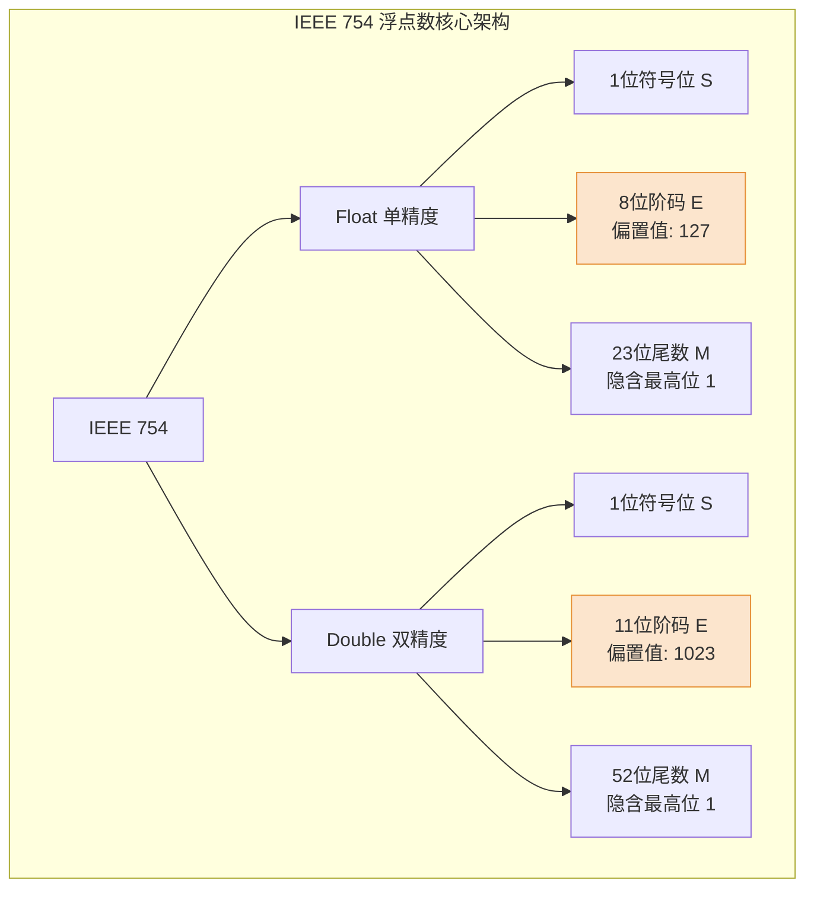

# 操作系统与计组：IEEE 754 浮点数例题实战与解析

> **导语**
> 各位同学大家好，继续来看 IEEE 754 浮点数的表示。在这个视频中，我们会引入几个重要的例题进行实战演练。由于浮点数这部分几乎是每年必考的考点，解决浮点数相关考题**最重要的基本功就是：能否把十进制真值转换成浮点数机器码，以及能否把浮点数的二进制机器码反向转换成十进制真值。**
> 接下来，我们将通过五道精选例题（包含历年真题），带大家一边学一边练，趁热打铁打牢基本功！

---

## 一、 例题 1：十进制转单精度浮点数 (Float)

**题目**：假如你是李华，你的加拿大笔友托马斯正在参加 408 考试，他想请教你如何将十进制数 **$-8.25$** 转换成一个 **IEEE 754 单精度浮点数 (float)**。请你告诉他如何处理。

### 💡 解析步骤：

1.  **确定 Float 的存储结构**
    单精度浮点数共 32 bit，结构为：`1 位符号位 (S)` + `8 位阶码 (E)` + `23 位尾数 (M)`。

2.  **真值转二进制普通记法**
    $-8.25_{10} = -1000.01_2$

3.  **转为二进制科学计数法（尾数规格化）**
    将小数点向左移动 3 位，确保小数点前有且仅有一个 1：
    $-1000.01_2 = -1.00001_2 \times 2^3$
    _得到：阶码真值 $e = 3$_

4.  **计算各部分机器码**
    - **符号位 (S)**：因为是负数，所以 `S = 1`。
    - **尾数 (M)**：隐含掉最高位的 1，只保留小数点后面的部分 `00001`，不足 23 位在末尾补 0。
      `M = 0000100 00000000 00000000`
    - **阶码 (E)**：用阶码真值加上偏置值。float 型偏置值为 $127$ ($2^{8-1}-1$)。
      真值 $3 + 127 = 130$。将 $130$ 转化为无符号 8 位二进制：`10000010`。

5.  **拼接得出最终结果**
    将 S、E、M 拼合：
    `1 10000010 00001000000000000000000`
    转换为十六进制即为：**`0xC1040000`**

---

## 二、 例题 2：十进制转双精度浮点数 (Double)

**题目**：将刚才的十进制数 **$-8.25$** 改为转换为 **IEEE 754 双精度浮点数 (double)** 格式。

### 💡 解析步骤：

Double 型与 Float 型的转换逻辑本质完全一样，区别仅在于**位数划分**与**偏置值**。

1.  **确定 Double 的存储结构**
    双精度浮点数共 64 bit，结构为：`1 位符号位 (S)` + `11 位阶码 (E)` + `52 位尾数 (M)`。

2.  **符号与尾数转换**
    - **符号位 (S)**：`1`（负数）。
    - **尾数 (M)**：依然是隐含最高位的 1，保留 `00001`，后面补满 52 个 0。

3.  **阶码 (E) 转换（唯一区别）**
    Double 型的移码偏置值为 $1023$ ($2^{11-1}-1$)。
    真值 $3 + 1023 = 1026$。将 $1026$ 转化为无符号 11 位二进制：`10000000010`。

4.  **拼接得出最终结果**
    `1 10000000010 00001000... (补满 52 个 0)`

---

## 三、 小数转二进制技巧 & 例题 3 (2022 真题)

**题目 (2022年统考 第14题)**：将十进制数 **$-0.4375$** 转换成 IEEE 754 单精度浮点数。

### 💡 核心难点突破：十进制复杂小数转二进制

很多同学会被 $0.4375$ 这种复杂小数卡住，这里提供两种极速转换技巧：

**方法 A：拼凑法 (根据位权累加)**
写出小数点后的二进制位权：$0.5, 0.25, 0.125, 0.0625$。
尝试拼凑目标值：$0.25 + 0.125 + 0.0625 = 0.4375$。
因此对应的二进制为：`0.0111`。

**方法 B：乘积取整法 (强烈推荐，适用于长小数)**
将小数部分不断乘以基数 2，取出整数部分作为高位到低位的二进制序列，小数部分继续参与下一轮相乘，直到小数部分为 0：

- $0.4375 \times 2 = \mathbf{0}.875$ （取整数 `0`）
- $0.875 \times 2 = \mathbf{1}.75$ （取整数 `1`，留 $0.75$）
- $0.75 \times 2 = \mathbf{1}.5$ （取整数 `1`，留 $0.5$）
- $0.5 \times 2 = \mathbf{1}.0$ （取整数 `1`，留 $0$，计算结束）
  得到二进制：`0.0111`。

### 💡 后续常规解析：

1.  **科学计数法**：$-0.0111_2 = -1.11_2 \times 2^{-2}$ （阶码真值 $e = -2$）
2.  **符号位 S**：`1`
3.  **阶码 E**：$-2 + 127 = 125 = 01111101_2$
4.  **尾数 M**：隐含最高位 1，保留 `11`，后面补 21 个 0。
5.  **最终答案**：拼接出相应的二进制序列即可。

---

## 四、 例题 4：浮点数机器码转十进制真值 (2013 真题)

**题目 (2013年统考 第13题)**：已知某单精度浮点数的十六进制表示，求其对应的十进制真值。
_(假设给出的是例题推导中的某个负数编码)_

### 💡 解析步骤 (逆向还原法)：

1.  **展开为 32 位二进制串**并划分区域 `1 + 8 + 23`。
2.  **判定符号**：最高位 `S`。若 `S=1`，则为负数。
3.  **计算阶码真值**：取出中间 8 位转为十进制无符号数（例如值为 140），再**减去偏置值 127**：
    $E_{true} = 140 - 127 = 13$
4.  **还原尾数**：将后 23 位前**补上隐含的 `1.`**。
    例如尾数部分是 `1000...0`，补上后变成 `1.1000...0_2`。将其转为十进制即为 $1.5$。
5.  **拼合最终真值**：$-1.5 \times 2^{13}$。

---

## 五、 例题 5：机器码的双重解读辨析 (2020 真题)

**题目 (2020年统考 第13题)**：给出一段 32 比特的机器数，指出该机器数如果作为一个带符号整数 (`int` 补码) 或者单精度浮点数 (`float`) 时，其真值分别等于多少。

### 💡 解析步骤：

遇到这种题目，我们需要用两种完全不同的编码规则去“解读”同一串二进制数据。

- **视角 1：作为 Float 型解读**
  1. 拆分 `1 + 8 + 23` 结构。
  2. 计算阶码真值并还原尾数（操作同例题4）。
  3. 如果算出诸如 $-1.0 \times 2^{17} = -2^{17}$ 的结果，去对比选项，发现没有符合 Float 型的匹配项。
- **视角 2：作为 Int 型 (带符号整数补码) 解读**
  1. **判断正负**：最高位为 `1`，说明是负数补码。
  2. **补码转原码 (极速技巧)**：从右往左扫，找到第一个 `1`，在这个 `1` 的左边画一条线；线左边的所有位（除符号位外）全部**按位取反**（`0变1, 1变0`），线右边和符号位**保持不变**。
  3. **计算真值**：得到原码后，直接将各为 `1` 的比特位对应的权值相加，附加上负号，即可算出对应的十进制整数真值。

---

## 六、 本节核心总结速记卡

1.  **位长分配**：`Float` = 1 (S) + 8 (E) + 23 (M)；`Double` = 1 (S) + 11 (E) + 52 (M)。
2.  **阶码移码偏置公式**：$Bias = 2^{n-1} - 1$。
3.  **尾数隐含位法则**：尾数部分通常是规格化的，一定要牢记由于最高位必定是 1，因此在**存储时小数点前的 `1` 被隐含省略了**，变相增加了 1 比特的实际精度！
4.  **解题基本功**：熟练掌握十进制与二进制科学计数法的互转、小数的乘积取整法，以及补码转原码的快速提取法。
