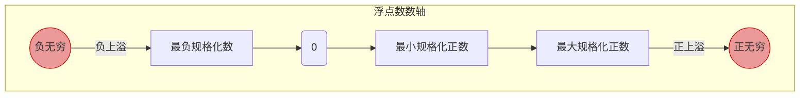

# 操作系统与计组：IEEE 754 浮点数的表示范围与特殊状态 (上)

> **导语**
> 各位同学大家好，本节课我们要探讨 IEEE 754 浮点数的一个极其重要且常考的核心点：**浮点数的表示范围**以及**几种特殊的状态**。
> 考虑到这部分内容较多，我们将分两个视频进行讲解。本节课我们将首先精确推导**规格化浮点数的极值范围**；接着，我们将探讨当计算结果超出这个范围时，计算机是如何处理**“上溢” (Overflow)** 的，并借此引出 IEEE 754 中第一个特殊状态：**无穷大 (Infinity)**。

---

## 一、 浮点数状态的全景框架

在深入探讨之前，我们需要对 IEEE 754 浮点数可能出现的所有状态建立一个全局认知。判定的核心依据是**阶码 (Exponent) 的取值情况**：

1.  **常规情况 (规格化数)**：阶码 **不全为 0**，也 **不全为 1**。
    _(这是我们上节课重点学习的情况，尾数隐含前导 '1')_
2.  **特殊情况 (阶码全 0 或全 1)**：

| 阶码状态 | 尾数状态   | 代表含义                 | 处理方式                      |
| :------- | :--------- | :----------------------- | :---------------------------- |
| **全 0** | **全 0**   | **正零 / 负零**          | 取决于符号位 `S`              |
| **全 0** | **不全 0** | **非规格化数**           | 尾数隐含前导 '0' (下节课详述) |
| **全 1** | **全 0**   | **无穷大 ($\pm\infty$)** | 正上溢或负上溢                |
| **全 1** | **不全 0** | **NaN (Not a Number)**   | 无定义数 (如负数开根号)       |

_(注：本节课我们将重点推导“规格化数”的范围，并详细讲解“全 1 + 全 0”构成的无穷大状态。)_

---

## 二、 规格化单精度浮点数 (Float) 的表示范围

IEEE 754 规定：**规格化浮点数的阶码不能全为 0，也不能全为 1。**
基于此，我们来推导单精度浮点数 `float (1-8-23)` 的极限取值范围。

### 1. 阶码的取值边界

- 8 位阶码本来的无符号取值范围是 `0 ~ 255`。
- 刨除全 0 (`0`) 和 全 1 (`255`) 后，规格化阶码的无符号取值范围为：**`1 ~ 254`**。
- 减去偏置值 `127` 后，**阶码的真实取值范围 $E_{true}$ 为**：
  - **最小值**：$1 - 127 = \mathbf{-126}$
  - **最大值**：$254 - 127 = \mathbf{+127}$

### 2. 尾数的取值边界

- 规格化尾数隐藏了小数点前的 `1.`。
- **最大尾数**：后面 23 位全为 1。即 $1.1111...1_2$
- **最小尾数**：后面 23 位全为 0。即 $1.0000...0_2$

### 3. 推导极值 (必考考点)

结合上述阶码和尾数的边界，我们就能得出单精度规格化浮点数的边界值（注意区分正负）：

#### A. 最大正数 (Max Positive)

- 要求：阶码取最大，尾数取最大，符号为正。
- **科学计数法**：**$+1.111...1_2 \times 2^{127}$**
- **机器码表示**：`0` (正) `11111110` (阶码真值127，移码254) `111...1` (尾数全1)
- **十进制转换技巧**：$1.111...1_2$ 可以巧妙地转化为 $2 - 2^{-23}$。
  因此最大正数用十进制表示为：**$(2 - 2^{-23}) \times 2^{127}$**

#### B. 最小正数 (Min Positive)

- 要求：阶码取最小，尾数取最小，符号为正。
- **科学计数法**：**$+1.000...0_2 \times 2^{-126}$**
- **机器码表示**：`0` (正) `00000001` (阶码真值-126，移码1) `000...0` (尾数全0)

#### C. 负数的极值

负数的范围与正数完全对称，只需将符号位改为 `1` 即可：

- **绝对值最大的负数 (最小的数值)**：$-1.111...1_2 \times 2^{127}$
- **绝对值最小的负数 (最接近 0 的负数)**：$-1.000...0_2 \times 2^{-126}$

> **真题演练 (2018统考 第14题)**：单精度浮点数可以表示的**最小的规格化正数**是多少？
> **答案**：即上面推导的 $+1.0 	imes 2^{-126}$。同理，大家必须能够自行推导出最大正数和极值负数的机器码。

---

## 三、 浮点数的溢出与特殊状态：无穷大 (Infinity)

### 1. 什么是上溢 (Overflow)？

如果两个合法的浮点数相加或相乘，导致其**运算结果超出了规格化浮点数所能表示的最大范围**（绝对值过大），我们就称之为**上溢 (Overflow)**。

- **正上溢**：结果大于规格化能表示的最大正数。
- **负上溢**：结果小于规格化能表示的最负数（绝对值最大的负数）。

### 2. 计算机如何处理上溢？

当发生上溢时，IEEE 754 规定使用一种特殊的状态——**无穷大 ($\pm\infty$)** 来记录这个结果。

- **机器码表示规则**：**阶码全 1，尾数全 0**。
- **单精度 (Float) 的机器码**：
  - **正无穷 ($+\infty$)**：`0 11111111 000...0` (Hex: `0x7F800000`)
  - **负无穷 ($-\infty$)**：`1 11111111 000...0` (Hex: `0xFF800000`)

### 3. 容错性设计机制

- **硬件层面**：当浮点数运算单元 (FPU) 检测到运算超出边界，除了将结果设为 $\pm\infty$ 外，还会将底层寄存器中的**浮点数溢出异常标志位 (如 OE - Overflow Exception)** 置为 1。
- **软件系统层面**：IEEE 754 标准规定，**系统默认不响应浮点数溢出异常**。这意味着，即使发生上溢，程序**不会崩溃或中断执行**，而是会带着 `inf` 这个特殊的返回值继续往下跑。
- _设计哲学_：这种设计极大地提高了程序的**容错性**。如果有需要，程序员可以在代码中手动加入 `isinf()` 等检查机制来捕获和处理这种异常状态。

---

## 四、 课堂小结与扩展预留

本节课我们重点攻克了以下内容：

1.  利用阶码 `1~254` 的无符号范围减去偏置值，推导出真实阶码范围是 `[-126, +127]`。
2.  推导出了单精度规格化浮点数的四大极值边界（最大/小正数，最大/小负数）。
3.  理解了绝对值超出边界导致的**上溢**现象，以及 IEEE 754 使用**阶码全1、尾数全0**来表示**无穷大**的容错处理机制。

> **防偷袭作业**：你能否仿照今天的推导逻辑，在草稿纸上写出 **双精度浮点数 (Double)** 的最大规格化正数、最小规格化正数，以及正/负无穷大的二进制机器码？_(答案将在下个视频揭晓)_

在下一个视频中，我们将探讨数轴的内部——当数值极度趋近于 0，乃至超出了“最小规格化正数”的下限时，会发生什么？敬请期待关于**下溢 (Underflow)** 与**非规格化数**的讲解！
