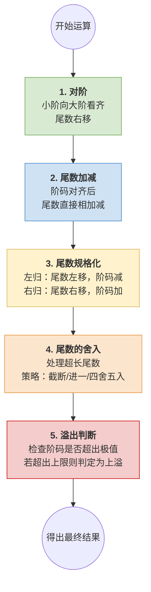

# 计算机组成原理：浮点数的加减运算 (五大步骤)

> **导语**
> 各位同学大家好，从这节课开始，我们要学习浮点数的加减运算是如何实现的。计算机在处理浮点数加减运算时，总共分为五个核心步骤：**对阶**、**尾数加减**、**尾数规格化**、**尾数舍入** 以及 **溢出判断**。
> 二进制浮点数与十进制科学计数法在思想原理上极其相似，因此本节笔记我们将通过大家熟悉的**十进制科学计数法**作为类比，带大家直观感受这五个步骤的具体含义，为后续的二进制实战打下基础。

---

## 浮点数加减运算全流程图解

---

## 步骤一：对阶 (Alignment of Exponents)

在进行加减法之前，必须保证两个数的“阶码”（即指数部分）完全相同。

- **原则**：**小阶向大阶看齐**。
- **操作**：将阶码较小的数，其阶码增大到与大阶码相等；同时，为了保证数值大小不变，其**尾数必须向右移动**（相当于小数点相对左移）。
- **为什么是小阶向大阶看齐？**
  如果大阶向小阶看齐，大阶的尾数就需要向左移。左移很容易导致尾数的高位有效数字丢失，从而产生严重的精度错误或越界。并且小阶向大阶对齐后，相加的结果更有可能直接得到一个规格化的尾数。

> **十进制类比**：
> 假设相加两个数：$9.85211 \times 10^{12}$ 和 $3.14 \times 10^{10}$
> **对阶处理**：将较小的 $10^{10}$ 对齐到 $10^{12}$。
> $3.14 \times 10^{10}$ 变为 $0.0314 \times 10^{12}$（尾数右移 2 位）。

---

## 步骤二：尾数加减 (Mantissa Addition/Subtraction)

- **操作**：在完成对阶（阶码一致）之后，直接将两个数值的尾数部分逐位进行相加或相减运算。
- **十进制类比**：
  将 $9.85211$ 和 $0.0314$ 相加，得到新的尾数 $9.88351$。
  此时结果为：$9.88351 \times 10^{12}$。
  _(注：这里相加后刚好是一个规格化的数字，但实际情况可能并非总是如此。)_

---

## 步骤三：尾数规格化 (Mantissa Normalization)

尾数加减后得到的新尾数，可能不符合“规格化”的标准（即最高有效位必须在小数点前一位）。此时需要进行“左归”或“右归”操作。

### 1. 左归 (Left Normalization)

- **适用场景**：运算结果的尾数变成了诸如 $0.00995...$ 的形态，最高非零位在小数点后面很远。
- **操作**：**尾数向左移动 $N$ 位，同时阶码减 $N$**。
- **十进制类比**：$0.0099517 \times 10^{12}$ 左归 3 位 $\rightarrow$ 变为 $9.9517 \times 10^9$（阶码 $12 - 3 = 9$）。

### 2. 右归 (Right Normalization)

- **适用场景**：运算结果的尾数发生了进位，变成了诸如 $99.517...$ 的形态（小数点前出现了两位数及以上）。
- **操作**：**尾数向右移动 $N$ 位，同时阶码加 $N$**。
- **十进制类比**：$99.517107 \times 10^{12}$ 右归 1 位 $\rightarrow$ 变为 $9.9517107 \times 10^{13}$（阶码 $12 + 1 = 13$）。

---

## 步骤四：尾数的舍入 (Mantissa Rounding)

计算机内部留给尾数的比特位数是固定的（例如 Float 单精度浮点数只有 1+23 位有效尾数）。如果运算后得到的尾数过长，超出了规定的位数，就必须对多余的位数进行“舍入”处理。

常见的舍入策略包括：

1.  **直接截断 (Truncation)**：最简单粗暴的方法。多余的尾数部分直接丢弃，不考虑进位。
2.  **不全零进一 (恒置一法)**：只要被舍弃的多余部分不是全零，就强行往保留的最低有效位“进一个 1”。
3.  **四舍五入 (Round to Nearest)**：观察被舍弃的第一位。在十进制中满 5 进 1，不满 5 舍去；在二进制中则是看第一位是 1 还是 0 来决定是否进位。

> **十进制类比**：
> 假设规定只保留 6 位有效尾数，当前计算结果为 $9.9517107 \times 10^{13}$。
> 多出的部分是 `07`，如果采用直接截断，结果变为 $9.95171 \times 10^{13}$；如果采用四舍五入等其他策略，进位情况会有所不同。

---

## 步骤五：溢出判断 (Overflow Check)

浮点数的阶码位数是固定的（例如 Float 阶码占 8 位），这意味着阶码有一个可表示的上下限。在运算的最后，必须检查**阶码是否超出了规定的合法范围**。

- **判定标准**：浮点数的溢出与否，**完全由“阶码”决定**，与尾数无关。
- **情况说明**：
  - **上溢 (Overflow)**：如果经过右归操作后，阶码不断加 1，最终突破了系统规定的阶码上限，说明运算结果发生了**真正的溢出**（超出了浮点数能表示的最大极值），系统会报错或记为 $\infty$。
  - **下溢 (Underflow)**：如果经过左归操作后，阶码不断减小，低于了阶码的下限，说明数值极度逼近于 0，系统通常会按照**机器零**来处理（默认不报错）。

> **十进制类比**：
> 假设我们规定科学计数法的阶码最大不能超过 $99$。
> 当两个大数相加得到 $9.9 \times 10^{99}$，再发生进位右归导致阶码加 1，变成 $10^{100}$。此时阶码 $100 > 99$，我们就判定该十进制加法运算发生了**溢出**。
