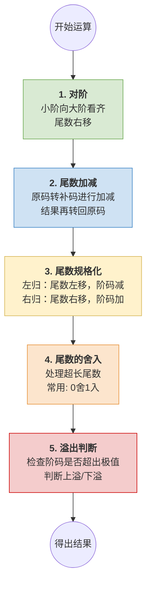

# 计算机组成原理：浮点数的加减运算

> **导语**
> 各位同学大家好，从这节课开始，我们要学习浮点数的加减运算是如何实现的。浮点数的加减运算在计算机底层通常分为五个核心步骤。在历年真题中，主要基于 IEEE 754 的 **float 单精度浮点型** 来考察。本节课我们将通过三个详细的计算实例，带大家彻底搞透这五个步骤的具体操作和底层原理。

---

## 浮点数加减运算的五大核心步骤

在进行二进制浮点数加减运算时，无论是加法还是减法，都必须严格遵守以下五个步骤：

---

## 实例一：浮点数加法运算 ($X + Y$)

假设有 $X, Y$ 两个 float 浮点数，十进制真值分别为 **$1.5$** 和 **$0.5$**，求 $Z = X + Y$。

### 准备工作：转换格式与提取尾数

1.  **真值转二进制科学计数法**：
    - $X = 1.5 = +1.1 \times 2^0$
    - $Y = 0.5 = +1.0 \times 2^{-1}$
2.  **转为 float 机器码** (阶码偏置值为 127)：
    - $X$ 阶码为 $0+127=127$，机器码：`0 01111111 100...0`
    - $Y$ 阶码为 $-1+127=126$，机器码：`0 01111110 000...0`
3.  **提取尾数原码（补上隐含的 1 和符号位）**：
    - $X$ 的尾数：`+1.1000...0`
    - $Y$ 的尾数：`+1.0000...0`

### 步骤 1：对阶

- **计算阶差**：$E_x - E_y = 0 - (-1) = 1$。说明 $X$ 的阶码比 $Y$ 大 1。
- **小阶向大阶看齐**：让 $Y$ 的阶码加 1（对齐到 0），同时 $Y$ 的尾数**整体右移 1 位**。
- **结果**：$Y$ 的尾数变为 `+0.1000...0`。
  > 💡 **注意**：IEEE 754 规定，右移移出的比特位**至少要额外保留 3 位**（用于提高后续运算精度）。本例移出的是 0，故先保留。

### 步骤 2：尾数加减

- 此时阶码已对齐到 $0$。进行尾数相加：
  `+1.1000...0`
  `+0.1000...0`
  `-------------`
  `+10.0000...0`
  > 💡 **底层原理**：计算机硬件做原码加减时，是先把原码转成**补码**，用补码相加减后再转回**原码**。本例都是正数，结果一致。

### 步骤 3：尾数规格化

- 当前尾数为 `+10.0...0`，不符合规格化要求（小数点前只能有一个 1）。
- **右归操作**：小数点固定不变，尾数整体向右移 1 位，变为 `+1.0000...0`。
- **阶码调整**：尾数每右归 1 位，阶码需要**加 1**。此时大阶码从 $0$ 变为 $1$。

### 步骤 4：尾数的舍入

- 保留 $1 + 23$ 比特的有效尾数位。
- 刚才多保留出来的位数，如果采用**“0舍1入”**原则，本例中多余的位全是 `0`，直接舍弃，无需向高位进一。

### 步骤 5：溢出判断

- 最终得到的阶码真值为 $1$（未全 0 且未全 1）。
- 没有超出 float 型的表示范围，**无溢出**。
- **最终结果**：符号 `0`，阶码真值 $1$ (移码 128 = `10000000`)，尾数 `000...0`。转换回十进制正是 **$2.0$**！

---

## 实例二：浮点数减法运算 ($X - Y$ 产生左归)

假设已知 $X, Y$ 提取出的尾数和阶差，求 $X - Y$。
_假设 $X$ 阶码比 $Y$ 小 2，即 $\Delta E = -2$。_

### 步骤 1：对阶

- $X$ 为小阶，向 $Y$ 看齐。$X$ 的尾数需**右移 2 位**，移出的 2 个比特被额外保留。

### 步骤 2：尾数加减 (核心难点：补码减法)

- **操作**：$X$ 的尾数减去 $Y$ 的尾数。
- **硬件实现**：原码 $\rightarrow$ 补码 $\rightarrow$ $X_{补} + (-Y)_{补}$ $\rightarrow$ 结果转回原码。
  - _减数按位取反，末位加 1 变成加法。_
  - _最终得到一个负的尾数原码结果（例如 `负的 0.0110...0`）。_

### 步骤 3：尾数规格化 (左归)

- 当前尾数形如 `-0.0110...0`，不是规格化数。
- **左归操作**：尾数整体向左移 1 位，变为 `-0.110...0`（仍不够），继续左移直至最高有效位为 `1`。假设需左移 1 位，变为 `-1.100...0`。
- **阶码调整**：尾数左移 1 位，阶码需要**减 1**。

### 步骤 4：尾数的舍入

- 截断多余的位数，使用“0舍1入”。全是 0 则直接舍弃。

### 步骤 5：溢出判断

- 检查调整后的阶码是否下溢（阶码全 0 且尾数非 0 为非规格化，若连非规格化也存不下则为机器零）。
- **最终结果**：转换为十进制验证结果（如 `-0.375`）。

---

## 实例三：浮点数减法运算 (舍入进位实战)

> **自我测验**：请暂停思考，完整的过一遍五个步骤。做错的同学，抽自己一鞭子啊！(笑)

假设 $\Delta E = 3$ ($X$ 阶码大于 $Y$)。

### 步骤 1：对阶

- 人类视角：$X$ 阶码大，$Y$ 的尾数右移 3 位。保留移出的 3 个比特，高位补 0。

### 步骤 2：尾数加减

- 补码相减，还原得到原码尾数结果。

### 步骤 3：尾数规格化

- 如果减法得到的尾数天然就是 `-1.xxxx...` 的形式，则**天然已经规格化**。
- **无需左归/右归**，阶码保持不变（即对齐后的大阶码）。

### 步骤 4：尾数的舍入 (重点)

- 保留 $1+23$ 比特有效位。
- 观察被舍弃的最高位（例如移出保留的 3 个比特是 `100`）。
- 根据**“0舍1入”**规则，舍弃的最高位是 `1`，必须**向保留的最低有效位进 1**！

### 步骤 5：溢出判断

- 检查阶码。拼装符号位、阶码移码、去掉隐含 `1` 的 23 位尾数。
- 输出最终的 float 二进制序列。转换为十进制验证（例如 `-110.125`）。

---

## 本节总结与复习建议

1.  **对阶的铁律**：**永远是小阶向大阶看齐！** 尾数右移可以保留附加位（丢失精度可控），若大向小看齐导致左移，会直接丢掉最高有效位，引发致命错误。
2.  **左归与右归的阶码口诀**：**左归减，右归加**。（小数点固定，尾数向左移相当于数值乘 2，为了保持总值不变，阶码必须减 1）。
3.  **底层补码运算**：遇到减法时，计算机底层其实是在跑补码的 `[X]补 + [-Y]补`，然后再转回原码进行后续的规格化和舍入。
4.  **做题技巧**：考试时若是笔算，**直接使用十进制科学计数法的逻辑去推导**（也就是“人类视角”）是最快的验证方式；若大题要求写出硬件运算流程，则严格遵循上述五步法。
