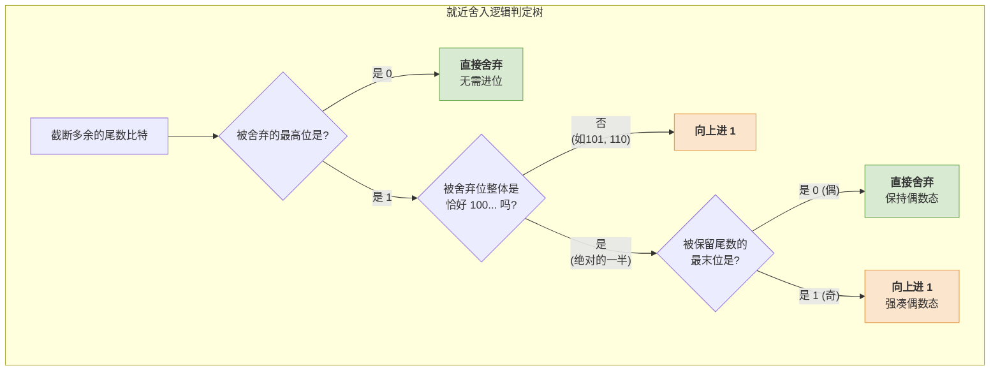

# 计算机组成原理：浮点数加减运算之“尾数的舍入”

> **导语**
> 各位同学大家好，在浮点数的加减运算（对阶、尾数加减、规格化、舍入、溢出判断）中，第四步“尾数的舍入”是最容易让人迷惑，也最容易产生神奇代码 Bug 的一个环节。
> 为什么在 C 语言里，一个极大的数加上 $0.5$ 或 $1.0$，结果竟然没有任何变化？为什么有时加 $1.5$ 却跳跃性地增加了 $2.0$？本节课我们将通过四个底层的二进制硬核推演，彻底揭开 IEEE 754 默认舍入模式——**“就近舍入 (Round to Nearest, Ties to Even)”** 的神秘面纱。

---

## 一、 为什么需要舍入？

在 IEEE 754 标准中，单精度浮点数 (`float`) 的尾数部分只有 **1 (隐含位) + 23** 比特。
当两个浮点数完成对阶并进行尾数加减后，得到的临时尾数长度往往会**超过 24 比特**。由于底层硬件（寄存器）的容量有限，我们必须将多余的比特位“砍掉”（舍弃）。而在砍掉这些位数后，到底要不要向保留的最低有效位“进一”，这就是**舍入 (Rounding)** 要解决的核心问题。

### IEEE 754 的四种舍入模式：

1.  **就近舍入 (Round to Nearest, Ties to Even)**：**系统默认，也是考研大纲默认考点。** (本节核心)
2.  **截断法 (Round toward Zero / 零向舍入)**：简单粗暴，多余位全部直接砍掉。
3.  **正向舍入 (Round toward $+\infty$)**：向正无穷方向舍入。
4.  **负向舍入 (Round toward $-\infty$)**：向负无穷方向舍入。

---

## 二、 默认模式解析：就近舍入 (类似“0舍1入”)

“就近舍入”的核心思想非常类似于十进制科学计数法中的“四舍五入”，但在二进制世界里，我们通常将其简化理解为**“0舍1入”**。

**判断核心**：观察**被舍弃的多余比特**中的**最高位**。

### 1. 常规情况：0 舍 1 入

- **0 舍**：如果被舍弃的最高位是 `0`（例如舍弃的是 `011`），则直接全部砍掉，不向高位进一。
- **1 入**：如果被舍弃的最高位是 `1`，且其**后面的位不全为 0**（例如舍弃的是 `101`, `110` 等），则必须向保留的最低位**进一**。

### 2. 特殊情况：“精准对半” (`100...`) 时的“向偶数舍入”

当被舍弃的位**恰好是 `100...`** 时（相当于十进制中恰好处于 0.5 的极其尴尬的位置），到底是舍还是入？

- **铁律**：此时要看**被保留的尾数的最末位**是 `0` 还是 `1`。
  - **若最末位是 `0`**：视为偶数，**直接舍弃，不进位**。
  - **若最末位是 `1`**：视为奇数，**强行进位 (+1)**，使其凑成偶数（末尾变成 0）。
    _(这也就是英文原称 "Ties to Even" 的含义：遇到平局，向偶数靠拢。)_

---

## 三、 四大实战案例硬核推演

为了彻底搞懂上述逻辑，我们来看四段产生“不可思议”结果的 C 语言代码。

> **背景设定**：$X = 16777216.0$ (即 $2^{24}$)。这是 `float` 能够精确表示的整数的临界点。
> 它的单精度浮点数机器码：阶码真值 $E = 24$。
> 尾数：`1.0000 0000 0000 0000 0000 000` (隐含 `1.`，后面全是 0)。

### 案例 1：常规“0舍” ($X + 0.5 = 16777216.0$)

- **计算**：$X + 0.5$
- **对阶操作**：$0.5$ 的阶码远小于 $X$。在向 $X$ 看齐对阶时，其尾数需要右移 25 位。
- **舍弃位情况**：$0.5$ 尾数右移后，多出来等待被舍弃的附加位是 **`010`**。
- **判定**：被舍弃最高位是 `0`。触发**“0舍”**。
- **结果**：直接砍掉，不进位。最终结果仍然是 $2^{24}$。加了 $0.5$ 相当于没加。

### 案例 2：常规“1入” ($X + 1.5 = 16777218.0$)

- **计算**：$X + 1.5$
- **对阶操作**：$1.5$ 尾数右移 24 位。
- **舍弃位情况**：多出来的附加位是 **`110`**。
- **判定**：最高位是 `1`，且不全是 `100`（属于 `110`）。触发常规**“1入”**。
- **结果**：向保留的最末位进 1。尾数末尾变成 `...001`。这相当于在原本的值上加了 $2$。最终结果变成了 $16777218.0$（原本只加 1.5，结果却跳了 2）。

### 案例 3：特殊“平局”，末位为 0 遇 `100` 不进位 ($X + 1.0 = 16777216.0$)

- **计算**：$X + 1.0$
- **对阶操作**：$1.0$ 尾数右移 24 位。
- **舍弃位情况**：多出来的附加位**恰好是 `100`**。
- **判定**：触发特殊平局处理。回头看被保留的尾数，其最末位是 **`0`**。
- **结果**：遇偶数不进位，直接截断。最终结果仍是 $16777216.0$。加了 1.0 却被吞了。

### 案例 4：特殊“平局”，末位为 1 遇 `100` 强行进位 ($(X+2) + 1.0 = 16777220.0$)

- **计算**：修改 $X = 16777218.0$（尾数最末位刚好是 `1`）。计算 $X + 1.0$。
- **对阶操作**：$1.0$ 尾数右移 24 位。
- **舍弃位情况**：多出来的附加位同样**恰好是 `100`**。
- **判定**：触发特殊平局处理。回头看被保留的尾数，其最末位是 **`1`** (奇数)。
- **结果**：强行进 1，使其凑成偶数态。尾数末位 `1` 加上进位 `1` 变成 `0` 并向前产生进位。最终结果变成了 $16777220.0$（本应是 $18+1=19$，却变成了 20）。

---

## 四、 本节核心要点总结

1.  **就近舍入 (Round to Nearest) 是双重逻辑**：
    - 绝大多数时间，它就是一个简单的**“0 舍 1 入”**（看被舍弃的第一位即可）。
    - 只有在被舍弃部分**恰好绝对等于一半**（二进制即为 `1000...`）这种罕见情况下，它才会去检查前一位的奇偶性，执行**“向偶数靠拢（末位凑0）”**的特殊处理。
2.  **大数吞小数 (精度丢失的本质)**：
    - 在上面的案例中，当一个极大的浮点数去加一个极小的浮点数时，小阶必然要疯狂右移去对齐大阶。
    - 一旦右移的位数超过了浮点数寄存器能容纳的附加位长度，小数的有效数字就会直接被移入“舍入区”乃至完全丢失。这就是计算机浮点运算误差的根源。
