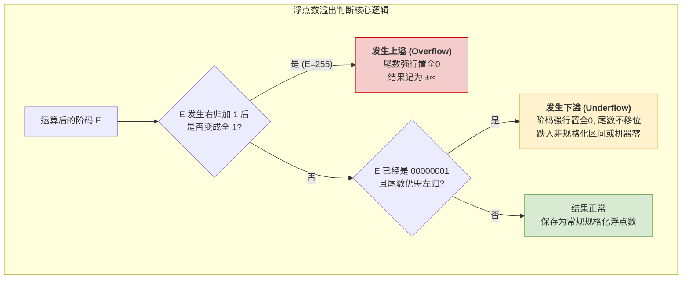

# 计算机组成原理：浮点数加减运算之“溢出判断”

> **导语**
> 各位同学大家好，本节课我们将完成浮点数加减运算的最后一块拼图——**溢出判断 (Overflow Check)**。
> 在经历了对阶、尾数加减、规格化和舍入四个步骤后，计算机还需要判断最终的结果是否超出了 IEEE 754 浮点数所能表示的范围。本节课我们将通过两个硬核的底层二进制实例，分别剖析**上溢 (Overflow)** 和 **下溢 (Underflow)** 的发生机制以及硬件的特殊处理逻辑。

---

## 浮点数加减运算五步曲回顾

1.  **对阶**：小阶向大阶看齐，尾数右移。
2.  **尾数加减**：阶码对齐后，进行尾数原码的相加减（底层转补码运算）。
3.  **尾数规格化**：左归（尾数左移，阶码减）或 右归（尾数右移，阶码加）。
4.  **尾数舍入**：处理超长的尾数位（默认就近舍入，即类似0舍1入）。
5.  **溢出判断**：**（本节核心）** 根据规格化后最终的**阶码状态**，判断是否发生上溢或下溢。

---

## 一、 上溢 (Overflow) 实例分析

### 1. 场景设定

假设有两个极大正数 $X$ 和 $Y$ 相加：

- $X = 2^{127}$
- $Y = 2^{127} + 2^{126}$
- **预期结果**：$Z = X + Y = \infty$ (无穷大)。

### 2. 二进制底层推演

1.  **提取机器码**：
    - $X$ 的阶码：`11111110` (真值 127)；尾数：`1.000...0`
    - $Y$ 的阶码：`11111110` (真值 127)；尾数：`1.100...0`
2.  **步骤 1：对阶**
    - 两数阶码相等，差值为 0，**无需对阶**。
3.  **步骤 2：尾数加减**
    - 将两个尾数相加：
      `  1.000...0`
      `+ 1.100...0`
      `-----------`
      ` 10.100...0`
4.  **步骤 3：尾数规格化 (核心环节)**
    - 相加后的尾数为 `10.100...0`，显然不符合规格化要求（小数点前只能有一个 `1`）。
    - **进行右归**：尾数整体向右移 1 位，变为 `1.0100...0`。
    - **阶码调整**：尾数右移 1 位，**阶码必须加 1**。
5.  **步骤 5：溢出判断 (上溢触发)**
    - 原本的阶码是 `11111110`，**加 1 后变成了 `11111111` (8 比特全 1)**。
    - 计算机硬件检测到阶码变为全 `1`，立刻判定发生了**正上溢**。

### 3. 硬件处理策略

- 一旦发生上溢，硬件会强行将**尾数全部置为 0**（抹去右归产生的尾数）。
- 最终机器码：符号位 `0`，阶码全 `1`，尾数全 `0` $\rightarrow$ 这是 IEEE 754 中 **正无穷 ($+\infty$)** 的标准表示。
- 同时，硬件会将“浮点数溢出异常标志位”置 1。但 IEEE 754 规定**默认不中断程序**，程序会带着 `inf` 结果继续向下运行，保证了极高的容错性。

> 🚨 **核心易错点：尾数溢出 $\neq$ 浮点数溢出**
> 尾数相加产生进位（如变成 `10.1`），仅仅是**尾数溢出**，这可以通过“右归”操作来纠正。
> **真正的浮点数溢出，是且仅是“阶码发生溢出”（来到了全 1 状态）**！

---

## 二、 下溢 (Underflow) 实例分析

### 1. 场景设定

假设有两个极小数值 $X$ 和 $Y$ 相加：

- $X = 2^{-126} + 2^{-149}$
- $Y = -2^{-126}$
- **预期结果**：$Z = X + Y = 2^{-149}$ (一个超出了规格化下限的极小值)。

### 2. 二进制底层推演

1.  **提取机器码**：
    - $X$ 的阶码：`00000001` (真值 -126)；尾数：`1.000...01` (末位为1)
    - $Y$ 的阶码：`00000001` (真值 -126)；尾数：`-1.000...00`
2.  **步骤 1：对阶**
    - 两数阶码相等，**无需对阶**。
3.  **步骤 2：尾数加减**
    - $X$ 的尾数减去 $|Y|$ 的尾数：
      `  1.000...01`
      `- 1.000...00`
      `-----------`
      `  0.000...01`
4.  **步骤 3：尾数规格化与溢出判断 (神奇的底层操作)**
    - 相加后的尾数为 `0.000...01`，最高位不是 `1`，按理说需要**左归**（尾数左移，阶码减 1）。
    - **矛盾出现**：当前的阶码已经是 `00000001` (规格化数允许的最小阶码)。如果再减 1，阶码将变成 `00000000` (全 0)。
    - **硬件的特殊处理逻辑**：当阶码已是 `00000001`，且尾数仍需左归时，计算机会**直接将阶码置为全 0，并且尾数保持原样，绝不进行移位！**

### 3. 硬件处理策略

- 最终机器码：符号位 `0`，阶码全 `0`，尾数 `000...01` (不全为0)。
- 这正是 IEEE 754 中 **非规格化浮点数** 的标准表示形式！
- **真值解读**：非规格化数的隐含前导位为 `0.`，固定阶码真值为 `-126`。因此真值为 $+0.000...01_2 \times 2^{-126} = 2^{-23} \times 2^{-126} = 2^{-149}$。计算完美自洽！

---

## 三、 溢出判定逻辑图解

通过上面两个例子，我们可以总结出浮点数溢出判断的终极逻辑树：

## 四、 本节小结

1.  **上溢的本质**：右归操作导致阶码加 1，触碰到了**阶码全 1** 的禁区。处理方式为置无穷大（不中断程序）。
2.  **下溢的本质**：左归操作导致阶码减 1，触碰到了**阶码全 0** 的禁区。处理方式为直接进入非规格化数区间（尾数放弃移位，隐含位变为 `0.`）；如果尾数恰好全 0，则下溢至**机器零**。
3.  **尾数溢出不是错**：尾数加减产生的进位是正常现象，靠右归调整即可。一定要盯紧**阶码**的变化！
