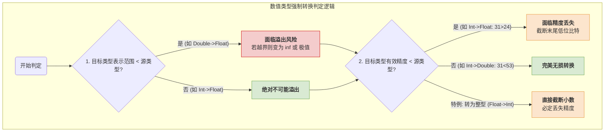

# 操作系统与计组：C语言中的浮点数类型转换

> **导语**
> 各位同学大家好，在这个视频中，我们要探讨 C 语言中的**浮点数类型转换**。这是历年真题中的高频考点，也是极易出错的盲区。
> 本节课我们将以 `int` 型、`float` 型和 `double` 型为例，分别探讨：**整型转浮点型**、**浮点型之间的互转** 以及 **浮点型转整型** 这几种情况下，是否会发生**溢出 (Overflow)**，以及是否会发生**精度丢失 (Precision Loss)**。

---

## 一、 数据类型的基本格式与范围回顾

在深入转换规则之前，必须先明确各个数据类型的底层结构和表示范围。C 语言中定义的 `float` 和 `double` 是完全符合 **IEEE 754** 标准的。

### 1. 结构与有效精度 (核心比对基准)

- **`int` 型 (32位)**：1 比特符号位 + **31 比特**有效数值位。（底层使用补码表示）
- **`float` 型 (单精度, 32位)**：1 比特符号位 + 8 比特阶码 (偏置值 127) + **23 比特**尾数。
  - _隐藏位法则_：规格化浮点数的尾数前隐含一个 `1`，故实际有效精度为 **$1 + 23 = 24$ 比特**。
- **`double` 型 (双精度, 64位)**：1 比特符号位 + 11 比特阶码 (偏置值 1023) + **52 比特**尾数。
  - _隐藏位法则_：同理，实际有效精度为 **$1 + 52 = 53$ 比特**。

### 2. 数值表示范围对比 (判断溢出的基准)

- **`int`**：约 $\pm 2.14 \times 10^9$
- **`float`**：约 $\pm 3.4 \times 10^{38}$
- **`double`**：约 $\pm 1.79 \times 10^{308}$

> 💡 **判别铁律**：
>
> - **看溢出**：比较“表示范围”。小范围转大范围绝不溢出，大范围转小范围可能溢出。
> - **看精度丢失**：比较“有效数值/尾数比特数”。目标类型的有效精度位数如果小于源类型，就可能发生精度丢失。

---

## 二、 整型转浮点型 (`int` $\rightarrow$ `float` / `double`)

### 1. 溢出分析：【不可能溢出】

由上述范围可知，`float` 和 `double` 的表示范围（$10^{38}$ 和 $10^{308}$ 数量级）远远覆盖了 `int` 型的表示范围（$10^9$ 数量级）。因此，`int` 转 `float` 或 `double` **绝不会发生溢出**。

### 2. 精度丢失分析

#### A. `int` $\rightarrow$ `float`：【可能发生精度丢失】

- **底层归因**：`int` 型最多包含 **31 位**有效数值，而 `float` 最多只能保存 **24 位**（含隐藏位）的有效精度。当 `int` 的有效数值超过 24 位时，强转为 `float` 只能保留高 24 位，最末尾的比特会被无情丢弃。
- **代码实例**：
  当 `int x = 16777217;` （即 $2^{24} + 1$，共占用 25 个有效比特位，首尾皆为 1），将其强转为 `float` 时，最低位的 `1` 会被丢弃。打印出的 `float` 值为 `16777216.0`，精度实实在在地丢失了。
  _(注：如果丢弃的末尾比特恰好全是 0，如 $2^{24}$，则虽遭截断但数值不变，不会发生精度丢失。因此结论是“**可能**”发生精度丢失。)_

#### B. `int` $\rightarrow$ `double`：【绝对安全，无精度丢失】

- **底层归因**：`double` 拥有高达 **53 位**的有效尾数精度，完全可以将 `int` 的 **31 位**有效数据完整、无损地“包容”进去，末尾补 0 即可。转换过程百分百无损。

---

## 三、 浮点型之间的互转 (`float` $\leftrightarrow$ `double`)

### 1. `float` $\rightarrow$ `double`：【无损转换，无溢出】

- **精度**：`double` (53位) > `float` (24位)，完美包容，不丢精度。
- **范围**：`double` ($10^{308}$) > `float` ($10^{38}$)，完美涵盖，绝不溢出。

### 2. `double` $\rightarrow$ `float`：【可能精度丢失，可能溢出】

- **精度丢失**：将 53 位的精度硬塞进 24 位的容器中，必然要舍弃后面的 29 位有效数值。如果被丢弃的部分不全为 0，就会发生精度丢失。
- **溢出 (Overflow)**：如果 `double` 保存了一个极大的数值（如 $1.0 \times 10^{40}$），超出了 `float` 能承受的最大上限，强转后 `float` 变量的值将被记为**无穷大 (`inf` 或 `-inf`)**。

---

## 四、 浮点型转整型 (`float` / `double` $\rightarrow$ `int`)

### 1. 精度丢失分析：【必定丢失小数精度】

- 浮点数能够表示小数点后的信息，而 `int` 型无法保留小数。
- **处理机制**：C 语言在执行浮点转整型时，处理方式非常简单粗暴——**直接截断（砍掉）小数部分，不进行任何四舍五入**。
  ```c
  float x = 5.75;
  int y = (int)x;
  printf("%d", y); // 输出结果永远是 5。底层二进制中 101.11 直接截断变为 101。
  ```

### 2. 溢出分析：【可能溢出】

- 浮点数的表示范围远大于 `int`。如果浮点数的整数部分超出了 `int` 能表示的最大极值（$\pm 2.14 \times 10^9$），强转为 `int` 就会发生溢出。
- **底层表现**：虽然 C 语言标准对这种溢出没有明确统一的规定，但在多数常见编译器中，严重正溢出通常会导致 `int` 变量被置为它能表示的**绝对值最大的负数**（即机器码最高符号位为 `1`，后面 31 位全 `0` 的补码：`1000...000`）。

---

## 五、 本节归纳总结与解题方法论

在考场上面对强制类型转换题，请在脑海中立刻调出这张总结表：

| 转换类型                           | 是否可能溢出 (看表示范围)  |       是否可能精度丢失 (看有效精度位)       |
| :--------------------------------- | :------------------------: | :-----------------------------------------: |
| `int` $\rightarrow$ `float`        |     ❌ 不可能 (范围大)     | ✅ **可能** ($31\text{bit} > 24\text{bit}$) |
| `int` $\rightarrow$ `double`       |     ❌ 不可能 (范围大)     |  ❌ 不可能 ($31\text{bit} < 53\text{bit}$)  |
| `float` $\rightarrow$ `double`     |    ❌ 不可能 (范围极大)    |  ❌ 不可能 ($24\text{bit} < 53\text{bit}$)  |
| `double` $\rightarrow$ `float`     |  ✅ **可能** (变成 `inf`)  | ✅ **可能** ($53\text{bit} > 24\text{bit}$) |
| `float/double` $\rightarrow$ `int` | ✅ **可能** (变成异常极值) |     ✅ **必定丢失** (直接截断小数部分)      |

### 逻辑分析全景图



### 💡 核心做题诀窍

当大题要求你具体分析 `int` 强转为 `float` 时，请严格遵循以下实操步骤：

1.  **取原码**：`int` 是带符号的补码，而浮点数的尾数是原码标准。务必先将 `int` 补码转化为**原码**。
2.  **数长度**：观察原码的数值部分，从第一个出现的有效位 `1`，一直数到最后一位 `1`，统计这段距离一共占用了多少个比特。
3.  **判精度**：看这段有效位是否超过了 `float` 能容纳的 24 位上限。
    - 未超过 $\rightarrow$ 精度无损。
    - 超过，且被舍弃的低位中包含 `1` $\rightarrow$ 精度确实丢失。
    - 超过，但被舍弃的低位恰巧全是 `0` $\rightarrow$ 精度无损。
