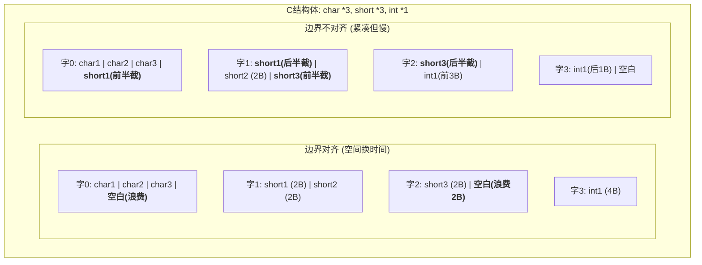

# 计算机组成原理：数据的存储和排列

> **导语**
> 各位同学大家好，本节课我们要探讨的是数据在内存中的存储和排列问题。主要包含两大核心考点：**大小端模式 (Big-Endian & Little-Endian)** 和 **边界对齐存储 (Data Alignment)**。理解这些底层机制，有助于我们在进行底层 C/C++ 编程或分析内存转储时，准确解析数据的真实面貌。

---

## 一、 大小端模式 (Endianness)

在内存中，多字节的数据类型（如占据 4 个字节的 `int` 型变量）需要被拆分成一个个字节连续存储。根据这些字节在内存地址中的排列顺序，分为**大端模式**和**小端模式**。

**【示例概念准备】**
假设有一个 32 位 (4 字节) 的 `int` 型数据，其十六进制值为 `0x01234567`。

- **MSB (Most Significant Byte)**：最高有效字节，即 `01`。
- **LSB (Least Significant Byte)**：最低有效字节，即 `67`。

### 1. 大端模式 (Big-Endian)

- **规则**：将数据的**最高有效字节 (MSB)** 存放在内存的**低地址**部分，最低有效字节 (LSB) 存放在高地址部分。
- **特点**：顺着内存地址递增的方向读过去，数据的排列与我们人类阅读十六进制数的习惯**完全一致**。

### 2. 小端模式 (Little-Endian)

- **规则**：将数据的**最低有效字节 (LSB)** 存放在内存的**低地址**部分，最高有效字节 (MSB) 存放在高地址部分。（即“逆序”存放）
- **特点**：虽然不符合人类的直观阅读习惯，但**更方便机器处理**。因为 CPU 在处理加法运算时，通常是从低位字节开始加起，如果低位字节刚好存放在低地址，CPU 就能按地址递增顺序最先读到它，从而提高处理效率。

```mermaid
graph TD
    subgraph 数据 0x01234567 在内存中的存储对比
        direction LR

        subgraph 内存地址 (递增)
            ADDR[0x0800] --> ADDR1[0x0801] --> ADDR2[0x0802] --> ADDR3[0x0803]
        end

        subgraph 大端模式 (Big-Endian)
            B1[<b>01</b> (MSB)] --> B2[23] --> B3[45] --> B4[<b>67</b> (LSB)]
            style B1 fill:#fce5cd,stroke:#e69138
            style B4 fill:#d9ead3,stroke:#6aa84f
        end

        subgraph 小端模式 (Little-Endian)
            L1[<b>67</b> (LSB)] --> L2[45] --> L3[23] --> L4[<b>01</b> (MSB)]
            style L1 fill:#d9ead3,stroke:#6aa84f
            style L4 fill:#fce5cd,stroke:#e69138
        end
    end
```

---

## 二、 寻址方式基础与地址转换

现代计算机通常是**按字节编址**的（即每个内存地址对应 1 个字节）。但 CPU 同样支持**按半字**或**按字**寻址。

假设机器的字长为 32 位（即 1 个字 = 4 字节，1 个半字 = 2 字节）：

- **按字节寻址**：给出地址 `N`，直接读取内存中编号为 `N` 的那个字节。
- **按半字寻址**：给出半字地址 `N`，读取连续的 2 个字节。
  - **地址转换**：字节起始地址 = 半字地址 $\times 2$ (即在二进制末尾添 1 个 `0`，**逻辑左移 1 位**)。
- **按字寻址**：给出字地址 `N`，读取连续的 4 个字节。
  - **地址转换**：字节起始地址 = 字地址 $\times 4$ (即在二进制末尾添 2 个 `0`，**逻辑左移 2 位**)。
  - _示例_：要访问字地址为 `2` (`10_2`) 的字，其对应的字节起始地址为 `8` (`1000_2`)。

---

## 三、 边界对齐存储 (Data Alignment)

在探讨对齐问题前，需要明确一个极其重要的硬件限制：

> 🚨 **硬件铁律**：CPU 每次访存只能读写**一个完整的字**（例如从地址 `0, 4, 8, 12...` 处读取 4 个字节），**绝对不能跨字（跨行）读取**！

假设我们在 C 语言中定义了一个结构体，依次包含：3 个 `char` (各占 1 字节)，3 个 `short` (各占 2 字节)，1 个 `int` (占 4 字节)。

### 1. 边界不对齐 (Unaligned Storage)

- **机制**：数据挨个紧凑存放，不留任何缝隙。
- **问题所在**：当存放完 3 个 `char` 后，第一个字只剩 1 个字节的空位。此时接着存放第 1 个 `short`（需 2 字节），导致它的**前半截存放在第一个字的末尾，后半截跨到了第二个字的开头**。
- **致命缺陷**：根据硬件铁律，如果 CPU 想要读取这个被劈成两半的 `short` 变量，就必须发起**两次访存操作**（分别读出第一个字和第二个字），再通过移位和拼接才能得到完整数据，极其耗时！

### 2. 边界对齐 (Aligned Storage)

- **机制**：保证每种类型的数据，其起始字节地址必须是其自身大小的整数倍。例如，`short` 的起始地址必须是 2 的倍数，`int` 的起始地址必须是 4 的倍数。
- **解决过程**：当存放完 3 个 `char` 后，遇到需占 2 字节的 `short` 时。由于当前地址不满足 2 的倍数（且所在行空间不足以放下一个完整的 `short`），系统会**直接跳过这 1 个字节的空位（用空白填充浪费掉）**，将 `short` 对齐放到下一行的起始位置（或者是当前行的下一个合法半字边界）。
- **优势**：确保任何一个基本类型变量都不会跨越字边界。CPU 读取任何变量都只需**一次访存**即可搞定。



> **总结**：边界对齐存储本质上是一种**“以空间换时间”**的策略。宁可浪费少许内存字节作为填充物，也要保证 CPU 的访存效率最大化，这也是现代编译器和操作系统的默认行为。
