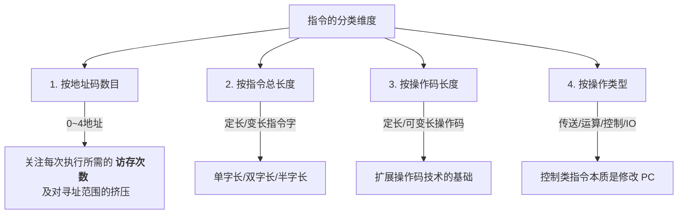

# 计算机组成原理：指令格式与分类

> **导语**
> 各位同学大家好，从这一小节开始，我们将进入《计算机组成原理》第四章——**指令系统**的学习。
> 在第二章和第三章中，我们分别学习了运算器（如何进行加减乘除移位）和存储器（数据如何存放与读取）。从本章开始，我们将聚焦于 CPU 的核心——**控制器**。控制器负责解析指令并协调各部件工作。本节课，我们将从指令的基本概念出发，深入探讨指令的结构，并根据地址码数量、指令长度、操作码长度以及操作类型等四个维度，对指令进行详细的分类解析。

---

## 一、 指令的基本概念与结构

**指令（机器指令）**：是计算机运行的最小功能单位，用于指示计算机执行某种操作的命令。
**指令系统（指令集）**：一台计算机所能支持的所有指令的集合。不同架构的 CPU（如 x86 和 ARM）拥有完全不同的指令集，这就是为什么电脑软件不能直接在手机上运行的原因。

在逻辑上，一条标准的指令可以划分为两个核心部分：

- **操作码 (Opcode)**：指明 CPU 应该“做什么”（如加法、乘法、停机）。
- **地址码 (Address/Operand)**：指明参与操作的“对象是谁”（即操作数存放在哪里）。

```mermaid
graph LR
    subgraph 典型指令结构
        direction LR
        OP[操作码 <br> (干什么?)] --- ADDR[地址码 <br> (对谁干?)]
    end
```

---

## 二、 按“地址码数目”分类

由于不同的操作需要的操作数数量不同，指令包含的地址码数目也会有所变化。通常可以分为以下五类：

### 1. 零地址指令

- **格式**：`[ 操作码 OP ]`
- **适用场景**：
  1.  **无需操作数的操作**：如 `HALT` (停机指令)、`NOP` (空操作)、开/关中断指令。
  2.  **堆栈型计算机的运算**：操作数隐含在堆栈的“栈顶”和“次栈顶”。执行如加法指令时，硬件会自动弹出栈顶两个元素，相加后再将结果压回栈顶。_(此模式常用于后缀表达式的硬件计算)_。

### 2. 一地址指令

- **格式**：`[ 操作码 OP | 地址码 A1 ]`
- **适用场景**：
  1.  **单操作数运算**：如自增 (+1)、自减 (-1)、求反码。指令含义为：`OP(A1) -> A1`。
      _(执行过程：访存取指令 $\rightarrow$ 访存取操作数 $\rightarrow$ 访存存回结果，共计 **3 次**访存)_。
  2.  **隐含双操作数运算**：另一个操作数固定隐含在 CPU 的特定寄存器中（通常是累加器 `ACC`）。指令含义为：`(ACC) OP (A1) -> ACC`。
      _(执行过程：访存取指令 $\rightarrow$ 访存取操作数 A1，因结果存回寄存器，共计 **2 次**访存)_。

### 3. 二地址指令 (最常见)

- **格式**：`[ 操作码 OP | 地址码 A1 | 地址码 A2 ]`
- **适用场景**：常用于需要两个操作数的算术/逻辑运算。
- **指令含义**：`(A1) OP (A2) -> A1`。（将运算结果默认覆盖存回 A1 所在的地址）。
- _(执行过程：取指令 $\rightarrow$ 取A1 $\rightarrow$ 取A2 $\rightarrow$ 存回A1，共计 **4 次**访存)_。

### 4. 三地址指令

- **格式**：`[ 操作码 OP | 地址码 A1 | 地址码 A2 | 地址码 A3 ]`
- **适用场景**：需要两个操作数，且显式指定运算结果的存放位置。
- **指令含义**：`(A1) OP (A2) -> A3`。
- _(执行过程：取指令 $\rightarrow$ 取A1 $\rightarrow$ 取A2 $\rightarrow$ 存回A3，共计 **4 次**访存)_。

### 5. 四地址指令

- **格式**：`[ 操作码 OP | 地址码 A1 | 地址码 A2 | 地址码 A3 | 地址码 A4 ]`
- **适用场景**：除了指定双操作数和结果存放位置外，还额外指定**下一条要执行的指令地址**。
- **指令含义**：`(A1) OP (A2) -> A3`，随后将程序计数器 `PC` 的值修改为 `A4`。

> 💡 **核心考点：地址码位数的博弈**
> 假设指令总长度固定：地址码的个数越多，分给每个地址码的位数 $n$ 就越少。而 $n$ 位地址码只能寻址 $2^n$ 个主存单元。因此，**地址码数量越多，指令的寻址能力（范围）就越差**。

---

## 三、 按“指令总长度”分类

首先需要理清三个极其容易混淆的字长概念：

- **机器字长**：CPU 一次能处理的二进制位数，固定不变。
- **存储字长**：主存一个存储单元能够保存的二进制位数，固定不变。
- **指令字长**：一条指令的总长度（比特数），**可能会发生变化**。

### 1. 长度倍数描述

如果某条指令的长度恰好等于机器字长，称为**单字长指令**；如果等于机器字长的两倍，称为**双字长指令**；如果是机器字长的一半，称为**半字长指令**。
_(注：如果机器字长与存储字长相等，取一条双字长指令需要进行 **2次** 访存，严重影响取指效率。)_

### 2. 结构分类

- **定长指令字结构**：指令系统中所有指令的长度都完全相等。
- **变长指令字结构**：指令系统中不同指令的长度可以不相等。

---

## 四、 按“操作码长度”分类

- **定长操作码指令系统**：所有指令的“操作码 OP”部分占用的比特位数固定不变。
  - _特点_：硬件控制器的译码电路设计极其简单。若操作码长为 $n$ 位，则系统最多支持 $2^n$ 条指令。
- **可变长操作码指令系统**：不同指令的操作码位数可以变化。
  - _特点_：译码电路极其复杂，但能在有限的指令字长内灵活地分配操作码和地址码的空间。
  - _(引申：下一节我们将重点学习的“扩展操作码”技术，就是在**定长指令字结构**中，通过改变操作码长度来增加指令类型的精妙设计。)_

---

## 五、 按“操作类型”分类

根据指令实际指挥计算机干什么活，可以将其分为四大类：

1.  **数据传送类指令**：用于 CPU 寄存器与主存之间的数据搬运（如 `LOAD` 取数，`STORE` 存数）。
2.  **运算类指令**：
    - _算术运算_：加减乘除。
    - _逻辑运算_：与、或、非、异或。
    - _移位运算_：算术移位、逻辑移位、循环移位。
3.  **程序控制类 (转移类) 指令**：用于改变程序的执行流（即修改 `PC` 的值）。
    - 如：无条件转移 (`JUMP`)、条件转移 (`BRANCH`)、函数调用 (`CALL`) 与返回 (`RET`)、陷入指令 (`TRAP`) 等。
4.  **输入输出类 (I/O) 指令**：专门用于 CPU 与 I/O 接口端口之间的数据交互（如上节课学过的 `IN` 和 `OUT` 指令）。

---

## 本节归纳总结

本节课我们建立了指令系统的全景认知框架，请务必在脑海中刻下以下四种分类维度：


