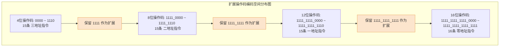

# 计算机组成原理：扩展操作码指令格式

> **导语**
> 各位同学大家好，在这个小节中我们要学习**扩展操作码 (Expanding Opcodes)**。
> 在上一小节中，我们了解到指令由“操作码”和“地址码”组成。如果整个系统中**指令总长度固定不变**（定长指令字结构），但在不同指令中**操作码的长度可以改变**，这种精妙的设计就是“扩展操作码”。它能够在有限的指令位宽内，根据地址码数量的递减，神奇地变出大量的空余位给操作码，从而支持极其丰富的指令种类。本节我们将通过具体的计算和设计实例，彻底搞懂扩展操作码的原理和设计规则。

---

## 一、 为什么需要扩展操作码？

假设我们有一套定长指令字结构的系统，**指令字长为 16 位**，**每个地址码占 4 位**。

- **如果采用定长操作码**：要设计三地址指令，3个地址码共占 $3 	imes 4 = 12$ 位，留给操作码的只剩 4 位。4位操作码最多只能表示 $2^4 = 16$ 种指令。这意味着整个系统不论是一地址还是零地址指令，操作码统统被锁死在 4 位，总指令条数不可能超过 16 条！这显然太少了。
- **采用扩展操作码**：当地址码数量减少时（如从三地址变为二地址），省下来的 4 位空间可以“上交”给操作码，让操作码从 4 位扩展到 8 位、12 位甚至 16 位！这样就能表示出成百上千种不需要那么多操作数的指令。

---

## 二、 经典扩展操作码设计实例推演

> **【设计条件】**
> 指令字长 16 位，每个地址码占 4 位。
> **要求设计**：15条三地址指令、15条二地址指令、15条一地址指令、16条零地址指令。

### 1. 三地址指令的分配

- **空间占用**：地址码占 $3 	imes 4 = 12$ 位。操作码剩 4 位（第 12~15 位）。
- **分配方案**：4 位能表示 16 种状态 (`0000` ~ `1111`)。我们取前 15 种 (`0000` ~ `1110`) 用于表示 15 条三地址指令。
- **扩展窗口**：留下最后一种状态 **`1111` 作为“逃逸码”或“扩展窗口”**，留给下一级的二地址指令。

### 2. 二地址指令的分配

- **空间占用**：地址码占 $2 	imes 4 = 8$ 位。操作码现在可以扩展到 8 位（第 8~15 位）。
- **前缀铁律**：因为所有三地址指令都不以 `1111` 开头，所以二地址指令**必须全部以 `1111` 开头**。
- **分配方案**：前 4 位固定为 `1111`，紧跟的 4 位（第 8~11 位）有 16 种状态 (`0000` ~ `1111`)。我们取前 15 种用于表示 15 条二地址指令。
- **扩展窗口**：留下 `1111 1111` 作为向一地址指令扩展的窗口。

### 3. 一地址和零地址指令的分配

以此类推：

- **一地址指令**：前 8 位必须是 `1111 1111`。紧跟的 4 位取 15 种状态。留下 `1111 1111 1111` 作为向零地址扩展的窗口。
- **零地址指令**：前 12 位必须是 `1111 1111 1111`。由于没有更低级的指令了，最后 4 位（第 0~3 位）的全部 16 种状态 (`0000` ~ `1111`) 都可以分配给 16 条零地址指令。

> 🚨 **CPU 是如何无歧义译码的？**
> CPU 读入 16 位指令后，会先看最前面的 4 位：
>
> - 如果不是 `1111` $\rightarrow$ 肯定是三地址指令，后面 12 位当地址码处理。
> - 如果是 `1111`，再看紧接着的 4 位：若不是 `1111` $\rightarrow$ 肯定是二地址指令。
> - 以此类推，像剥洋葱一样层层解析，绝不会出现歧义。

---

## 三、 扩展操作码设计的两大核心原则

在设计扩展操作码时，必须严守以下底线，这也是考试最爱出判断题的地方：

1.  **不允许短码是长码的前缀 (哈夫曼前缀铁律)**：
    - **核心准则**：任何一条指令的短操作码，绝对不能和任何长操作码的前端部分完全相同！
    - _解释_：如果三地址指令的某个操作码是 `1111`，而二地址指令的操作码是 `1111_0000`。当 CPU 读到开头的 `1111` 时，它到底该把这条指令当成三地址还是二地址？这就产生了致命的歧义。
2.  **各指令的操作码一定不能重复**：
    - **核心准则**：任何两条指令的完整操作码二进制序列必须唯一。
3.  **使用频率优化原则 (可选)**：
    - 通常将**使用频率最高的指令分配给最短的操作码**（如三地址或二地址）。操作码越短，译码电路分析的时间越短。这种思想与《数据结构》中的哈夫曼编码 (Huffman Coding) 完全一致。

---

## 四、 复杂情况下的空余状态计算法 (★ 大题必杀技)

如果题目要求的指令条数不是刚好 15 条这种规整的数字怎么办？我们需要掌握通用的计算公式：

> 💡 **核心计算公式**：
> **本层可提供的最大状态数 = 上一层保留的扩展窗口数 $m$ $\times$ 本层新增地址码释放出的状态数 ($2^n$)**
> _(其中 $n$ 为一个地址码的比特位数)_

**【进阶真题推演】**

> **条件**：指令长 16 位，每地址占 4 位。
> **要求设计**：13条三地址、12条二地址、62条一地址、32条零地址。能否实现？

1.  **三地址层 (4位 OP)**：
    - 4位空间共有 $2^4 = 16$ 种状态。
    - 需求 13 条。分配 `0000` ~ `1100`。
    - **上一层留给二地址的扩展窗口数 $m_1 = 16 - 13 = 3$ 种。** (即 `1101`, `1110`, `1111`)。
2.  **二地址层 (8位 OP)**：
    - 利用上一层的 3 种前缀，加上释放的 4 位地址空间 ($2^4 = 16$)，本层**最大可用状态数** = $3 \times 16 = 48$ 种。
    - 需求 12 条。
    - **留给一地址的扩展窗口数 $m_2 = 48 - 12 = 36$ 种。**
3.  **一地址层 (12位 OP)**：
    - 利用上一层的 36 种前缀，加上释放的 4 位地址空间，本层**最大可用状态数** = $36 \times 16 = 576$ 种。
    - 需求 62 条。
    - **留给零地址的扩展窗口数 $m_3 = 576 - 62 = 514$ 种。**
4.  **零地址层 (16位 OP)**：
    - 利用上一层的 514 种前缀，加上释放的最后 4 位地址空间，本层**最大可用状态数** = $514 \times 16 = 8224$ 种。
    - 需求仅仅 32 条。8224 远大于 32。**完全可以实现！**

---

## 五、 本节复习要点对比总结

| 指令格式类型          |     操作码位数     |    指令支持条数     |      译码器设计难度       |    内存空间利用率     |
| :-------------------- | :----------------: | :-----------------: | :-----------------------: | :-------------------: |
| **定长操作码**        |      固定不变      | 较少 ($2^n$ 被锁死) |  **最简单** (硬件容易造)  | 较差 (浪费多余地址位) |
| **扩展操作码 (变长)** | 随地址数减少而变长 |    **极其丰富**     | **较复杂** (需层层剥洋葱) |         极高          |

> **一句话精要**：扩展操作码就是在定长的 16 位或 32 位指令框框里，通过减少地址码的数量，将腾出来的“坑位”借给操作码使用。只要坚守**“短码不能是长码的前缀”**这条红线，就能用有限的位数变幻出成百上千种指令。
