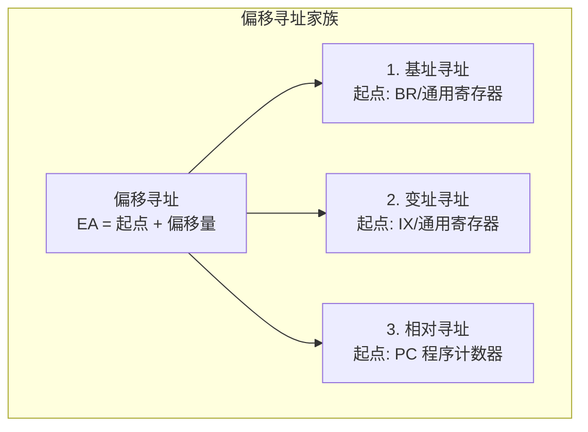

# 计算机组成原理：数据寻址方式 (下) —— 偏移寻址

> **导语**
> 各位同学大家好，在上一小节中，我们介绍了六种基础的数据寻址方式。本节课我们将深入学习剩下的三种高阶数据寻址方式：**基址寻址**、**变址寻址** 和 **相对寻址**。
> 这三种方式可以统称为 **“偏移寻址”**。它们的核心思想非常统一：都是以某一个特定的地址作为“起点”，再加上指令中给出的形式地址作为“偏移量”，从而算出最终的有效地址。理解它们各自的“起点”寄存器是什么，以及它们在操作系统和高级语言编程中的实际应用场景，是攻克本节考研重难点的关键。

---

## 一、 偏移寻址的核心思想

偏移寻址的通用有效地址计算公式为：
$$ \text{EA (有效地址)} = \text{起点地址} + \text{A (形式地址 / 偏移量)} $$

根据“起点地址”存放位置的不同，分为以下三种：

---

## 二、 基址寻址 (Base Addressing)

### 1. 核心机制

- **起点**：**基址寄存器 (BR, Base Register)** 或被指定的通用寄存器。
- **有效地址公式**：**EA = (BR) + A**。
  _(注：这里 `A` 通常被看作**偏移量**，而 `BR` 里存放的是**基地址**)_。

### 2. 为什么需要基址寻址？(解决“程序浮动”问题)

在多道程序并发运行的操作系统中，程序每次被加载到主存的位置（起始物理地址）可能都不一样。

- 如果使用直接寻址（写死物理地址），程序一旦换个地方加载，所有地址就全错了。
- 使用基址寻址时，**编译器只生成从 0 开始的相对偏移量 (A)**。当程序被真正装入主存时，**操作系统负责将程序的“物理起始地址”写入基址寄存器 (BR)**。
- 这样，指令执行时，硬件自动用 `(BR) + A` 算出真实的物理地址。程序无论被丢到主存的哪个角落，都能正常运行！

### 3. 特点总结

- **面向对象**：面向**操作系统**（BR 的值由 OS 控制，普通程序员无法随意修改）。
- **核心优势**：方便实现**多道程序并发运行**和**程序的动态浮动**；同时，长位数的 BR 加上短位数的 A，可以**扩大指令的寻址范围**。

---

## 三、 变址寻址 (Indexed Addressing)

### 1. 核心机制

- **起点**：**变址寄存器 (IX, Index Register)** 或被指定的通用寄存器。
- **有效地址公式**：**EA = (IX) + A**。
  _(注：在变址寻址的常规逻辑中，**`A` 被看作基地址 (起点)**，而 **`IX` 被看作动态变化的偏移量**，这与基址寻址的视角恰好相反！)_

### 2. 为什么需要变址寻址？(解决“数组遍历 / 循环”问题)

假设要写一个 `for` 循环把数组 `a[0]` 到 `a[9]` 全部加起来。

- 如果不使用变址寻址，你需要写 10 条独立的加法指令，每条指令分别写死 `a[0]`, `a[1]`... 的物理地址。这违背了循环的初衷。
- 使用变址寻址，只需这样设计：
  - 把数组的起始地址（首地址）填入形式地址 `A` 中。
  - 将变址寄存器 `IX` 初始清零。每次循环后执行 `IX++`。
  - 循环体内只用写一条加法指令：`ADD (IX)+A`。硬件会自动算出 `a[0], a[1], a[2]` 的地址。

### 3. 特点总结

- **面向对象**：面向**用户程序员**（程序员可以自由读写、修改 IX 的值来实现循环逻辑）。
- **核心优势**：极其适合处理**数组问题**、**循环程序**以及**字符串操作**。

> **💡 复合寻址拓展：基址寻址 + 变址寻址**
> 在实际的复杂系统中（如数组不仅要循环，整个程序还要在主存中浮动），通常将两者结合：**EA = (BR) + (IX) + A**。先用 BR 找程序的头，再用 A 找数组的头，最后用 IX 找当前的数组元素。

---

## 四、 相对寻址 (Relative Addressing)

### 1. 核心机制

- **起点**：**程序计数器 (PC)**。
- **有效地址公式**：**EA = (PC) + A**。
  _(注：形式地址 `A` 用**补码**表示，可正可负，实现向前或向后偏移)_。

> 🚨 **高频大坑预警：相对寻址的基准到底是哪条指令？**
> 很多教材说相对寻址是相对于“当前指令”。这是极易算错的！
> 记住铁律：**CPU 取出当前指令后，PC 的值会立刻自动加 1，指向下一条指令。**
> 因此，执行阶段算有效地址时：**相对寻址是基于“下一条指令的地址”进行偏移的！**

### 2. 为什么需要相对寻址？(解决“代码段内部浮动”问题)

通常用于 **条件转移指令 (如 if 语句生成的 Jump 指令)**。

- 假设一个 `for` 循环，循环底部的指令需要跳回循环开头的加法指令。
- 如果使用绝对地址（如 `JMP 100`），一旦这段代码在程序内部被程序员移动了位置（增加或删除了几行代码），或者程序被分段存储，绝对地址 `100` 就失效了。
- 如果使用相对寻址（如 `JMP -4`），意思是“无论代码被搬到哪里，只要跳转到**距离 PC 往回数 4 个指令**的位置即可”。这样，这段代码块就具备了极强的自我封闭性和可移植性。

### 3. 特点总结

- **核心优势**：方便实现**一段代码在程序内部的浮动**，广泛应用于**转移类指令**。

---

## 五、 本节寻址方式大总结

| 寻址方式     |  起点寄存器   |     公式      | 偏移量是谁 |  谁来管理控制  | 核心应用场景                                        |
| :----------- | :-----------: | :-----------: | :--------: | :------------: | :-------------------------------------------------- |
| **基址寻址** | **BR** (基址) | EA = (BR) + A |   **A**    |  **操作系统**  | 扩大寻址范围，**整个程序在内存中的浮动 (多道程序)** |
| **变址寻址** | **IX** (变址) | EA = (IX) + A |   **IX**   | **用户程序员** | **数组处理，编织循环程序**                          |
| **相对寻址** |    **PC**     | EA = (PC) + A |   **A**    |       -        | **转移指令，代码块在程序内部的浮动**                |

---

## 六、 【硬件拓展】CPU 是如何判断 "if (a > b)" 的？

在汇编语言或机器码层面，并没有高级语言那种 `if-else` 的直观语法。硬件其实是通过**减法运算**结合**程序状态字 (PSW / 标志寄存器)** 来实现的。

1.  **比较指令 (Compare)**：硬件执行 `CMP a, b`，本质上是让 ALU 执行一次**隐式的减法操作 (`a - b`)**。减法的结果不会保存，但会改变 PSW 寄存器中的状态位。
2.  **PSW 状态位更新**：
    - **ZF (零标志)**：若 `a - b = 0`，则 `ZF = 1`。说明 $a = b$。
    - **SF (符号标志)**：若 `a - b < 0`，则 `SF = 1`。
    - **CF (进/借位标志)** 和 **OF (溢出标志)**：用于无符号数和有符号数的大小判定辅助。
3.  **条件跳转指令接力**：
    - `JE` (Jump if Equal)：硬件去查 `ZF`，如果 `ZF == 1`，则修改 PC 执行跳转。
    - `JG` (Jump if Greater)：硬件去查相应的状态位组合，如果判断出 $a > b$，则修改 PC 执行跳转。

这就是高级语言中形形色色的 `if` 判断，在最底层的机器硅片上的真实运作逻辑。
