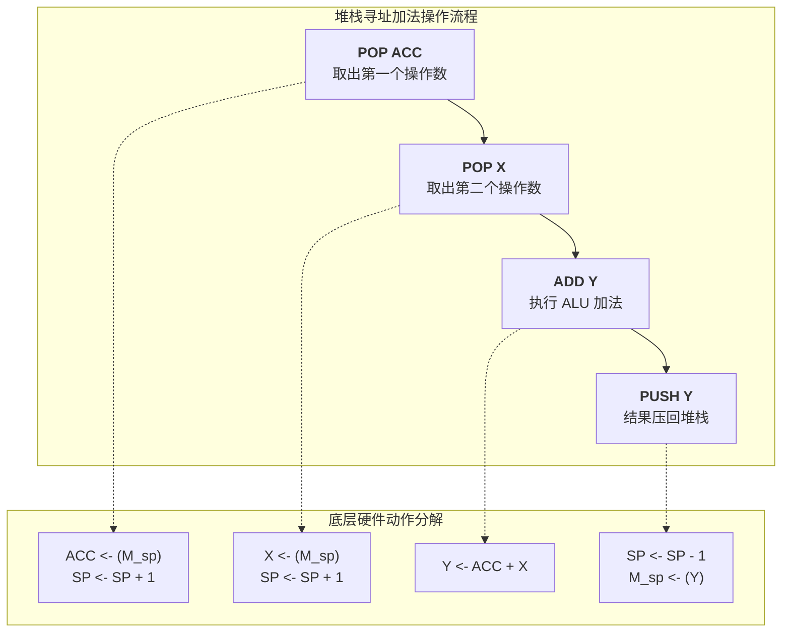

# 计算机组成原理：数据寻址方式之“堆栈寻址”

> **导语**
> 各位同学大家好，在这个小节中，我们会学习最后一种数据寻址方式——**堆栈寻址 (Stack Addressing)**。
> 经过前面几个小节的学习，我们已经把前边的九种数据寻址方式给搞定了。现在，让我们一起来探索这种在函数调用、中断处理以及后缀表达式计算中扮演核心角色的特殊寻址方式。

---

## 一、 堆栈寻址的核心概念

### 1. 什么是堆栈寻址？

如果一条指令采用的是堆栈寻址，就意味着**这条指令想要寻找的操作数存放在某一个堆栈当中**。
在《数据结构》课程中我们学过，堆栈 (Stack) 是一种只能从其中一端进行插入 (Push) 和删除 (Pop) 的数据结构，遵循**后进先出 (LIFO)** 的原则。

### 2. 堆栈指针寄存器 (SP)

- CPU 内部设有一个专门的**堆栈指针寄存器 (SP, Stack Pointer)**。
- `SP` 始终指向当前堆栈的**栈顶元素**所在的存储位置。
- **隐含性**：采用堆栈寻址的指令（如零地址的加法指令、`PUSH`、`POP` 等），**不需要显式地给出操作数的存放地址**。操作数的地址是隐含的，即隐含在 `SP` 寄存器当中。

### 3. 堆栈的两种硬件实现方式

- **硬堆栈 (Hard Stack)**：利用 CPU 内部的**一组专门的寄存器**来实现堆栈。
- **软堆栈 (Soft Stack)**：在**主存**中划出特定的一片连续区域来作为堆栈。（**这是实际系统中最常用的方式**）。

---

## 二、 堆栈操作实例：用硬堆栈实现加法计算

假设我们用 $R_0 \sim R_3$ 四个通用寄存器来实现一个硬堆栈，并规定**地址较小的寄存器（如 $R_0$）作为栈顶**。当前 $SP$ 指向 $R_0$。
我们需要将栈顶和次栈顶的两个元素相加，结果存回栈顶。

### 1. 初始状态

- $R_0$ (栈顶): `0001` （加数）
- $R_1$ (次栈顶): `1001` （被加数）
- $SP$ 指向 $R_0$。
- 另有 `ACC` (累加器), `X`, `Y` 寄存器用于辅助运算。为了书写方便，记当前栈顶单元为 $M_{sp}$。

### 2. 执行过程 (Pop & Push 操作拆解)

**步骤详解：**

1.  **出栈 `POP ACC`**：
    - 把当前栈顶元素（$R_0$ 中的 `0001`）送入 `ACC`。
    - **由于弹出元素，栈顶下移**。在此例（栈顶在小地址方向）中，使 **$SP \leftarrow SP + 1$**，指向 $R_1$。（逻辑上相当于删除了栈顶元素）。
2.  **出栈 `POP X`**：
    - 把新栈顶元素（$R_1$ 中的 `1001`）送入 `X`。
    - **$SP \leftarrow SP + 1$**，指向 $R_2$。
3.  **加法 `ADD Y`**：
    - ALU 将 `ACC` 和 `X` 中的数据相加 (`0001 + 1001 = 1010`)，结果送入寄存器 `Y`。
4.  **入栈 `PUSH Y`**：
    - **由于压入元素，必须先移动栈顶指针腾出空位**。使 **$SP \leftarrow SP - 1$**，重新指向 $R_1$。
    - 将 `Y` 中的运算结果 `1010` 写入当前 $SP$ 指向的位置（覆盖原有数据）。

> ⚠️ **重要考点防坑**：
> 上述例子中，$SP$ 是向大地址方向（加1）出栈。如果题目规定**栈顶处于地址更大**的方向（或栈底固定在某地址），则 $SP$ 在 `PUSH` 和 `POP` 时的加减方向**会完全相反**。大家在做题时，务必先画图明确堆栈是向上生长还是向下生长。

---

## 三、 硬堆栈与软堆栈的对比

在实际运行中，程序的函数调用、局部变量保存、中断现场保护等，都高度依赖堆栈寻址。

| 堆栈类型   | 物理实现介质               | 执行期访存次数 (`PUSH`/`POP` 时) | 优缺点对比                                         | 实际应用                   |
| :--------- | :------------------------- | :------------------------------: | :------------------------------------------------- | :------------------------- |
| **硬堆栈** | CPU 内部的一组**寄存器**   |             **0 次**             | 速度极快，无需访存；但成本高，容量极小。           | 早期或特殊架构机型         |
| **软堆栈** | 从**主存**中划出的一片区域 |             **1 次**             | 成本低，容量巨大；但速度较慢，每次出入栈都需访存。 | **现代操作系统的绝对主流** |

- _注意：这里所说的“访存次数”是指在**指令执行期间**（排除取指令的那 1 次访存）。_

---

## 四、 本节与本章复习要点总结

### 1. 堆栈寻址的有效地址 (EA) 确定

- **出栈 (POP)** 时：有效地址 **EA = SP 当前所指的地址**。操作数取出后，SP 再变化。
- **入栈 (PUSH)** 时：必须**先使 SP 变化**（加1或减1，取决于堆栈生长方向），变化后的新地址才是写入数据的有效地址 **EA**。

### 2. 数据寻址方式的“全家福”回顾

至此，我们已经完成了第四章最核心考点——**十种数据寻址方式**的学习。请在脑海中再次复现它们的特征，这是大题和选择题的必考重灾区：

1.  **隐含寻址**：地址藏在硬件（如 ACC）中，不显式写出。
2.  **立即寻址**：形式地址就是操作数本身，速度最快。
3.  **直接寻址**：形式地址就是真实的物理主存地址。
4.  **间接寻址**：形式地址是主存中存放指针的地址。
5.  **寄存器寻址**：操作数在通用寄存器中。
6.  **寄存器间接寻址**：通用寄存器中存放的是主存的指针。
7.  **相对寻址**：起点是 `PC`（下一条指令的地址），常用于转移指令。
8.  **基址寻址**：起点是 `BR`，常由操作系统管理，用于程序的整体浮动。
9.  **变址寻址**：起点是 `IX`，面向用户，常用于数组和循环遍历。
10. **堆栈寻址**：起点是 `SP`，用于函数调用和后进先出逻辑。

建议大家结合课后习题，重点训练各种寻址方式下有效地址的计算方式、执行阶段的访存次数，以及它们各自不可替代的应用场景。
