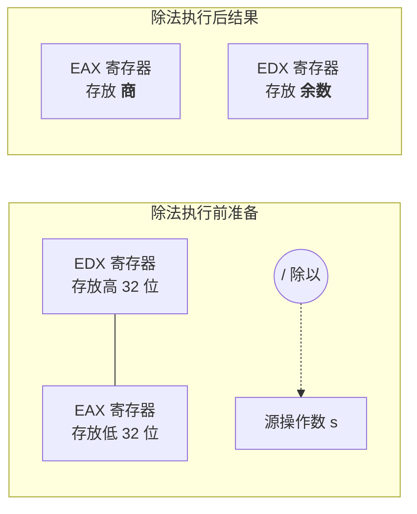

# 机器级代码：常用的 x86 汇编指令详解

> **导语**
> 各位同学大家好，在上一小节中，我们解决了汇编语言中“数据在哪里（寻址）”的问题。本节课，我们将重点解决“**对数据做什么（指令功能）**”的问题。
> x86 汇编指令看似繁杂，但核心逻辑非常清晰。我们将重点学习**算术运算**和**逻辑运算**两大类指令。只要掌握了英文单词的前缀缩写规则，以及 `目标操作数(d)` 和 `源操作数(s)` 的流转方向，你就能轻松看懂各种底层代码。

---

## 一、 x86 汇编指令的通用语法规则

在正式学习具体指令前，必须先明确 x86 汇编（Intel 格式）的通用操作数书写规则：

**格式**： `指令助记符 目的操作数(d), 源操作数(s)`

- **目的操作数 (d, Destination)**：
  - **作用**：既作为运算的参与者之一，又作为**最终运算结果的存放地**。
  - **限制条件**：因为它要用来存结果，所以**绝对不能是常量（立即数）！** 只能是寄存器或内存地址。
- **源操作数 (s, Source)**：
  - **作用**：仅作为运算的参与者提供数据。
  - **限制条件**：可以是寄存器、内存地址，或者是常量（立即数）。
- **🚨 硬件底层铁律**：**x86 汇编严格禁止两个操作数同时来自于主存（内存）！** （即 `[地址], [地址]` 的写法是错的）。因为主存速度慢，若一条指令需多次读写主存，会严重拖慢 CPU 效率。至少有一个操作数必须在寄存器或指令（立即数）中。

---

## 二、 算术运算类指令 (Arithmetic Instructions)

算术运算指令基本都是由对应英文单词的前三个字母缩写而成。运算结果默认存回目标操作数 `d`。

| 汇编指令        | 英文原词                 | 操作逻辑      | 功能说明                                               |
| :-------------- | :----------------------- | :------------ | :----------------------------------------------------- |
| **`ADD d, s`**  | **Add**ition             | `d = d + s`   | **加法**：将 d 和 s 相加，结果存回 d。                 |
| **`SUB d, s`**  | **Sub**tract             | `d = d - s`   | **减法**：将 d 减去 s，结果存回 d。                    |
| **`MUL d, s`**  | **Mul**tiply             | `d = d * s`   | **无符号乘法**：将无符号数 d 和 s 相乘，结果存回 d。   |
| **`IMUL d, s`** | **I**nteger **Mul**tiply | `d = d * s`   | **有符号乘法**：将带符号整数 d 和 s 相乘，结果存回 d。 |
| **`DIV s`**     | **Div**ide               | `EDX:EAX / s` | **无符号除法**：除数是 s。被除数隐含在 `EDX:EAX` 中。  |
| **`IDIV s`**    | **I**nteger **Div**ide   | `EDX:EAX / s` | **有符号除法**：除数是 s。被除数隐含在 `EDX:EAX` 中。  |
| **`NEG d`**     | **Neg**ative             | `d = -d`      | **取负**：将 d 按位取反再加 1 (补码取负)，结果存回 d。 |
| **`INC d`**     | **Inc**rease             | `d = d + 1`   | **自增**：相当于 C 语言的 `d++`。                      |
| **`DEC d`**     | **Dec**rease             | `d = d - 1`   | **自减**：相当于 C 语言的 `d--`。                      |

### 💡 重点解析：除法指令 (`DIV` / `IDIV`) 的“潜规则”

为什么除法指令只有一个操作数 `s` (除数)？被除数去哪了？

- **隐含寻址机制**：由于两个 32 位数相乘或相除，结果或被除数可能高达 64 位。因此，x86 硬件规定在执行 32 位除法前，必须将 64 位的被除数**提前放进两个 32 位寄存器中拼接起来**：
  - **高 32 位** 存放在 **`EDX`** 中。
  - **低 32 位** 存放在 **`EAX`** 中。
- **结果存放**：除法运算执行完毕后：
  - **商 (Quotient)** 会自动存入 **`EAX`**。
  - **余数 (Remainder)** 会自动存入 **`EDX`**。

---

## 三、 逻辑运算类指令 (Logical Instructions)

逻辑运算指令对操作数进行**按位 (Bitwise)** 计算。

| 汇编指令       | 英文原词             | 操作逻辑    | 功能说明                                                                 |
| :------------- | :------------------- | :---------- | :----------------------------------------------------------------------- | ---------------------------------- |
| **`AND d, s`** | **And**              | `d = d & s` | **按位与**：常用于将特定的位清零 (掩码操作)。                            |
| **`OR d, s`**  | **Or**               | `d = d      | s`                                                                       | **按位或**：常用于将特定的位置 1。 |
| **`NOT d`**    | **Not**              | `d = ~d`    | **按位非 (取反)**：所有位 0 变 1，1 变 0。                               |
| **`XOR d, s`** | e**X**clusive **OR** | `d = d ^ s` | **按位异或**：相异为 1，相同为 0。常用于寄存器清零 (如 `XOR EAX, EAX`)。 |
| **`SHL d, s`** | **Sh**ift **L**eft   | `d << s`    | **逻辑左移**：将 d 左移 s 位，右边补 0。                                 |
| **`SHR d, s`** | **Sh**ift **R**ight  | `d >> s`    | **逻辑右移**：将 d 右移 s 位，左边补 0。                                 |

_注：移位指令中的 `s` (移位次数) 通常是一个立即数（如 `SHL EAX, 2` 表示将 EAX 左移两位），或者存放在 `CL` 寄存器中。_

---

## 四、 本节知识串联与底层逻辑回顾

当我们在看这些指令时，要时刻联想到上一章 CPU 内部的 **控制单元 (CU)** 和 **算术逻辑单元 (ALU)** 是如何配合的：

1.  **取指与译码**：CU 从主存读入 `AND EAX, EBX` 指令，译码后发现这是一条“按位与”指令。
2.  **发控制信号**：CU 立即向 ALU 发送 `AND` 运算的专属电信号控制字。
3.  **送操作数**：同时，将 `EAX` 和 `EBX` 两个寄存器的数据连通到 ALU 的左、右两个输入端。
4.  **算术输出**：ALU 内部的逻辑门电路根据控制信号，瞬间输出按位与的结果。
5.  **写回结果**：将 ALU 输出端的结果写回到 `EAX` 寄存器，覆盖其原值。

这就是高级语言的一行代码，在硅片上真实发生的微观物理过程。

---

## 预告

除了数据加工（算术与逻辑运算），程序还需要根据条件判断来选择执行路径。在接下来的小节中，我们将继续解锁剩下的“硬骨头”指令：

- **分支控制与循环**：`CMP`, `TEST`, `JMP`, `Jcc` (各类条件跳转)。
- **函数调用核心指令**：`PUSH`, `POP`, `CALL`, `RET`。
  掌握了这些，你就能彻底读懂 C 语言在汇编层面的终极奥义。
