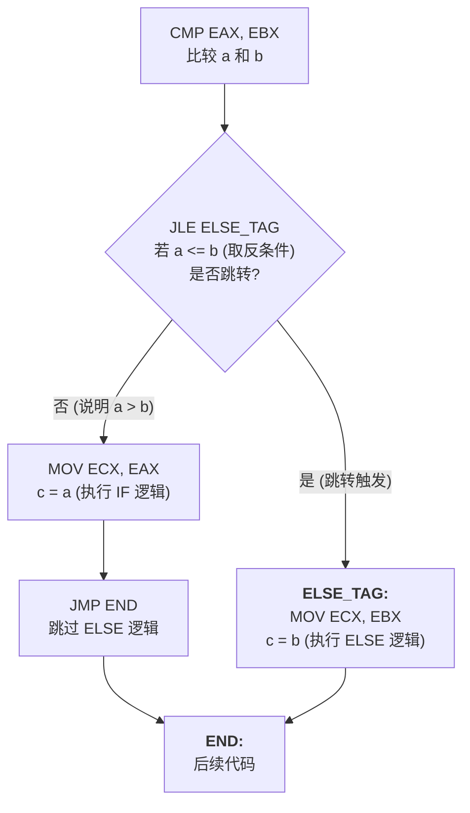

# 机器级代码：选择语句 (if-else) 的汇编实现与底层原理

> **导语**
> 各位同学大家好，经过上个小节的学习，我们已经能够看懂汇编指令中数据的来源（寻址）以及基本的算术逻辑操作。
> 本节课，我们将深入探讨高级语言中极度常用的**选择结构 (`if-else`)** 在底层机器级代码中是如何实现的。这涉及到程序执行流的改变，即如何通过修改**程序计数器 (PC / IP)** 的值来实现代码的跳转。我们将详细解析无条件转移指令 (`JMP`) 和各类条件转移指令 (`Jcc`)，并从硬件底层揭秘 CPU 是如何利用标志寄存器完成“比较大小”这一动作的。这也是历年 408 考研真题“阅读理解”的重中之重！

---

## 一、 程序执行流与无条件转移指令 (JMP)

正常情况下，CPU 是顺序执行指令的：取出当前指令后，**程序计数器 (PC)** 会自动指向下一条相邻指令。在 x86 架构中，PC 通常被称为 **IP (Instruction Pointer, 指令指针寄存器)**。

要打破这种顺序执行，实现程序的跳转，就需要使用**转移类指令**。

### 1. 无条件转移指令 `JMP`

`JMP` 类似于 C 语言中的 `goto` 语句，只要执行到它，**无论什么条件，必定发生跳转**。其本质是**强行修改 PC (IP) 寄存器的值**。

- **书写方式 1：直接给出绝对地址或相对地址 (硬编码)**
  ```assembly
  JMP 128      ; 将 PC 修改为 128，直接跳到主存地址 128 处执行
  ```
- **书写方式 2：寄存器间接给出**
  ```assembly
  JMP EAX      ; 将 PC 修改为 EAX 寄存器中存放的地址
  ```
- **书写方式 3：主存间接给出**
  ```assembly
  JMP [999]    ; 从主存地址 999 处读取一个值，将 PC 修改为该值
  ```
- **书写方式 4：使用标号 (Label) —— 最灵活、最常用**
  程序员在编写汇编时，通常不知道指令最终会被加载到内存的哪个物理地址。因此，通常在目标指令前打一个**冒号 `:`** 作为标号，让汇编器自动计算偏移量。
  ```assembly
      JMP NEXT     ; 直接跳转到标号为 NEXT 的位置
      ...
  NEXT:            ; 这是一个标号，锚定了一个位置
      MOV EAX, 1
  ```

---

## 二、 条件转移指令 (Jcc) 与比较指令 (CMP)

要实现 `if-else`，单靠无条件闭眼跳的 `JMP` 是不够的，必须在判断条件成立时才跳转。这就需要**条件转移指令 (`Jcc`)** 的配合。

### 1. 比较指令 `CMP` (Compare)

在使用条件转移指令前，**通常必须先使用 `CMP` 指令来比较两个操作数**。

- **格式**：`CMP a, b` (比较操作数 a 和 b)
- **操作数来源**：a 和 b 可以来自寄存器、主存或立即数（但同样不能同时来自主存）。

### 2. 常见条件转移指令助记符记忆法则

这类指令全部以字母 `J` 开头，后面的字母是英文单词的缩写，极其好记！

| 汇编指令  | 英文含义                               | 触发跳转的条件     | 适用场景            |
| :-------- | :------------------------------------- | :----------------- | :------------------ |
| **`JE`**  | **J**ump when **E**qual                | 若 `a == b` 则跳转 | 判断是否相等        |
| **`JNE`** | **J**ump when **N**ot **E**qual        | 若 `a != b` 则跳转 | 判断是否不等        |
| **`JG`**  | **J**ump when **G**reater than         | 若 `a > b` 则跳转  | 比较大小 (大于)     |
| **`JGE`** | **J**ump when **G**reater or **E**qual | 若 `a >= b` 则跳转 | 比较大小 (大于等于) |
| **`JL`**  | **J**ump when **L**ess than            | 若 `a < b` 则跳转  | 比较大小 (小于)     |
| **`JLE`** | **J**ump when **L**ess or **E**qual    | 若 `a <= b` 则跳转 | 比较大小 (小于等于) |

---

## 三、 实战：将 if-else 翻译为汇编语言

假设有如下 C 语言代码：

```c
int a = 7;
int b = 6;
int c;
if (a > b) {
    c = a;
} else {
    c = b;
}
```

假定 `a` 存在 `EAX`，`b` 存在 `EBX`，`c` 存在 `ECX`。

### 翻译方案 1：正向逻辑 (代码可读性较差，顺序颠倒)

```assembly
    MOV EAX, 7       ; a = 7
    MOV EBX, 6       ; b = 6
    CMP EAX, EBX     ; 比较 a 和 b
    JG NEXT          ; 如果 a > b (Greater)，跳到 NEXT 执行 IF 逻辑
    ; 以下是 ELSE 逻辑 (a <= b)
    MOV ECX, EBX     ; c = b
    JMP END          ; ELSE 执行完，必须无条件跳过 IF 逻辑，直达结尾
NEXT:
    ; 以下是 IF 逻辑 (a > b)
    MOV ECX, EAX     ; c = a
END:                 ; 结束位置
```

### 翻译方案 2：逆向逻辑 (编译器常用，结构清晰)

**核心技巧：对 `if` 的条件取反！** 原本是 `a > b` 才执行 IF。我们换个思路：如果 `a <= b` (`JLE`)，我们就跳到 ELSE 去执行；如果不跳，顺理成章往下执行 IF 逻辑。



> **【真题防坑指南】标号与偏移量的结合**
> 在真实的 408 考研真题（如 2019 年）中，你可能会看到类似于 `JLE f1+35H` 这样的写法。
> 不要慌！这里的 `f1` 其实就是一个**函数名标号**（代表函数的起始地址）。`f1+35H` 意思就是：如果条件满足，就跳转到距离 `f1` 函数起始位置偏移 `35H` 字节的那个地址去执行。这就起到了和自定义标签 `NEXT` 一模一样的跳转定位作用。

---

## 四、 硬件底层揭秘：CMP 指令是如何“比较”大小的？

在硬件层面，CPU 根本不知道什么叫“大于”、“小于”。**比较操作的本质是做减法，并观测标志寄存器！**

1.  **执行减法**：执行 `CMP a, b` 时，算术逻辑单元 (ALU) 在底层默默执行了一次 **`a - b`** 的减法运算。但这只是一次“隐式减法”，**运算结果不会覆盖 a 或 b 原本的值**，直接被丢弃了。
2.  **更新标志位**：这次隐式减法唯一留下的痕迹，就是它更新了 **程序状态字寄存器 (PSW)**（在 Intel x86 中称为 **标志寄存器 (EFLAGS)**）中的各个标志位：
    - **`ZF` (Zero Flag, 零标志)**：若 `a - b = 0`，则 `ZF = 1`。（说明 $a = b$）
    - **`SF` (Sign Flag, 符号标志)**：若 `a - b < 0`，则 `SF = 1`。（说明最高位符号位变 1 了）
    - **`OF` (Overflow Flag, 溢出标志)** 和 **`CF` (进位标志)**：辅助判断带符号/无符号数的边界情况。
3.  **条件跳转指令接力查岗**：
    紧跟在 `CMP` 后面的 `Jcc` 指令，其实就是一个“查岗员”。它根本不关心刚才的数字是多少，它只去查看 PSW 寄存器中的特定位！
    - 例如执行 **`JE`** (若相等则跳)，硬件底层其实就是检查 **`ZF == 1`** 是否成立。若成立，就把目标地址赋给 PC；否则什么也不做，PC 继续指向下一条。

这就是高级语言 `if` 语句在硅片微观世界中的全部真相。只要熟记这些跳转助记符，分析分支结构汇编代码就如同读英语句子一样简单！
