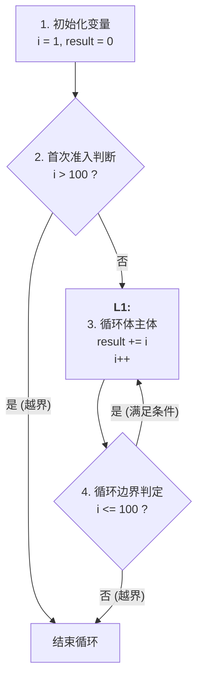

# 机器级代码：循环结构 (for/while) 的汇编实现

> **导语**
> 各位同学大家好，在上一小节中我们学习了如何用条件转移指令实现 `if-else` 分支结构。本节课，我们将继续探讨高级语言中同样高频的**循环结构 (`for` / `while`)** 在底层的汇编实现方式。
> 循环结构本质上也是一种程序执行流的“条件跳转”（跳回之前的代码重复执行）。在 x86 汇编中，实现循环有两种主流方式：一种是利用我们已经学过的 **条件转移指令 (`Jcc`)** 手工搭建循环框架；另一种则是使用专门的 **循环指令 (`LOOP`)**。掌握这两种方式的核心框架，你就能在考研真题中迅速剥离出循环体，看懂复杂的底层逻辑。

---

## 一、 方式一：用条件转移指令 (`Jcc`) 手工搭建循环

无论是 `for` 循环还是 `while` 循环，在底层都可以用“比较 (`CMP`) + 条件转移 (`Jcc`)”的方式来实现。

### 1. 经典 C 语言循环案例 (1 加到 100)

```c
int result = 0;
for (int i = 1; i <= 100; i++) {
    result += i;
}
```

### 2. 汇编语言实现框架解析

假设 `result` 存在 `EAX` 寄存器中，循环变量 `i` 存在 `EDX` 寄存器中。

```assembly
    ; 第一部分：循环前初始化
    MOV EAX, 0       ; result = 0
    MOV EDX, 1       ; i = 1

    ; 第二部分：首次循环前判断 (防止不满足条件也执行了一次)
    CMP EDX, 100     ; 比较 i 和 100
    JG L2            ; 如果 i > 100 (Greater)，直接跳过循环体，跳到 L2 结束处

L1: ; 第三部分：循环体主体 (标号 L1 是循环开始的位置)
    ADD EAX, EDX     ; result += i (将 i 的值加到 result 中)
    INC EDX          ; i++ (循环变量自增)

    ; 第四部分：例行条件判断，决定是否继续下一轮
    CMP EDX, 100     ; 比较 i 和 100
    JLE L1           ; 如果 i <= 100 (Less or Equal)，跳转回 L1 继续循环

L2: ; 循环结束后的代码位置
    ...
```

### 3. 循环框架“四步曲”总结

在分析考研真题中的汇编代码时，遇到循环，请立即用这四个模块去套用、拆解：

1.  **初始化**：给循环控制变量和结果变量赋初值。
2.  **首次准入判断 (防越界)**：判断是否在第一次进入循环前就已经触发了结束条件，若是则直接 `JMP` 跃过循环体。
3.  **循环体主体 (Loop Body)**：每一轮需要重复执行的核心计算逻辑。
4.  **步进与循环判定**：更新循环变量 (如 `i++`) $\rightarrow$ 用 `CMP` 比较边界 $\rightarrow$ 用 `Jcc` 决定是否跳回循环开头。



---

## 二、 方式二：使用专门的循环指令 (`LOOP`)

在写代码时，如果循环次数是预先确定好的（比如“执行 500 次”），使用条件转移指令来搭建循环显得有些冗长。为此，x86 提供了专门的缩写指令：**`LOOP`**。

### 1. `LOOP` 指令的专属“计数器”：`ECX` 寄存器

在 x86 架构中，四个通用寄存器其实有各自隐形的“偏好”：

- `EAX` 常用于累加/算术结果。
- `EBX` 常用于基址指针。
- **`ECX` (Count Register) 是专门为计数设计的寄存器**。
- `EDX` 常用于数据暂存。

> 🚨 **核心铁律**：`LOOP` 指令**必须、且只能**与 `ECX` 寄存器配合使用！

### 2. `LOOP` 指令的底层执行逻辑

当 CPU 执行到 `LOOP L1` 这条指令时，它在底层自动、原子性地连做了三件事：

1.  自动执行 `ECX = ECX - 1` (计数器减 1)。
2.  自动判断 `ECX` 是否等于 `0`。
3.  如果 `ECX != 0`，则跳转回标号 `L1` 继续循环；如果 `ECX == 0`，则循环结束，PC 指向下一条指令。

也就是说，一条 `LOOP L1` 指令，**完全等价于**以下两条汇编指令的组合：

```assembly
    DEC ECX          ; ECX 自减 1
    JNE L1           ; 若 ECX 不等于 0 (Not Equal) 则跳转到 L1
```

### 3. C 语言与 LOOP 的对应示例

**C 语言代码：**

```c
int i = 500;
while (i > 0) {
    // 循环主体逻辑
    i--;
}
```

**对应的汇编代码：**

```assembly
    MOV ECX, 500     ; 将循环次数 500 赋给专属计数器 ECX

LOOP_TOP:            ; 循环开头的标号
    ; ... (循环主体逻辑) ...

    LOOP LOOP_TOP    ; 自动 ECX--, 若 ECX != 0 则跳回 LOOP_TOP
```

_使用 `LOOP` 指令，不仅使得汇编代码更加简洁紧凑，也让阅读代码的人（包括出题人和考生）能一眼看出这是一个纯正的循环结构，而不是普通的 `if` 分支跳转。_

---

## 三、 【拓展防坑】带附加条件的 LOOP 指令 (`LOOPcc`)

有时候，循环的结束条件不仅取决于次数，还取决于某种运算结果是否达到了特定状态（例如：在一个数组中寻找第一个值为 0 的元素，找到了就提前退出循环）。

为此，x86 提供了一组带条件的 LOOP 指令：**`LOOPcc`**。

- **`LOOPNZ` / `LOOPNE`** (Loop while Not Zero / Not Equal)：
  - **触发条件**：`ECX = ECX - 1`，且当 `ECX != 0` **并且** `ZF == 0`（即最近一次运算结果不为零）时，继续循环。
- **`LOOPZ` / `LOOPE`** (Loop while Zero / Equal)：
  - **触发条件**：`ECX = ECX - 1`，且当 `ECX != 0` **并且** `ZF == 1`（即最近一次运算结果为零）时，继续循环。

> 💡 **考场破题秘籍**：
> 考研大纲并不要求你死记硬背所有复杂的指令后缀。在考场上，如果你遇到形如 `LOOPxx` 或者 `Jxx` 的陌生指令，**千万不要慌！**
> 你只需要做到两步：
>
> 1.  确认它是控制流跳转指令（判断是否构成循环或分支）。
> 2.  **直接去看题目给出的 C 语言源码！** 根据 C 语言的 `if` 或 `while` 判断条件，**逆向推导**出这条陌生汇编指令到底在检查什么条件。这就叫“以源码解底码”。

---

## 本节复习要点总结

处理循环结构时，牢记两条分析主线：

1.  **见 `Jcc` 拆四步**：遇到用 `CMP` 和条件跳转搭起来的循环，迅速在草稿纸上圈出“初始化”、“首次防越界判定”、“循环体”、“结尾步进与判定”这四个模块。
2.  **见 `LOOP` 盯 `ECX`**：只要看到 `LOOP` 指令，立刻去找前面给 `ECX` 寄存器赋初值的语句，那个值就是这个循环**最高可能的循环次数**。

下一节，我们将学习高级语言中最复杂的结构——**函数调用**的底层实现原理。看看在函数跳转、传参和返回时，栈 (Stack) 是如何发挥关键作用的。
