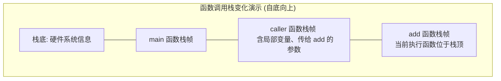
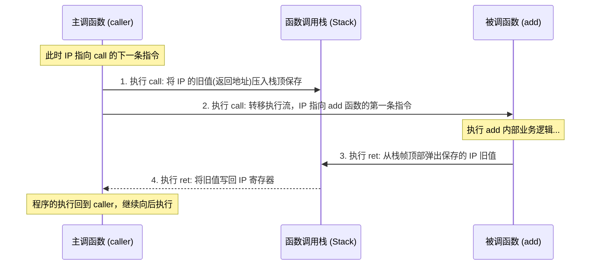

# 机器级代码：函数调用的机器级表示 (CALL 与 RET)

> **导语**
> 各位同学大家好！在这个小节中，我们将学习**函数调用的机器级表示**。本节课我们将先认识与函数调用密切相关的两条极为重要的汇编指令——`call` 和 `return` (通常简写为 `ret`)。我们将从大家熟悉的高级语言视角出发，观察函数调用背后发生的内存变化，然后再切换到汇编语言视角，彻底搞懂底层是如何利用 `IP` 寄存器和调用栈来实现程序的“过得去，还回得来”的。

---

## 一、 高级语言视角：函数调用栈与栈帧

当程序运行并发生函数调用时，系统会在内存中为其分配一片专门的区域，这片区域被称为**函数调用栈 (Call Stack)**。顾名思义，它是专门用于实现和管理函数调用的。

### 1. 栈帧 (Stack Frame) 的概念

- **栈帧**：用于存储单个函数运行期数据的内存区域。每个正在执行的函数都在调用栈中拥有自己的栈帧。
- **栈底信息**：在调用栈的最底部，通常会保存一些与硬件和操作系统相关的初始信息。
- **栈帧内容**：每个函数的栈帧内部主要包含两类关键数据：
  1.  **局部变量**：例如函数内部定义的 `temp1`, `temp2`, `sum` 等局部变量。
  2.  **函数调用相关信息**：例如主调函数向被调函数传递的**参数 (Arguments)** 等。

### 2. 函数调用的动态过程 (LIFO)

程序的执行严格遵循栈的**后进先出 (LIFO)** 逻辑。假设程序的调用链为：`main -> p -> q`，以及返回后再 `main -> caller -> add`。

1.  **启动**：程序从 `main` 函数出发，将 `main` 的栈帧压入栈底。
2.  **嵌套调用**：`main` 调用 `p` 函数，`p` 的栈帧被压入栈顶；`p` 继续调用 `q` 函数，`q` 的栈帧继续压入栈顶。
3.  **返回出栈**：当 `q` 函数执行完毕返回时，**`q` 的栈帧会从栈顶出栈 (被删除)**。执行流回到 `p`，此时栈顶变回 `p` 的栈帧。
4.  **同级调用**：后续调用 `caller` 函数时，压入 `caller` 的栈帧。`caller` 将两个参数存入自身栈帧后，调用 `add` 函数，压入 `add` 的栈帧。
5.  **时刻保持**：**当前正在执行的函数，其对应的栈帧一定位于栈顶**。

_(注：大家可能会疑惑，为什么上图的栈顶画在下方、栈底画在上方？这个悬念我们将在后续章节解答。)_

---

## 二、 汇编语言视角：核心指令 CALL 与 RET

在 x86 汇编语言中，函数的调用与返回是由 `call` 和 `return (ret)` 这两条指令实现的。

### 1. 核心寄存器：IP (Instruction Pointer)

- **功能**：在 CPU 内部，有一个非常重要的寄存器叫做**程序计数器 PC**，其作用是指向下一条要执行的指令。
- **命名差异**：在 x86 处理器中，程序计数器 PC 通常被称为 **IP 寄存器 (Instruction Pointer，指令指针寄存器)**。在做题时，如果看到 IP 寄存器，就要立刻反应过来它本质上就是程序计数器。
- **跳转本质**：程序的执行流发生跳转，本质上就是要让 IP 寄存器指向另一个位置。

### 2. 核心问题：过得去，还回得来

当主调函数 (如 `caller`) 调用被调函数 (如 `add`) 时，汇编中常使用标号（如 `add:` 或 `caller:`）来标记一个函数的开始。
调用指令写为 `call add`，返回指令写为 `ret`。它们是如何解决“跳转与返回”问题的呢？

#### ① `call` 指令：如何“过得去”并且“记好回来的路”？

当 CPU 正在执行 `call` 指令时，IP 寄存器本应自动指向紧跟在 `call` 后面的下一条指令。执行 `call` 时会自动完成两步操作：

1.  **压栈保存断点**：将当前 IP 寄存器中的**旧值 (即正确的返回地址)** 压入调用栈的栈顶保存起来。
2.  **转移执行流**：根据 `call` 后面给出的标号位置进行无条件转移，将目标被调函数的第一条指令地址写入 IP 寄存器。
    _(这样程序就成功跳到了被调函数去执行，同时在栈中留下了回家的“路标”。)_

#### ② `ret` 指令：如何完美“回得来”？

当被调函数 (如 `add` 函数) 的逻辑处理完毕，准备结束时，会执行最后一条指令 `return (ret)`。执行 `ret` 时的唯一使命就是：

1.  **出栈恢复断点**：从当前函数栈帧的顶部找到刚才压入保存的 **IP 旧值**，并将其取出。
2.  **写回 IP 寄存器**：把取出的旧值重新写入 IP 寄存器中。
    _(这样程序执行流就完美回到了主调函数中 `call` 指令的后一条指令处，继续往后执行。)_

---

## 三、 遗留悬念与后续探讨预告

在本次视频中，我们仅解决了函数调用时“怎么过去、怎么回来”的 PC/IP 寄存器跳转问题。但在真实的底层函数调用中，还有更多复杂细节需要解决：

1.  **参数与返回值传递**：`call` 和 `ret` 两条指令本身不带参数和返回值。那么调用函数时的参数和处理结束后的返回值是如何被传递的？
2.  **栈帧内部结构**：每一个栈帧里面具体到底包含了哪些内容？如何去访问栈帧里面保存的数据（局部变量、参数等）？
3.  **栈的生长方向**：为什么在这个例子中，栈底画在了上方，而栈顶画在了下方？为什么函数调用栈要“倒过来画”？

这些关键的底层细节问题，我们将会在接下来的课程中一一详细探讨，敬请期待！
