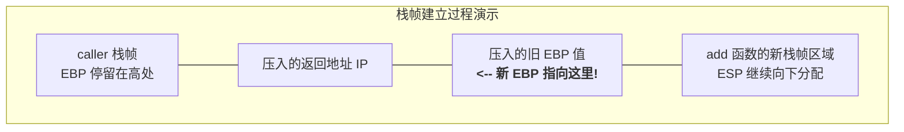

# 机器级代码：栈帧切换的汇编实现与底层原理

> **导语**
> 各位同学大家好，在上个小节中，我们探究了函数调用栈的宏观结构以及如何使用 EBP 和 ESP 寄存器来访问栈内数据。
> 本节课，我们将解决函数调用中最核心的难题：**栈帧是如何完成“无缝切换”的？** 当函数 A 调用函数 B 时，EBP 和 ESP 是如何挪移以圈出一块新的栈帧？当函数 B 执行完毕时，它们又是如何精确地退回到函数 A 的地盘的？我们将通过真实汇编代码的逐行推演，揭秘隐藏在每个函数头尾的“神秘指令对”，并带你破解 408 历年真题中函数体代码的“万能框架”。

---

## 一、 调用前夜：`CALL` 指令的双重作用复习

假设 `caller` 函数准备调用 `add` 函数。在执行 `call add` 指令瞬间，CPU 会自动完成两件事：

1.  **压栈返回地址**：相当于执行了 `PUSH IP`。将当前 `IP` 寄存器的值（即 `call` 指令的下一条指令地址）压入调用栈。此时栈顶存放的就是**“回家的路”**。
2.  **转移执行流**：相当于执行了 `JMP add`。将 `IP` 寄存器修改为 `add` 函数的起始地址，程序开始执行被调函数。

> 此时，执行流虽然已经跳到了 `add` 函数，但 `EBP` 和 `ESP` 依然停留在 `caller` 函数的栈帧状态。**接下来，`add` 函数必须亲自动手“开辟”自己的新栈帧！**

---

## 二、 进入函数：建立新栈帧 (Prologue / 序言)

除了 `main` 函数，任何一个被调函数（如 `add`）在开头都**必然存在两行例行的汇编指令**，用于完成栈帧的切换。

### 1. 两步建立新栈帧

```assembly
add:
    PUSH EBP      ; 第一步：保存上一层函数的栈底指针
    MOV EBP, ESP  ; 第二步：将 EBP 挪到当前栈顶，作为新栈帧的栈底
```

**【动态推演】**

1.  **`PUSH EBP`**：将 `caller` 函数的栈底地址（旧 EBP 的值）压入栈中。这相当于在栈中留下了一个**“锚点”**。
2.  **`MOV EBP, ESP`**：把当前 `ESP` 的值赋给 `EBP`。此时，`EBP` 和 `ESP` 指向同一个位置。**这个位置就正式成为了 `add` 函数新栈帧的底部基准！**

> **💡 黄金推论**：任何一个函数的栈帧，其**最底部 (EBP 所指的位置)** 存放的一定是**主调函数的旧 EBP 值**！通过这个旧值，就像顺藤摸瓜一样，可以在返回时找回上一层的栈底。



### 2. `ENTER` 指令 (语法糖)

x86 提供了一条零地址指令 **`ENTER`**，其功能**完全等价于**上述的 `PUSH EBP` + `MOV EBP, ESP` 组合。
_(注：`ENTER` 是“进入”的意思，但在实际的高级语言编译器生成的汇编中，反而更常见那两条基础指令的组合。)_

---

## 三、 退出函数：恢复旧栈帧 (Epilogue / 结语)

当 `add` 函数内部的业务逻辑执行完毕，准备执行 `RET` 之前，必须先“打扫战场”，把 `EBP` 和 `ESP` 原封不动地还给 `caller` 函数。这也需要**两行例行指令**。

### 1. 两步恢复旧栈帧

```assembly
    MOV ESP, EBP  ; 第一步：将栈顶指针拉回到当前栈底
    POP EBP       ; 第二步：弹出旧的 EBP 值，恢复上一层栈底
    RET           ; 随后执行返回指令
```

**【动态推演】**

1.  **`MOV ESP, EBP`**：强行让 `ESP` 等于 `EBP`。这瞬间**废弃了当前栈帧中的所有局部变量**，栈顶指针直接回退到了当前栈的底部。
2.  **`POP EBP`**：由于现在 `ESP` 正指向栈底，而我们之前在栈底存入的正是 `caller` 的旧 EBP 值。因此 `POP` 操作会将这个旧值重新装入 `EBP` 寄存器中。此时，`EBP` 完美回到了 `caller` 函数的栈底！
    _(并且，`POP` 执行后 `ESP` 会自动加 4 向上移。此时 `ESP` 恰好指着当初 `call` 指令压入的**返回地址 IP**！)_

### 2. `LEAVE` 指令 (语法糖)

同样，x86 提供了一条指令 **`LEAVE`**，其功能**完全等价于** `MOV ESP, EBP` + `POP EBP` 组合。
_(注：`LEAVE` 即“离开”，在编译器生成的代码中出现频率极高。)_

### 3. `RET` 指令收尾

此时，由于 `ESP` 正好指着返回地址，紧接着执行的 `RET` 指令就会从栈顶弹出该地址赋给 `IP` 寄存器。执行流完美跳回 `caller` 函数。整个栈帧切换宣告圆满结束！

---

## 四、 考研通关秘籍：函数汇编代码的“万能框架”

掌握了上述知识，我们在面对 408 真题（如 2017、2019 年）的大段陌生汇编代码时，就能拥有“上帝视角”。
**任何非 `main` 函数的汇编代码，必然遵循以下“三明治”结构**：

```assembly
函数名:
    ; ========== 1. 序言 (Prologue) 建立栈帧 ==========
    PUSH EBP
    MOV EBP, ESP      ; (这两句也可能用 ENTER 代替)
    SUB ESP, xxx      ; (可选) 为局部变量开辟栈空间

    ; ========== 2. 函数主体 (Body) ==========
    ... (各种算术、逻辑运算、MOV 寻址等业务代码) ...

    ; ========== 3. 结语 (Epilogue) 恢复栈帧 ==========
    MOV ESP, EBP
    POP EBP           ; (这两句绝大多数用 LEAVE 代替)

    ; ========== 4. 返回 (Return) ==========
    RET
```

> **🔥 破题策略**：
> 考试时，如果你看到题目中省略了开头或结尾的代码（用 `...` 代替），或者问你某条指令的上一条指令是什么，你只需直接套用这个万能框架去“脑补”残缺部分。只要认准 `PUSH EBP` 开局，`LEAVE` + `RET` 结尾，就能迅速锁定中间的业务逻辑部分，剥离无用信息，大大提高解题速度！
