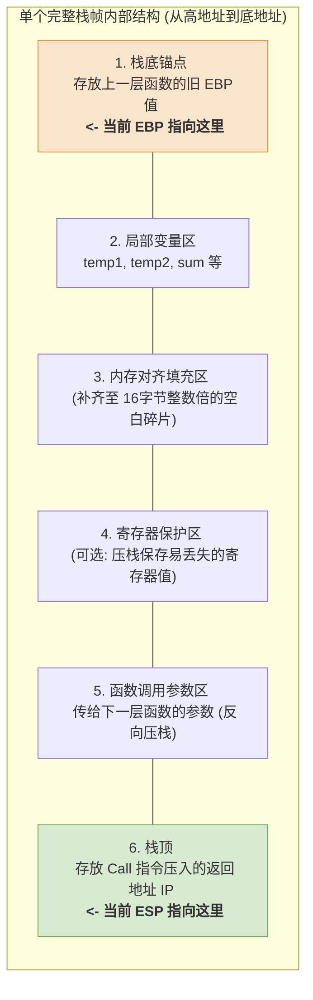

# 机器级代码：函数栈帧的内部结构与数据传递机制

> **导语**
> 各位同学大家好，经过前几个小节的学习，我们已经攻克了函数调用时程序执行流如何跳转（`CALL` 与 `RET`）以及栈帧的基址如何切换（`EBP` 与 `ESP` 的挪移）这两个难题。
> 本节课，我们将探究函数调用的最后一块拼图：**函数之间到底是如何传递参数和返回值的？** 并且，我们将像解剖麻雀一样，**彻底剖析一个完整栈帧的内部结构**。掌握了这套结构，你在看考研真题汇编代码时，就能像戴了透视眼镜一样，一眼看出每一个偏移量代表的是参数、局部变量还是系统信息。

---

## 一、 栈帧内部的终极结构解剖

一个典型的函数栈帧（如主调函数 `caller` 的栈帧）在其内部可能包含以下几个区域（自底向上，即从高地址到低地址）：



### 1. 必选与可选区域辨析

- **绝对存在的区域**：
  - **栈底的 `EBP` 旧值**：没有它就无法返回上一层栈帧。
  - **栈顶的 `IP` 返回地址**：只要发起了函数调用，`CALL` 指令必定会压入这个地址。
- **视情况而定的区域**：
  - **局部变量区**：如果函数内部没有定义局部变量，此区不存在。
  - **参数区**：如果调用的子函数不需要参数，此区不存在。
  - **寄存器保护区**：如果不需要保护通用寄存器的值，此区不存在。
  - **对齐填充区**：GCC 编译器强行规定每个栈帧大小必须是 **16 字节的整数倍**。如果有零头，就会用空白数据填充对齐。

---

## 二、 透视数据：局部变量与参数的“游标卡尺”寻址法 (★ 核心考点)

在了解了栈帧的物理分布后，我们如何在茫茫栈空间中精准定位想要的数据呢？
秘诀就在于：**死死咬住当前函数的栈底基址指针 `EBP` 不放，利用偏移量上下求索！**

### 1. 寻找局部变量：`[EBP - 偏移量]` (向下找)

编译器在处理 C 语言的局部变量时，会按照定义顺序，紧贴着栈底向下（低地址方向）依次分配空间。

- `[EBP - 4]`：通常对应 C 语言中**最后定义**的那个局部变量。
- `[EBP - 8]`：倒数第二个定义的局部变量。
- 以此类推...

> **💡 破题心法**：如果在汇编代码中看到形如 `MOV EAX, [EBP - 8]` 的指令，闭着眼睛也该知道，这绝对是在读取本函数内部的某个**局部变量**！

### 2. 寻找传入的参数：`[EBP + 偏移量]` (向上找)

这是一个极其反直觉但又极其精妙的设计！
当 `caller` 函数准备调用 `add(x, y)` 时，它会提前把参数 `x` 和 `y` 压入**自己栈帧的顶部**。当进入 `add` 函数建立新栈帧后，`add` 函数的 `EBP` 正好卡在参数区的下方（中间隔着一个返回地址）。
因此，被调函数要拿参数，只能越过栈底，**回到上一层栈帧**的参数区去取：

- `[EBP + 8]`：第一个传入的参数（如 `x`）。_(为什么是 +8？因为跨过了 EBP旧值(4B) 和 返回地址(4B) 共 8 个字节)_
- `[EBP + 12]`：第二个传入的参数（如 `y`）。
- 以此类推...

> **💡 破题心法**：如果在汇编代码中看到形如 `MOV EAX, [EBP + 8]` 的指令，这必然是被调函数正在读取主调函数传来的**参数**！

---

## 三、 实战推演：参数传递与返回值带回的全流程

假设我们要执行 `caller` 函数调用 `add(125, 80)` 并接收返回值的完整过程。

### 阶段 1：调用前的准备 (参数入栈)

在 `caller` 内部，执行 `CALL` 之前：

```assembly
    ; 1. 准备第二个参数 (压入自己栈帧的参数区)
    MOV EAX, [EBP - 8]  ; 取局部变量 temp2 的值 (80)
    MOV [ESP + 4], EAX  ; 存入参数 y 的位置

    ; 2. 准备第一个参数
    MOV EAX, [EBP - 12] ; 取局部变量 temp1 的值 (125)
    MOV [ESP], EAX      ; 存入参数 x 的位置 (最靠近将来的栈顶)

    ; 3. 发起调用
    CALL add            ; 压入返回地址，PC 飞往 add
```

_(注：这里生动展示了 x86 的底层铁律——不能用 `MOV [ESP], [EBP-12]` 直接把内存数据搬到内存，必须用 `EAX` 做中转。)_

### 阶段 2：被调函数内部执行 (取参计算)

进入 `add` 函数，完成栈帧切换后：

```assembly
    ; 1. 跨栈帧取参数
    MOV EAX, [EBP + 12] ; 从上一层取第二个参数 y (80)
    MOV EDX, [EBP + 8]  ; 从上一层取第一个参数 x (125)

    ; 2. 核心运算
    ADD EAX, EDX        ; EAX = 80 + 125 = 205

    ; 3. 准备返回
    LEAVE               ; 销毁当前栈帧，EBP 退回上一层
    RET                 ; 弹出返回地址赋给 IP
```

**【灵魂拷问】返回值 205 在哪里？**
注意看最后运算的结果停留在了 `EAX` 寄存器中。在 x86 体系（包括 C 语言的底层实现）中有一个雷打不动的规矩：**函数的返回值永远统一放在 `EAX` 寄存器中带回！**

### 阶段 3：调用结束 (获取返回值)

程序回到 `caller` 函数继续执行：

```assembly
    ; 1. 从 EAX 接收返回值
    MOV [EBP - 4], EAX  ; 把刚才 add 函数算好的 205 存入局部变量 sum 中
```

---

## 四、 本章高阶知识融会贯通大总结

这几节课是 408 考研大纲“阅读理解”汇编代码的核心。请牢牢掌握以下分析范式：

1.  **见头知尾的“三明治”框架**：
    所有函数上来必是 `PUSH EBP` / `MOV EBP, ESP` 建栈帧；结尾必是 `LEAVE` / `RET` 拆栈帧。中间才是真正的业务逻辑。
2.  **游标卡尺定位法 (无敌口诀)**：
    - 看到 **`[EBP - x]`** $\rightarrow$ 这是在用**自己的局部变量**。
    - 看到 **`[EBP + x]`** $\rightarrow$ 这是在拿**别人传进来的参数**。
    - 看到 `EAX` 在 `CALL` 之后被使用 $\rightarrow$ 这是在拿**函数的返回值**。
3.  **寄存器保护机制**：
    如果在 `CALL` 之前看到了好几个无关紧要的 `PUSH 寄存器`，说明主调函数怕自己的中间结果被子函数弄脏，主动进行了“寄存器保护现场”。返回后必然有对应的 `POP 寄存器` 来恢复现场。

掌握了这些，再看到满屏的汇编代码，你就再也不会恐惧，而是像庖丁解牛一样游刃有余了！
