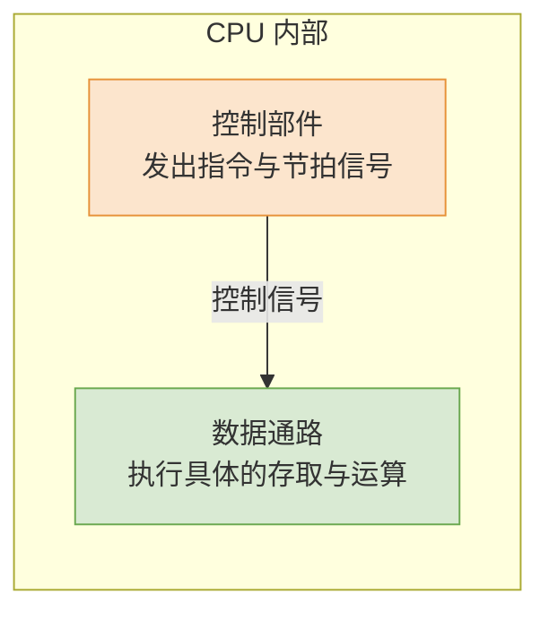

# 计算机组成原理：数据通路的功能与宏观认知

> **导语**
> 各位同学大家好，本节课我们将认识 CPU 内部极其重要的概念：**数据通路 (Data Path)**。
> 在历年的 408 考研真题（如 2015 年、2022 年）的综合大题中，经常会给出一张看起来极其复杂的硬件结构图，让很多初学者感到“两眼一黑”。本节课的核心目的，就是通过生动的类比，消除大家对这套复杂硬件图的恐惧感，建立起 CPU 内部数据流转的宏观认知框架。

---

## 一、 CPU 的内部核心分工：指挥与干活

我们可以将整个 CPU 想象成一个交响乐团或一个大型食品加工厂。它内部主要由两大核心部分组成：

1.  **控制部件 (Control Unit, CU)**：相当于乐团的指挥或加工厂的调度室。它不直接碰数据，而是负责**发出各种电信号 (控制信号)**，指挥其他部件按特定的节奏工作。
2.  **数据通路 (Data Path)**：相当于乐团的乐手或加工厂的生产流水线。它是数据流经的路径，以及路径上负责存储、运算的各种硬件部件集合。**具体怎么干活，全听控制部件的信号。**



---

## 二、 食品加工厂类比：解构复杂的数据通路

初看真题中的数据通路图，会觉得密密麻麻全是线和框。我们可以把它完美映射到一个**食品加工厂**的运作模型上：

### 1. 硬件部件的类比映射

- **总线 (Bus)** $\rightarrow$ **传送带**：片内总线用于在各个硬件部件之间搬运数据。
- **ALU 等组合逻辑电路** $\rightarrow$ **各道加工工序 (总厨)**：加法器、移位器、乘法器等执行部件，就像加工厂里的清洗区、油炸区或一位全能的“总厨”。根据收到的控制信号，对送来的食材（数据）进行煎、炸、炒等特定处理。
- **主存与各类寄存器** $\rightarrow$ **冷库与保鲜柜**：通用寄存器 (GPRs) 就像随手可及的保鲜柜（暂存中间数据）；主存 (Main Memory) 就像后方的大冷库（存放海量原始数据）。
- **标志寄存器 (FR/PSW)** $\rightarrow$ **品控记录本**：记录刚才总厨炒的菜是否糊了（溢出）、是否太咸了（结果为负），以供后续步骤参考。

### 2. 指令执行的流转类比

指令就像是下发给工厂的**食品加工单 (订单)**，不同的订单需要调度生产线上的不同设备。

- **工单 1：油焖小龙虾 (指令 A，如乘法)**
  1.  从冷库取虾 (从主存读取操作数)。
  2.  清洗 $\rightarrow$ 油炸 $\rightarrow$ 爆炒 (数据送入 ALU 等执行各种复杂算术操作)。
  3.  放入保鲜柜 (将运算结果写回通用寄存器)。
- **工单 2：炸薯条 (指令 B，如移位)**
  1.  从冷库取土豆 (取操作数)。
  2.  切丝 $\rightarrow$ 油炸 (数据送入移位器等进行处理，不需要经过“爆炒”硬件)。
  3.  放入保鲜柜 (结果写回)。

**结论**：不同的指令，就是调度数据在数据通路的这些硬件节点中**走不同的路径、经历不同的加工步骤**。

```mermaid
graph TD
    subgraph 指令执行的数据流转 (番茄炒蛋模型)
        GPR[(通用寄存器 <br> 保鲜柜: 取鸡蛋)] --> ALU
        MEM[(主存储器 <br> 冷库: 取番茄)] --> ALU

        ALU((ALU <br> 核心总厨加工)) --> |产生状态| FR[标志寄存器 <br> 记录糊没糊]
        ALU --> |运算结果| GPR
        ALU --> |或者写回| MEM
    end

    style ALU fill:#cfe2f3,stroke:#3d85c6
```

---

## 三、 本节总结与后续预告

本节课我们仅停留在概念认知层面。大家在看到考研真题中的数据通路大图时，请不要再把它当成死记硬背的电路图，而是要在脑海中浮现出一个流水线的动态画面：

1.  **找源头**：数据从哪里来？（是从通用寄存器 `GPRs` 取的，还是从主存取的？）
2.  **找加工站**：数据去哪里算？（通常都会汇聚到核心的 `ALU` 或者专用的算术单元。）
3.  **找归宿**：算完去哪里？（是顺着总线写回寄存器，还是写回主存？）

在接下来的课程中，我们将正式深入技术细节，详细拆解各类典型的数据通路（如单总线结构、三总线结构）是如何在每个时钟节拍下，被控制信号一步步驱动完成取指、译码、执行等完整指令周期的。
