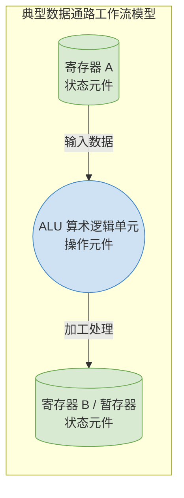

# 计算机组成原理：数据通路的基本组成元件

> **导语**
> 各位同学大家好，上一节课我们从宏观的“食品加工厂”视角认识了数据通路的功能。本节课我们将深入其内部，探究构成数据通路的“一砖一瓦”。
> CPU 数据通路的内部不论多么复杂，都可以被归纳为两大基本元件阵营：**组合逻辑元件**（负责干活/操作）和**时序逻辑元件**（负责记忆/状态）。本节课不仅要搞懂这两种元件的本质区别，还会重点补充三种在 408 考研大题硬件图中频繁出镜的核心组件：**译码器、多路选择器和三态门**。

---

## 一、 数据通路的两大基本阵营

### 1. 组合逻辑元件 (操作元件)

- **核心特征**：**不能存数据！没有记忆功能！** 其当前的输出**仅取决于**当前的输入信号。
- **生活类比**：食品加工厂的“切丝器”或“油炸锅”。你扔进去土豆，它立刻输出土豆丝/炸土豆。它只负责当前这一瞬间的加工操作，不负责保存食材。
- **典型代表**：加法器、**ALU (算术逻辑单元)**、移位器、译码器、多路选择器、三态门。

### 2. 时序逻辑元件 (状态元件)

- **核心特征**：**能存数据！具备记忆功能！** 其当前的输出不仅取决于当前的输入（如控制信号），还取决于该元件**过去的历史状态**（它之前存了什么）。
- **生活类比**：食品加工厂的“多格冷藏柜”。你从 2 号格子里能拿出什么，取决于你昨天往 2 号格子里放了什么（历史状态），以及你今天是不是按下了打开 2 号格子的按钮（当前输入信号）。
- **典型代表**：**各类寄存器 (PC, IR, MAR, MDR, GPRs, 标志寄存器等)**、主存储器、触发器。

> **💡 黄金定律**：数据通路的典型工作流模型，总是遵循着 **“状态元件 $\rightarrow$ 操作元件 $\rightarrow$ 状态元件”** 的节奏。即：从寄存器取数据 $\rightarrow$ 经过组合逻辑电路进行加工 $\rightarrow$ 运算结果存入下一个寄存器。

---

## 二、 三种高频组合逻辑元件解析 (★ 核心重难点)

在读懂考研硬件大图时，这三种元件是必不可少的“标点符号”。

### 1. 译码器 (Decoder)

- **功能**：将少量的输入信号（二进制编码）翻译/扩展为多根互斥的输出线信号。
- **命名规则**：如 `k-n` 译码器，代表有 $k$ 根输入线，对应 $n = 2^k$ 根输出线。
- **工作机制**：如果输入信号是某个二进制数（例如 3），那么在所有的输出线中，**只有编号为 3 的那唯一一根线会输出有效信号（高电平 1）**，其余所有线均输出无效信号（低电平 0）。

| 译码器类型     | 输入位数 (k) | 输出线数 (n) | 示例                                                      |
| :------------- | :----------: | :----------: | :-------------------------------------------------------- |
| **2-4 译码器** |      2       |   $2^2=4$    | 输入 `11` (即十进制 3) $\rightarrow$ 第 3 号输出线亮起。  |
| **3-8 译码器** |      3       |   $2^3=8$    | 输入 `110` (即十进制 6) $\rightarrow$ 第 6 号输出线亮起。 |

### 2. 多路选择器 (MUX, Multiplexer)

- **功能**：从多个并行的输入数据通路中，根据**控制信号**，“钦定”其中一路数据通过，到达唯一的输出端。
- **工作机制**：如果有 $N$ 个输入通道，那么必然需要至少 $k$ 位的控制信号（满足 $2^k \ge N$）。
- **考研常见图示**：例如一个 **4路选择器 (4-to-1 MUX)**，它有 4 组数据输入（每组可能是 8 位或 32 位线宽），但要控制选择这 4 路中的哪一路，只需要 **2 个比特的控制信号 (`00, 01, 10, 11`)**。
  - 在 2015 年真题中，ALU 前方通常会放一个 2 路选择器，它的控制信号只需要 1 个比特 (`0` 走左边，`1` 走右边)。

### 3. 三态门 (Tri-state Gate)

- **功能**：控制数据是否被允许打入到系统总线上。它是实现“总线分时复用”的物理闸门。
- **图示与机制**：图示为一个三角形。平边是输入，尖角是输出，侧边接入一个控制信号（如 `MDR_out`）。
  - **控制信号为 `1` (导通)**：闸门大开，输入什么数据，就原封不动地输出什么数据到总线上。
  - **控制信号为 `0` (高阻态)**：闸门锁死，物理上相当于断路，完全不向外输出任何电平信号。
- _考点_：一个三态门只需要 **1 个比特**的控制信号。

---

## 三、 数据通路的硬核底层：时钟周期的物理极限

前面我们讲到，数据在一个时钟节拍内，要完成 `寄存器 -> ALU -> 寄存器` 的旅行。但这趟旅行的耗时，是被底层的物理电路延迟死死限制住的。

一个最基本的操作节拍耗时，包含以下三部分延迟之和：

1.  **$t_{clk\_to\_q}$**：源端寄存器收到时钟信号后，将内部数据输出到引脚的响应延迟。
2.  **$t_{max}$ (组合逻辑延迟)**：ALU 等加工电路进行计算并让电压信号稳定下来的时间。（_这是耗时的大头，越复杂的电路如乘法器，延迟越长_）。
3.  **$t_{setup}$ (建立时间)**：目的端寄存器在接收新数据时，需要数据在时钟信号到来前保持稳定的一段时间。

> **🌟 考研核心结论**
> **CPU 的最小时钟周期长度（即主频的上限），受限于数据通路中最慢的那一段组合逻辑电路的延迟！**
> 就像木桶效应一样，如果乘法电路极度复杂耗时，那么为了保证它能在一个节拍内算完，整个 CPU 的时钟周期就必须拉长来迁就它。

---

## 本节复习要点总结

在阅读真题硬件结构图时，请用这双“火眼金睛”去分类：

1.  **看到寄存器 (PC, IR, GPRs)、主存 (MEM)** $\rightarrow$ 这都是**时序逻辑元件**，用来存数。
2.  **看到 ALU** $\rightarrow$ 这是**操作元件**，负责干活。
3.  **看到梯形框 (MUX 多路选择器)** $\rightarrow$ 想一想它有几个输入口？对应需要**几位控制信号**来拨动开关。
4.  **看到三角形加个横线 (三态门)** $\rightarrow$ 这代表一个阀门，需要 **1 位控制信号**来决定是否允许该部件把数据放到公共总线上。
