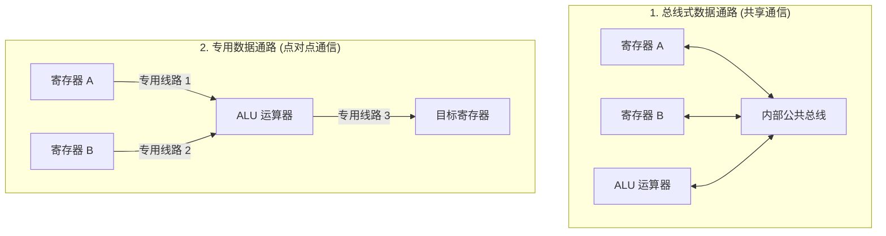
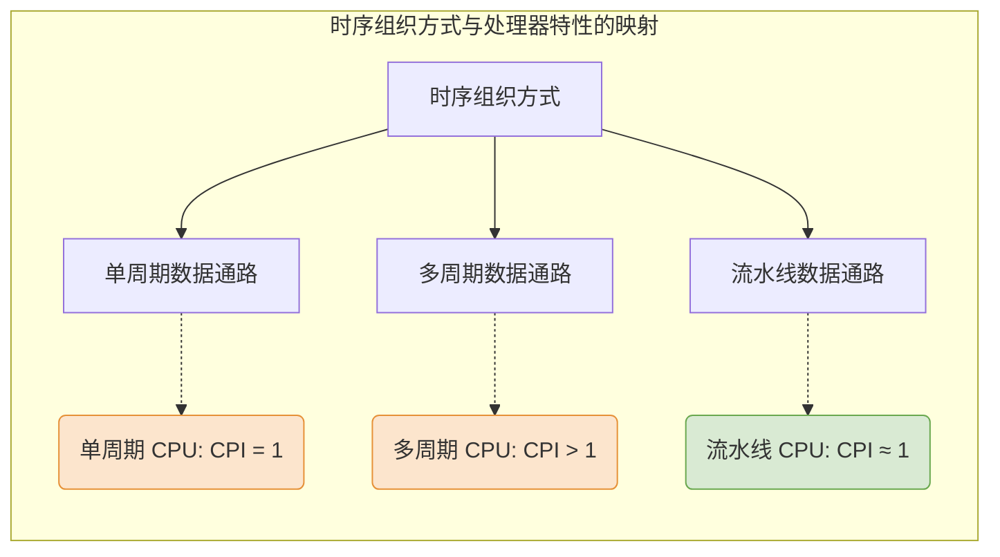

# 计算机组成原理：数据通路的组织与分类

> **学习建议**
> 本节课内容以**阅读王道书自学**为主。由于涉及后续的高阶内容，强烈建议初学者**“先往后学，再回过头来阅读”**。等后续详细学完了具体的数据通路设计后，再回来看本节的宏观分类，效率和效果都会更好。

---

## 一、 按部件连接方式划分

根据 CPU 内部各功能部件（如 ALU、寄存器、主存等）之间的数据交互线路结构，数据通路可以分为两大类：

### 1. 总线式数据通路

- **概念**：所有部件都挂载在一条或多条共享的公共总线上。
- **特点**：结构简单，易于扩展；但同一时刻只能有一个部件向总线发送数据，存在资源竞争。
- _后续学习指引_：在后续课程中会详细拆解“单总线/多总线数据通路”的内部节拍流转。

### 2. 专用数据通路

- **概念**：根据指令执行的实际需求，在需要频繁交互的部件之间铺设专门的点对点数据线路。
- **特点**：避免了总线竞争，数据传输极快，支持高并发；但硬件连线极其复杂，成本较高。

---

## 二、 按时序组织方式划分

根据数据通路在一个时钟周期内处理指令的节奏，可以将其分为三类，这与我们之前学习的**处理器类型**是严密对应、息息相关的：

### 1. 单周期数据通路

- **对应处理器**：单周期处理器。
- **核心特点**：一条指令的全部执行过程（取指、译码、执行、访存、写回）在一个极长的时钟周期内一气呵成。
- **性能特征**：`CPI = 1`（每条指令耗时 1 个时钟周期）。

### 2. 多周期数据通路

- **对应处理器**：多周期处理器。
- **核心特点**：将一条指令的执行过程拆分为多个阶段，每个阶段占用一个较短的时钟周期。不同的指令按需消耗不同数量的时钟周期。
- **性能特征**：`CPI > 1`。

### 3. 流水线数据通路

- **对应处理器**：流水线处理器。
- **核心特点**：在多周期数据通路的基础上引入了**流水线寄存器（段寄存器）**，允许多条指令在不同的加工阶段重叠并行执行，极大榨干了硬件的并发潜力。
- **性能特征**：理想情况下，平均 `CPI ≈ 1`。

---

## 三、 本节学习指南总结

本节内容属于承上启下的**分类概述**：

1.  **关于连接方式**：大家现阶段只需知道有“总线式”和“专用式”之分。具体的电路图和微操作序列请留在后面的章节中死磕，学完后再看本节图表将豁然开朗。
2.  **关于时序组织**：完全依赖于前期学习过的“指令执行”与“CPI 计算”等基础概念。大家在自学阅读教材时，只需结合前期对处理器的理解，迅速通读即可，无需在此处死记硬背。
