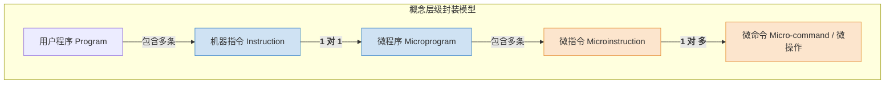

# 计算机组成原理：微程序控制器基本原理

> **导语**
> 各位同学大家好，从这个小节开始，我们将学习 CPU 控制器的第二种实现方式——**微程序控制器**。
> 上节课我们学习了“硬布线控制器”，它的速度虽快，但纯硬件逻辑的设计极其复杂，且一旦造好就无法修改。为了解决这一痛点，人们引入了**软件的思想**来设计硬件控制器。本节课我们将剖析微程序控制器的基本原理，搞懂“机器指令”与“微指令”的套娃关系，并拆解微程序控制器内部的专属核心部件。

---

## 一、 核心设计思想：指令的“套娃”

- **宏观视角 (程序员视角)**：一个**程序 (Program)** 是由一系列的**机器指令 (Instruction)** 序列组成的。程序放在主存 (Main Memory) 中。
- **微观视角 (硬件设计师视角)**：一条机器指令的执行，实际上是由一连串更细微的**微操作序列 (Micro-operations)** 来完成的。

**微程序设计的灵魂**：既然程序是由指令组成的序列，那么我们为什么不把“微操作”也当成一种底层的“微型指令”？
我们将同一时钟周期内可以并行执行的微操作打包成一条 **微指令 (Microinstruction)**。那么，用来实现某一条机器指令功能的一系列微指令序列，就构成了一个 **微程序 (Microprogram)**。

> 💡 **核心对应关系映射**：
>
> - **程序** 之于 **机器指令**
> - 就等同于 **微程序** 之于 **微指令**

---

## 二、 易混淆概念辨析 (★ 选择题高频考点)

在微程序控制器中，存在几组极易混淆的名词，请务必死死咬住它们之间的对应关系：

### 1. 操作与命令的层级

- **微操作** (干什么)：执行指令时不可再分的最小动作（如 `PC -> MAR`）。
- **微命令** (怎么干)：控制部件发出的电信号（如 `PC_out`, `MAR_in`）。
- **对应关系**：**微操作与微命令是“一一对应”的关系**。

### 2. 微指令与微命令的包含关系

- **微指令**：在微程序控制器中，将一个时钟节拍内能**并行执行**的多个微命令组合在一起，加上下一条微指令的地址，构成一条微指令。
- **对应关系**：**一条微指令通常包含多个微命令 (一对多)**。

### 3. 机器指令与微程序的对应关系

- **微程序**：由一系列微指令组成。
- **对应关系**：**一条机器指令对应一个微程序 (一对一)**。可以说，机器指令就是对微程序功能的一个宏观封装。

---

## 三、 微程序控制器的内部硬件结构

为了实现上述的“套娃”思想，CPU 的控制单元 (CU) 内部必须有一套小型的、专门针对微指令的“取指-执行”系统。我们将它与 CPU 外围访问主存的部件进行类比记忆：

| 外围 CPU 系统 (处理机器指令) | CU 内部微型系统 (处理微指令)  | 功能说明对比                                                                                                                                                           |
| :--------------------------- | :---------------------------- | :--------------------------------------------------------------------------------------------------------------------------------------------------------------------- |
| **主存储器 (Main Memory)**   | **控制存储器 (CM / ROM)**     | CM 简称控存，由 ROM 制成，出厂时烧录固化，断电不丢失。用于存放所有指令对应的**微程序**。                                                                               |
| **PC (程序计数器)**          | **CMAR (或 $\mu$PC)**         | CMAR 指向控存中**下一条将要执行的微指令地址**。                                                                                                                        |
| **IR (指令寄存器)**          | **CMDR (或 $\mu$IR)**         | 用于暂存从 CM 中取出的**当前正在执行的微指令**。                                                                                                                       |
| **主存地址译码器**           | **微地址译码器**              | 将 CMAR 中的地址解码，选中 CM 中对应的存储单元。                                                                                                                       |
| **硬件自动 +1 逻辑**         | **微地址形成部件 & 顺序逻辑** | **微地址形成部件**：根据 IR 中机器指令的**操作码**，算出对应微程序的**首地址**。 **顺序逻辑**：结合微指令自带的“下地址”字段和机器状态标志，决定下一条微指令的地址。 |

### 微指令的内部格式

存储在 CMDR 中的一条微指令，通常包含两个核心字段：

1.  **操作控制字段**：存放微命令的编码，翻译后向数据通路发出各种控制电信号（如 `PC_out`, `MAR_in`）。
2.  **顺序控制字段 (下地址字段)**：指明下一条要执行的微指令在控存中的物理地址。

---

## 四、 微程序的共享与存储布局

一条完整的机器指令周期通常包括：取指、间址、执行、中断。

- **共享特性**：所有机器指令的**取指周期、间址周期、中断周期**所需要做的微操作是完全一样的！因此，这三个周期的微程序在控存中**只需存储一份，供所有指令共享**。
- **差异特性**：只有**执行周期**所对应的微程序，才是因机器指令而异的。

> **🌟 考研经典命题：控存容量计算**
> **题目**：某指令系统共有 $N$ 条机器指令，如果采用微程序控制，那么控制存储器中至少需要包含多少个微程序段？
> **答案**：**$N + 1$ 个**。
> **解析**：$N$ 条指令对应 $N$ 个各自独立的执行周期微程序段，再加上 $1$ 个所有指令共享的**公共取指周期微程序段**。
> _(注：间址和中断周期在某些极简 CPU 中可以不实现，故题目问“至少”时，通常只考虑必不可少的取指周期。)_
> **防抬杠说明**：如果物理上问“有多少个微程序段”，答案是 $N+1$；如果逻辑上问“有多少个微程序”，答案是 $N$，因为逻辑上我们认为：取指+执行组合成了一个完整的微程序对应一条指令。

---

## 本节复习要点总结

1.  **本质思想**：用软件编程的思想来设计硬件控制逻辑。把庞大复杂的硬件连线逻辑，变成了存储在内部 ROM 里的微指令序列查找。
2.  **核心部件记忆对子**：把 `PC` 对应 `CMAR (μPC)`，把 `IR` 对应 `CMDR (μIR)`，把 `Main Memory` 对应 `CM (控存)`。
3.  **运行机制**：执行指令的本质，就是根据机器指令的**操作码**，通过**微地址形成部件**找到控存中对应微程序的**首地址**，然后一条条顺着下地址字段去执行微指令。
