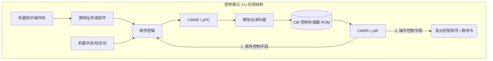

# 计算机组成原理：微程序控制器基本原理

> **导语**
> 各位同学大家好，从这个小节开始，我们将学习 CPU 控制器的第二种实现方式——**微程序控制器**。
> 相比于硬布线控制器（纯硬件逻辑，设计复杂，速度快但难以修改），微程序控制器引入了**软件的思想**。本节课我们将剖析微程序控制器的基本原理，搞懂“机器指令”与“微指令”的层级嵌套关系，并拆解微程序控制器内部的专属核心硬件部件。

---

## 一、 核心设计思想：指令的“套娃”映射

微程序控制器的核心思想，是借鉴了“存储程序”的理念，用软件的思路来处理硬件微操作。

- **宏观视角**：一个**程序 (Program)** 是由一系列的**机器指令 (Instruction)** 序列组成的。
- **微观视角**：一条机器指令的执行，实际上可以被细分为一连串更细微的**微操作序列 (Micro-operations)**。

既然程序是由指令序列组成的，那么我们也可以**将一个时钟周期内可以同时并行的“微操作”打包成一条“微指令 (Microinstruction)”**。用来实现某一条机器指令功能的一系列微指令序列，就构成了一个 **微程序 (Microprogram)**。

> 💡 **核心映射关系**：
> **机器指令序列** 构成了 **程序** ；
> **微指令序列** 构成了 **微程序**。
> 当 CPU 执行一条机器指令时，本质上就是在执行这条机器指令对应的那个**微程序**。

---

## 二、 微程序控制器的基本结构

为了实现上述思想，CPU 的控制单元 (CU) 内部嵌了一套小型的“取指-执行”系统。我们可以将其与 CPU 外围主存系统的部件进行类比记忆：

| 外围 CPU 系统 (处理机器指令) | CU 内部微型系统 (处理微指令)  | 缩写与别名             | 功能说明对比                                                                                                                                           |
| :--------------------------- | :---------------------------- | :--------------------- | :----------------------------------------------------------------------------------------------------------------------------------------------------- |
| **主存储器 (Main Memory)**   | **控制存储器 (CM)**           | Control Memory         | 由 **ROM (只读存储器)** 制成，出厂烧录不丢失。存放所有机器指令对应的**微程序**。                                                                       |
| **PC (程序计数器)**          | **CMAR**                      | $\mu$PC (微程序计数器) | 指向控存中**下一条将要执行的微指令地址**。                                                                                                             |
| **IR (指令寄存器)**          | **CMDR**                      | $\mu$IR (微指令寄存器) | 暂存从 CM 中取出的**当前正在执行的微指令**。                                                                                                           |
| **地址译码器**               | **微地址译码器**              | -                      | 将 CMAR 中的地址解码，选中 CM 中对应的存储单元。                                                                                                       |
| **PC 自动 +1 逻辑**          | **微地址形成部件 & 顺序逻辑** | -                      | **微地址形成部件**：根据机器指令的**操作码**，算出对应微程序的首地址。 **顺序逻辑**：结合当前微指令的“下地址”字段和标志位，决定下一条微指令的地址。 |

### 1. 微指令的内部结构

存放在 CMDR 中的一条微指令，通常包含两个核心部分：

1.  **操作控制字段**：若干比特位，指明当前这条微指令需要发出哪些**微命令**（控制信号，如 `PC_out`, `MAR_in` 等）。
2.  **顺序控制字段 (下地址字段)**：若干比特位，指明**下一条**要执行的微指令存放在控存的哪个地址。

### 2. 微程序的执行流程

1.  机器指令取入 IR 后，将其**操作码**送入 **微地址形成部件**，解析出该指令对应的执行周期微程序**首地址**。
2.  该地址送入 **顺序逻辑**，打入 **CMAR ($\mu$PC)**。
3.  通过微地址译码器选中 **CM (控存)** 中的对应单元，取出微指令放入 **CMDR ($\mu$IR)**。
4.  根据 CMDR 的**操作控制字段**发出微命令（控制信号）驱动数据通路干活；同时将其**下地址字段**反馈给顺序逻辑，结合标志位产生下一条微指令的地址。

---

## 三、 微程序的共享与控存容量计算 (★ 高频考点)

一条完整的机器指令周期通常包括：取指周期、间址周期、执行周期、中断周期。

- **公用微程序段**：所有的机器指令在**取指周期、间址周期、中断周期**所需要做的微操作是完全一样的！因此，这三个周期的微程序在控存中**只需各存一份，供所有指令共享**。
- **专属微程序段**：只有**执行周期**所对应的微程序，才是每条机器指令各不相同的。

> **🌟 考研经典命题：控存中微程序段的个数计算**
> **题目**：某指令系统共有 $N$ 条机器指令，如果采用微程序控制，那么控制存储器中至少需要包含多少个微程序段？
> **答案**：**$N + 1$ 个**。
> **解析**：$N$ 条机器指令对应 $N$ 个各自独立的**执行周期**微程序段，再加上 $1$ 个所有指令共享的**公共取指周期**微程序段。（注：间址和中断周期在某些精简架构中可以不提供，所以问“至少”时，通常只加 1 个取指周期的微程序段）。
>
> **防混淆声明**：
>
> - 物理存储上：有 $N+1$ 个微程序**段**。
> - 逻辑概念上：一条机器指令对应 **1 个**完整的微程序（逻辑上把该指令的取指、间址、执行、中断拼成了一个整体微程序）。

---

## 四、 易混淆核心概念辨析总结

请务必死死咬住以下几组名词的对应关系：

1.  **微命令 vs 微操作**：
    - **一一对应**。微操作是“做什么动作”，微命令是“发什么电信号”。
2.  **微指令 vs 微命令 (微操作)**：
    - **一对多**。一条微指令可以并行发出多个微命令（完成多个微操作）。
3.  **微程序 vs 微指令**：
    - **一对多**。一个微程序由多条微指令按照时序排列组成。
4.  **机器指令 vs 微程序**：
    - **一对一**。一条机器指令在控制逻辑上对应一个完整的微程序。
5.  **CMAR / $\mu$PC**：微地址寄存器 / 微程序计数器（指明下一条微指令地址）。
6.  **CMDR / $\mu$IR**：微数据寄存器 / 微指令寄存器（存放当前正在执行的微指令）。
7.  **指令周期 vs 微指令周期 (微周期)**：
    - **指令周期**：从主存取出并执行完一条**机器指令**的时间。
    - **微周期**：从控存 (CM) 取出并执行完一条**微指令**的时间。微周期通常用来衡量微程序的执行速度。
